
Our final exams at Nanyang Polytechnic were finally over just a few days ago and on the 28th of August, we were slated to leave. A group of 4 of us students going to Karlsruhe for Overseas Attachment (known as Overseas Internship Programme), with no permanent accommodation, with the hope that we can find one there.

We met at the airport. I realised that I forgot to buy any souvenirs for my buddy so at the airport, I bought for him a can opener with a bell, with the logic being to use when drinking beer with others. We boarded our plane by Lufthansa Airlines. It was quite expensive. We paid $1,592 as our trip was confirmed quite late by the school and we had requirements of taking a direct flight to Karlsruhe

After depositing our luggage and before going past the departure gates, we took a group photo, 1 with Dr. Kenny alone and another with all the parents, and my friend, Syahiran for coming to send me off.

 
 
 
  <meta/> <meta/> 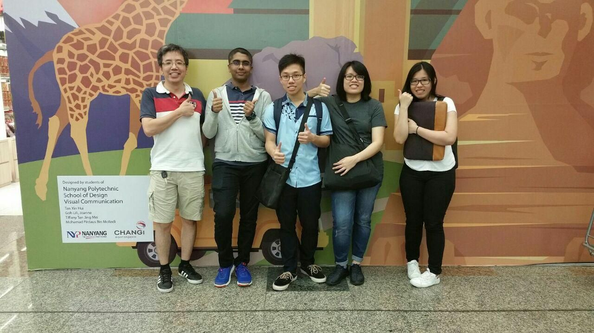   With Dr Kenny only  
 
 <!-- close group --> 
 
  <meta/> <meta/> 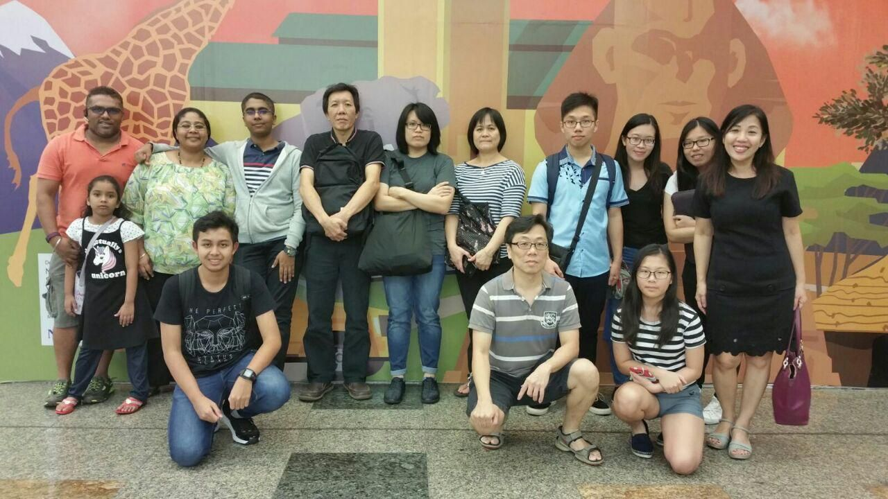   With all families and Syahiran  
 
 <!-- close group --> 
 <!-- close row --> 

The airline’s in-flight entertainment system was not very outstanding as it was hard to find movies even though they had good movies and their screen was super sensitive. I slept the longest in the flight, an estimated 9 hours following which we played 4 in a row as a whole. The sad part was the playing cards ran out or were not present as I was intending to get one from Lufthansa.

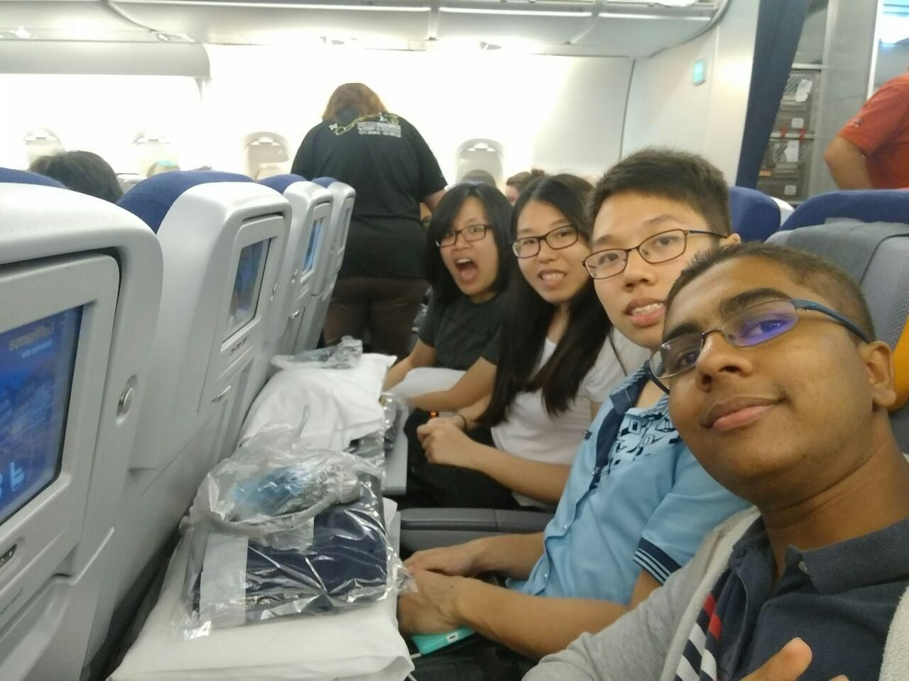

The flight food was pretty good as I got tandoori chicken for dinner and Mee Goreng for breakfast, as recommended by Pawandeep( former student who went to Germany the previous round).

Flight Dinner: Tandoori Chicken with Brinjal

 
 
 
  <meta/> <meta/> 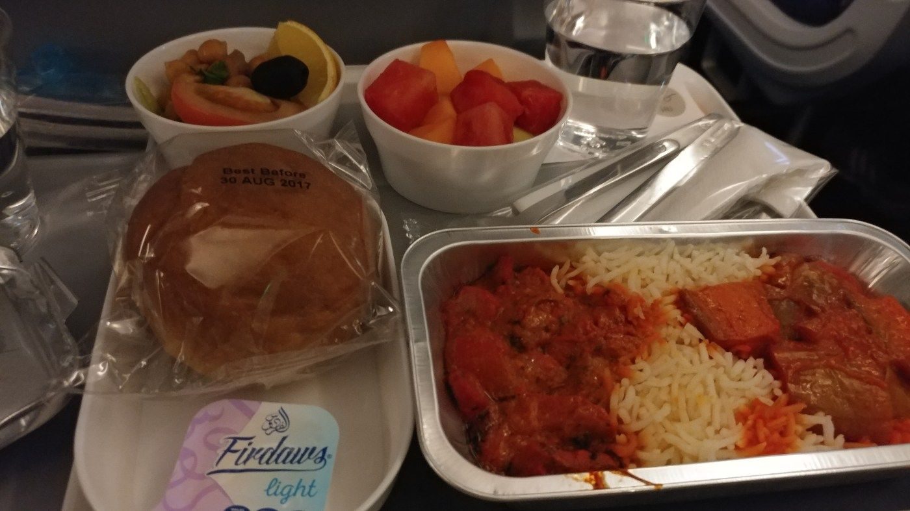  
 
 <!-- close group --> 
 
  <meta/> <meta/> 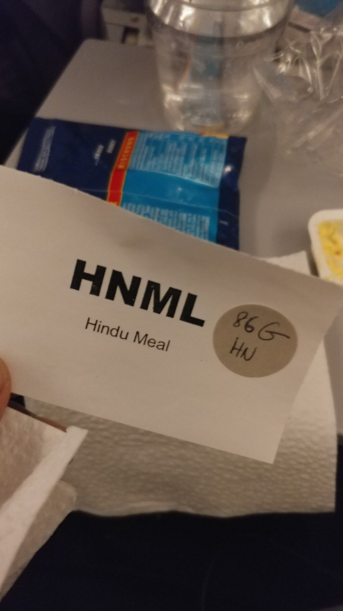  
 
 <!-- close group --> 
 <!-- close row --> 

Flight breakfast: Tandoori Chicken with Samosa and yogurt

 
 
 
  <meta/> <meta/> 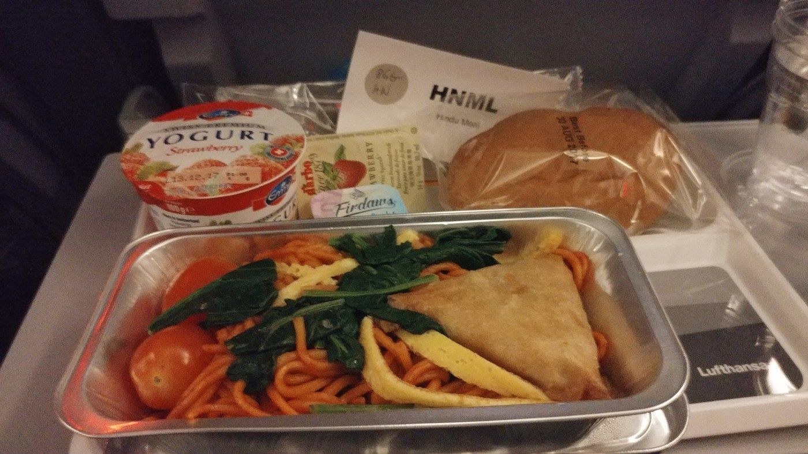  
 
 <!-- close group --> 
 
  <meta/> <meta/> 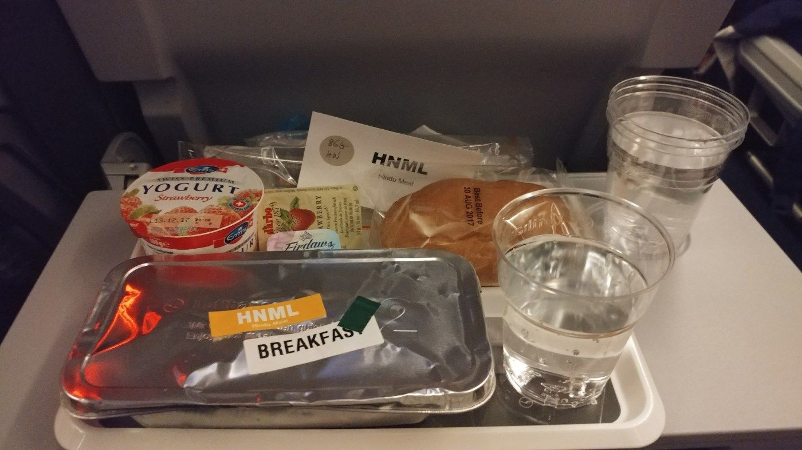  
 
 <!-- close group --> 
 <!-- close row --> 

Tuesday 29th August (Day 1 in Germany)

Upon touchdown, we split up into pairs when alighting and we got lost after we came out. We took a while to find each other and realized that we exited different doors from the airplane. Then we waited for 2 – 3 hours to wait for the train. We went around finding a water cooler because everyone mentioned that tap water is drinkable and from my previous experience going to Finland, there was a tap in the toilet to get drinking water. Supposedly, people here still drink bottled water greatly.

In the meantime, we played Taiti (Singaporean Poker Game, also known as Big 2) at Starbucks without buying a drink. Then when we left, I almost forgot my luggage. We struggled to accustom ourselves to the way they take the train. In the train, I met an Indonesian and talked to him throughout our 1hour 10 minutes train ride. I found out how to read the train ticket, and learnt some things about Germany from him. It was a good experience talking to him. We found out that on weekends, the trains can be overbooked so we can sit/stand outside. Trains bookings do not check the number of seats before allowing so there can be more people than seats.

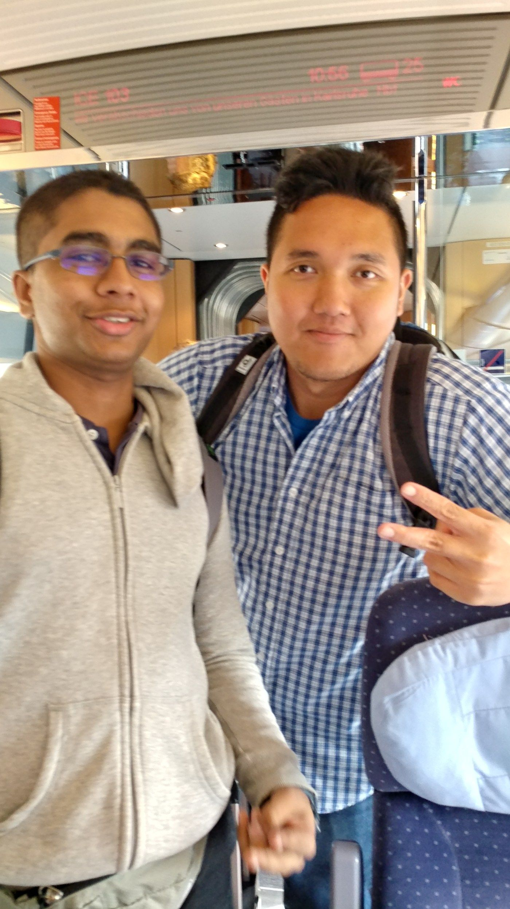

Upon getting down, we took a cab to a youth hostel. The cab driver seemed like of Indian descend so I talked to him and found out that he was Pakistani. He has been here since he was born and bought his own taxi. Found out that in Germany, cars are cheaper to purchase but need to be scraped every 5-6 years.

We settled down in our room, after asking if we can get the same room. The room was rather small. There was no kitchen, the washing machine was smelly but on the bright side, there was a foosball table.

We then went to the International Affairs Office to meet Ms Angelika (Liasion for International Students). There we found that we need a permanent accommodation address to apply for tram pass, bank account and so on. She suggested that our utmost priority was to find accommodation. We also had to settle health insurance and had to pay a one-time fee of 82.90 euro for matriculation. We met our buddy, Leonie and she accompanied us to the health insurance but were rejected as the boss was not in the office and asked us to come the next day.

We ate at our first Turkish Restaurant, Hanim restaurant, where I tried Doner Kebab. It was so different from the one I tried in UAE, where it looked more like a sandwich. The meat and vegetables were not evenly spread out. To top up the meal, I bought Ayran, a salty Turkish drink.

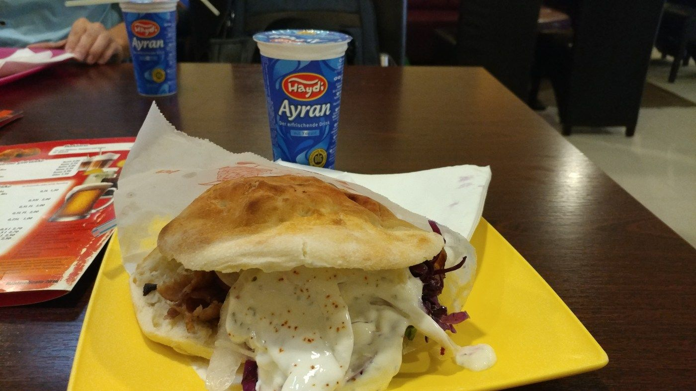

We went to Aldi Markt to buy a sim card and water. We got a 3GB data sim card for 20 euros.

We also caught a glimpse of Markt Square, but was under construction and also kept a lookout for good ice-cream.

The hostel WiFi was down. Ate Maggi Cup noodles for dinner with the kettle I brought from Singapore.

Wednesday (30th August 2017) – Day 2

We ate our first breakfast at Jugendherberge Hostel. The bread there was pretty hard and had different types of cereal.

We played foosball.

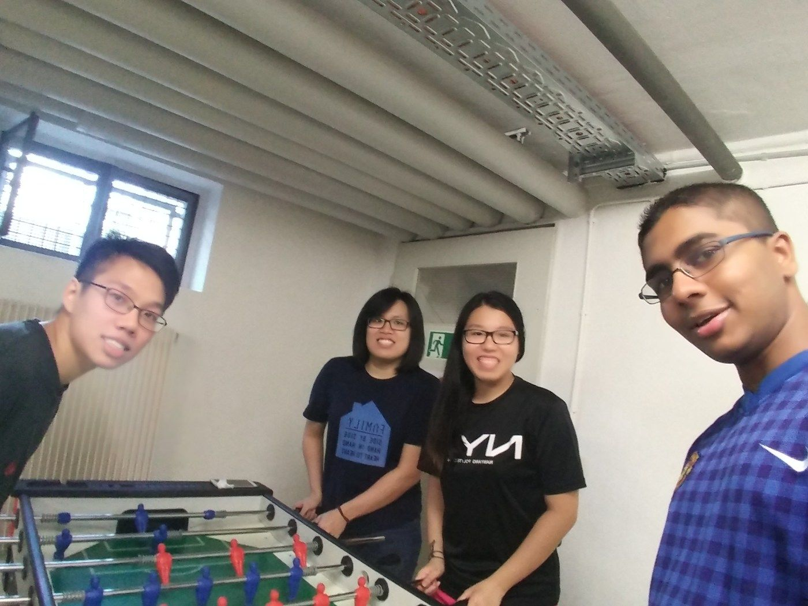

We left the hostel around 12 to settle our health insurance. Following that, we went to have lunch at a Thai restaurant. The waiter was kind enough and gave us an English menu. The chicken fried rice was overwhelmed by tons of vegetables. This was the first time that I ate finish so many vegetables on one plate. We also tried their desert, fried Banana with honey.

 
 
 
  <meta/> <meta/> 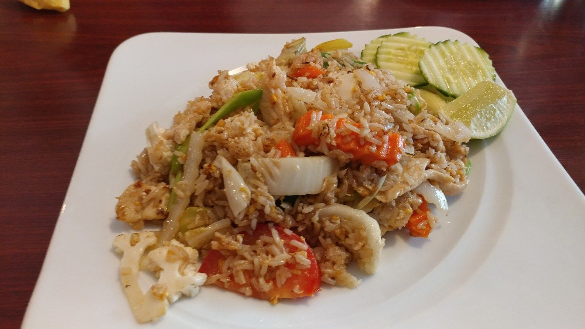  
 
 <!-- close group --> 
 
  <meta/> <meta/> 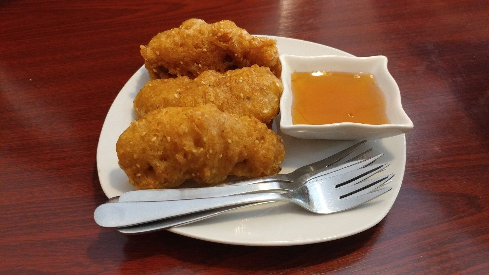  
 
 <!-- close group --> 
 <!-- close row --> 

Then, we went to meet Ms Angelika to submit our matriculation forms. We then found out that the state of Karlsruhe gives us free semester tram tickets for all students after registering our residence.

We scouted the library and found that there was a pretty decent Wi-Fi as our hostel Wi-Fi was still down. But when we wanted to leave for the library, we realised that it was closed. It closes early at 4.30pm.

We next went to check AO hostel. There we found out that the maximum we can stay there is 2 weeks and if we exceed this, we will get kicked out. Thus, we exploited their Wi-Fi (used it for free) to search for accommodation. The receptionists recommended us to check on eBay and KIT Accommodation board.

We went to China Imbiss (means China Snacks). They thought that they were Chinese and tried talking in Chinese but found out they were Vietnamese.

Thursday (31st August 2017) – Day 3

Ate a heavy breakfast, found some accommodation. Went to Memo restaurent to eat pizza. Was not sure of the menu then thinking Pepperoni was the same here as in Singapore but to our utmost dismay, we were wrong. Salami here is the same as pepperoni as in Singapore. They gave us some spicy vegetable. We shared 2 pizza. All in all, the pizza is the best we have eaten so far.

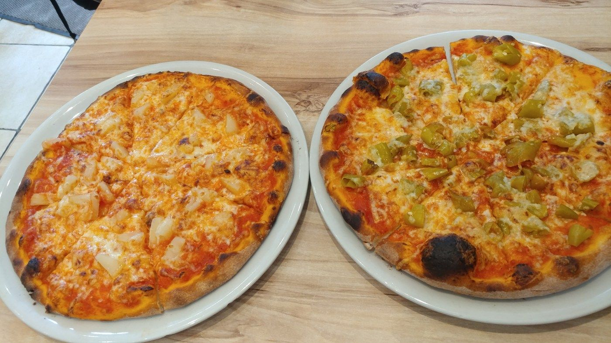

We then went to Edeka (a supermarket) and other shops such as Euroshop. The Euroshop is the Germany version of Value Dollar in Singapore. It was on the main road, near KronenPlatz.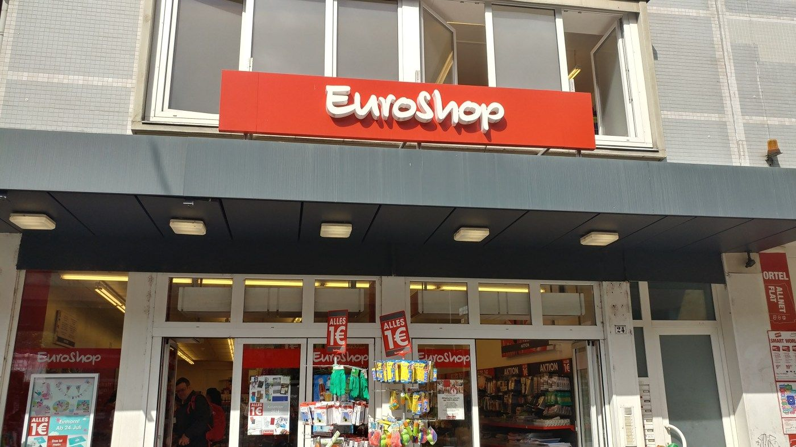

I found Oreo cup and thin Oreo for 1 euro. I am a big fan of thin oreo. We found a water dispenser at the shop DM. the first we have seen.

 
 
 
  <meta/> <meta/> 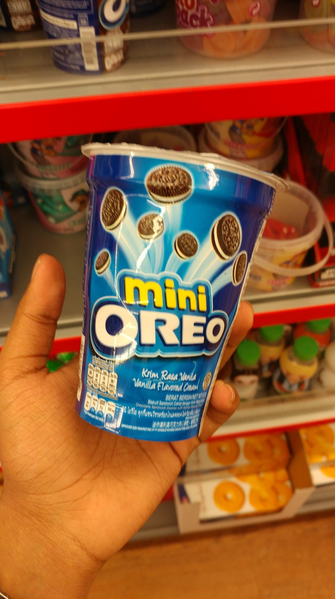  
 
 <!-- close group --> 
 
  <meta/> <meta/> 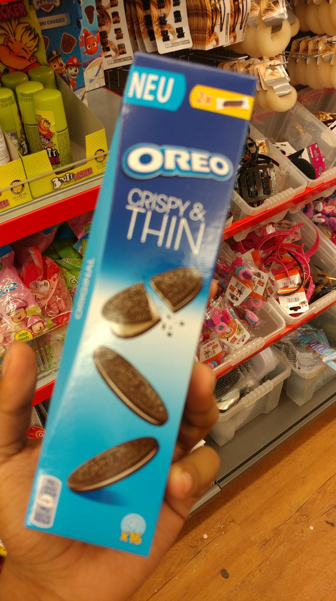  
 
 <!-- close group --> 
 <!-- close row --> 

After 3 days, finally, the WiFi started working at the youth hostel, finally but it was rather slow. It blocked all torrent.

Went with Nicholas to CurryWurst (sausage with curry) where they tried it. Mentioned it was horrible. I ate a few their fries, tasted a bit weird. After a few days , I found out that the guy working at the restaurant was Muslim.

Friday (1st September 2017) – Day 4

It was Hari Raya Haji here. I will be writing another post to post my experience of my first Hari Raya Haji out of Singapore.

Saturday (2nd September 2017) – Day 5

We were woken up by the fire alarm at 5.45am, disrupting our beauty sleep. The receptionist called firefighters and supposedly seemed like a false alarm. I couldn’t sleep after that.

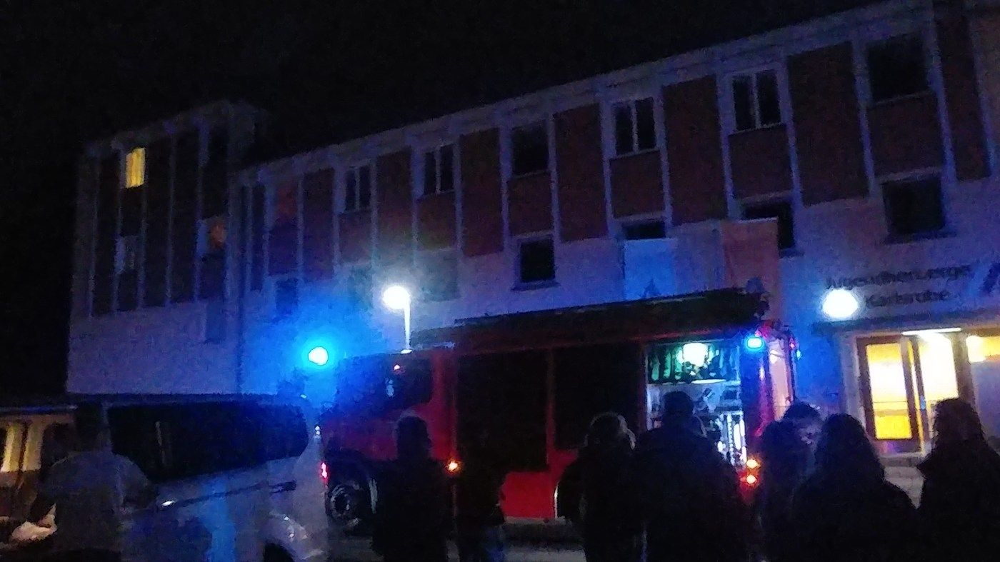

We went to the different hostels indicated in Dr. Kenny’s list but they were all closed today so we decided to continue the search on Monday.

Went back to Memo and now ordered our pizza properly. We bought Salami + mozzarella and spinach + Ananas.

For dinner, we went to Macdonalds. I bought caramel McFlurry and took the voucher coupon from the counter, even though it was not to be released yet. #rebel.

The fries taste the same here.

Sunday (3rd September 2017) – Day 6

We ate KFC for lunch. Realised that to get extra ketchup, we need to pay extra. We went to explore the first Asian store near Edeka but it was closed on Sunday. We released that many shops were closed on Sunday.

So, we went exploring further up from Edeka and went to a beautiful park and explored the vicinity. We then went to the Schloss (Karlsruhe Palace) at 5.30pm but it was family day and we need to get a ticket of 10 euro to get in and they were about to close.

We went to the pizza shop next to MacDonalds and bought half salami and half ananas pizza. They accidentally burnt it a bit so they asked us if its okay or should they redo. We told them its okay and they charged 1 euro less.

That was quite an interesting first week. Following this post, I will be posting the more interesting experiences I have, like when I travel Switzerland and France.

