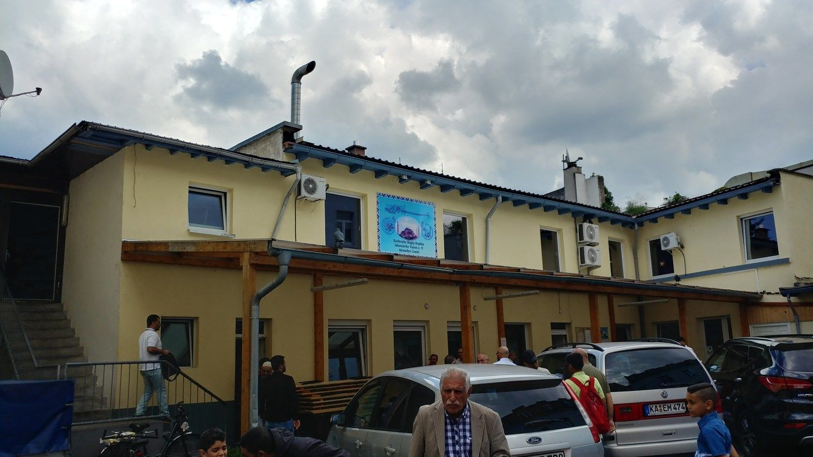
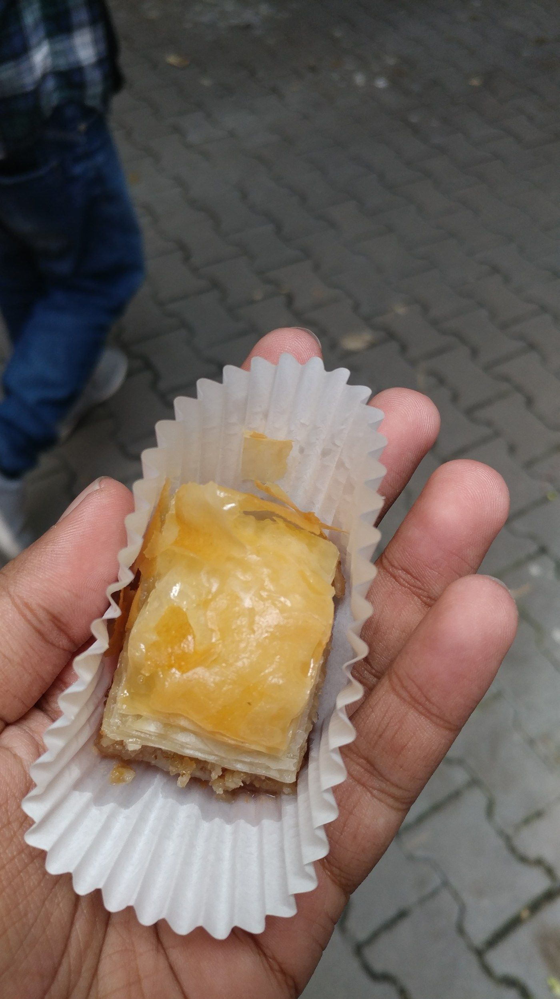

2017 marks the first Festival prayer I am not in Singapore and I knew I was in for an adventure as it was our first few days there and we were not accustomed to the city yet. In a way, I was excited for how it would turn out but also nervous. 
The previous days, I asked Lollyk, an Indonesian Muslim I met at Jugendherberge hostel, a staff there. He told me how to go to the Turkish mosque from there. However, I forgot to ask for his number and the time the prayer starts and I didn’t see him anywhere to ask him. 
I woke up early, around 6.30am to bath and get ready, following which Nicholas did. Ate a muffin I bought from Singapore. 
Cross-referencing to Singapore, I thought that the prayer will start at 8am and made arrangements to reach there promptly. Relying on Google Maps to reach there, I was for a moment lost when it said I had reached my location but the mosque was nowhere to be seen. Thankfully, a man saw me lost and asked me if I was finding the Masjid (mosque in Arabic ) and then instructed me to follow him. I realized that the mosque was just there, but I had to walk into an alley to see it.

I reached there at 7.50am but by then, the prayer had finished and they were reading Dua (Muslim prayer). A few of us missed the prayer and I tried talking to them to lead the prayer (1 Pakistani and 1 African). The African said he will go to the mosque on cycle. The Pakistani led the prayer but prayed in a different manner (not sure if wrong or correct). I wonder if I should have led the prayer. 
It was the first time I had missed a festival prayer and to make it worse, I may have prayed wrongly. I decided to put everything behind me and enjoy the rest of the day. 
Mosque was 15 minutes’ walk from the hostel and around 5-7 minutes from Europaplatz, passing by Riverbed office, a company I did an assignment before in Year one.

Following our return, I saw Lollyk at the hostel and he said that he couldn’t make it in time for the prayer at the Turkish mosque and went to Masjid Suna (another mosque) where the prayer was to be held at 8.30am. Then I exchanged numbers with him and asked if we could go together for Friday Prayers. He agreed but he brought me to the same mosque. In conjunction of Eidul Adha( Hari Raya Haji), they were giving out Baklava (Turkish sweet) for free. I got one and it was very sweet.

Was quite an interesting experience. To more interesting experiences here in Germany.

