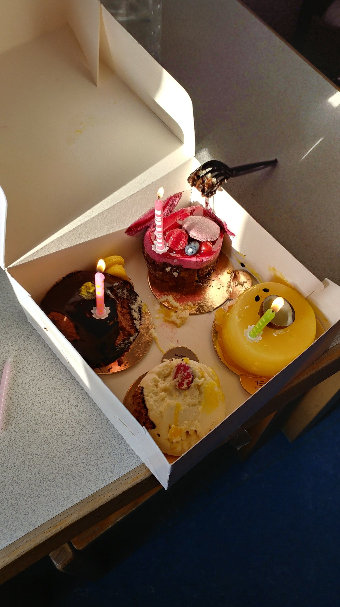
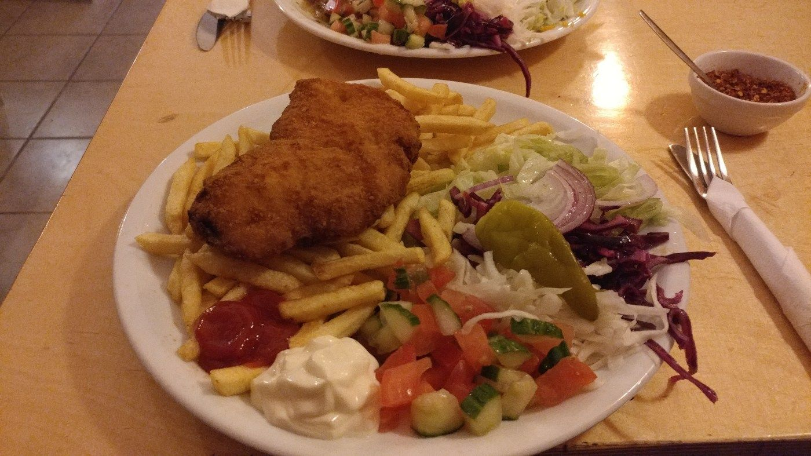

Prior to coming to this trip, I had intended to make my birthday this year more special. The last two years had been rather boring. 2 years prior, I was in China, climbing a mountain and with no one knowing it was my birthday and the previous year, the mood at home was down as my sister was very ill. I wanted to do something unique on my birthday and was dreaming of visiting Eiffel Tower on my birthday.

However, fate had other plans for me. Ever since arrival, we had yet to find accommodation for ourselves, something we were very confident in finding. Without finding accommodation, it was virtually impossible to travel there.

On the 8th of September, a day before my birthday, we finally found housing, but at a distance 2.6km away from the university. We were slated to move in the next day, which coincides with my birthday.

I was initially down that my wish did not come true but my mood improved thereafter. On the 8th, we met one of our buddy Lukas for lunch and after lunch, he accidentally broke the surprise planned by my friends by saying let’s go buy the cake. It was nice of them to think of celebrating my birthday.

So, we went to Ludwig Pastry shop and bought cake for me, after asking if the cake had alcohol or not. On the way back, there was sudden gusts of wind and because of that, the cake moved and got disfigured.

At 18:00 hour Germany time, which is at 12am Singapore time, we sang the birthday song and cut the cake. It was interesting and Lollyk joined us too.

We acknowledged that it was our last day in the Jugendherberge Youth Hostel and took a photo with Lollyk and the Russian receptionist, who has been very nice to us.

This slideshow requires JavaScript.

The next day, we moved to our new hostel, Hostel Ariva, where we will be spending the next 2.5 months there.

Following our move, we went to eat lunch at K2 Doner Kebap centre, where I bought Puten Schitzel (turkey cutlet) and my other friends tried various dishes like Chicken Biriyani.

All in all, this birthday wasn’t exactly as I expected but on the bright side, I got 30 hours of birthday time (technically) and most importantly, I enjoyed myself.

