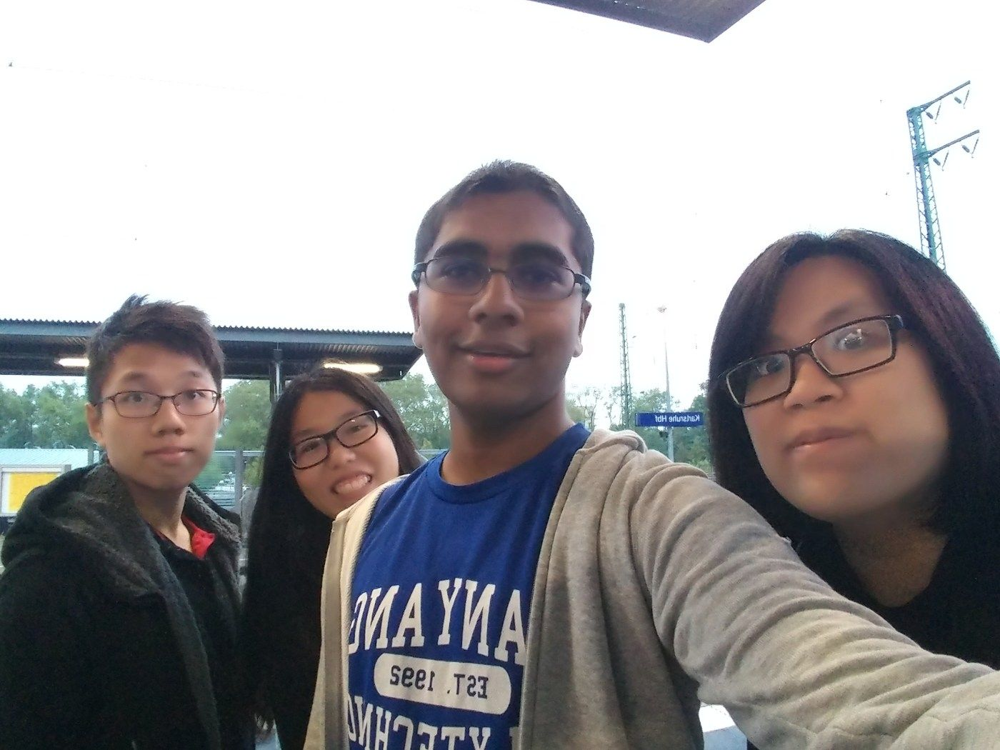
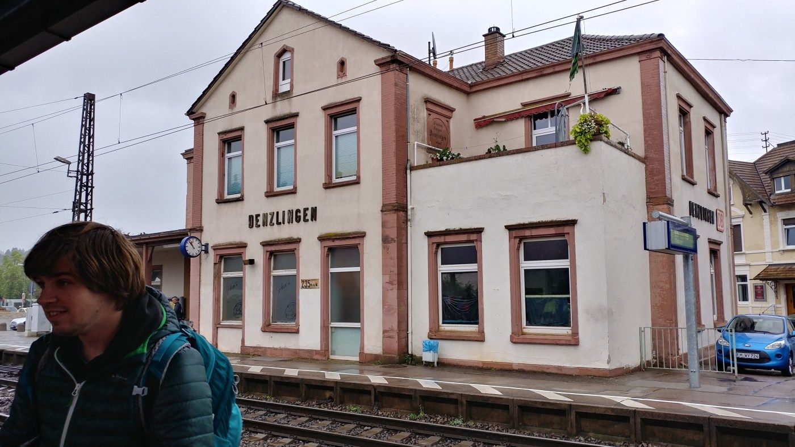
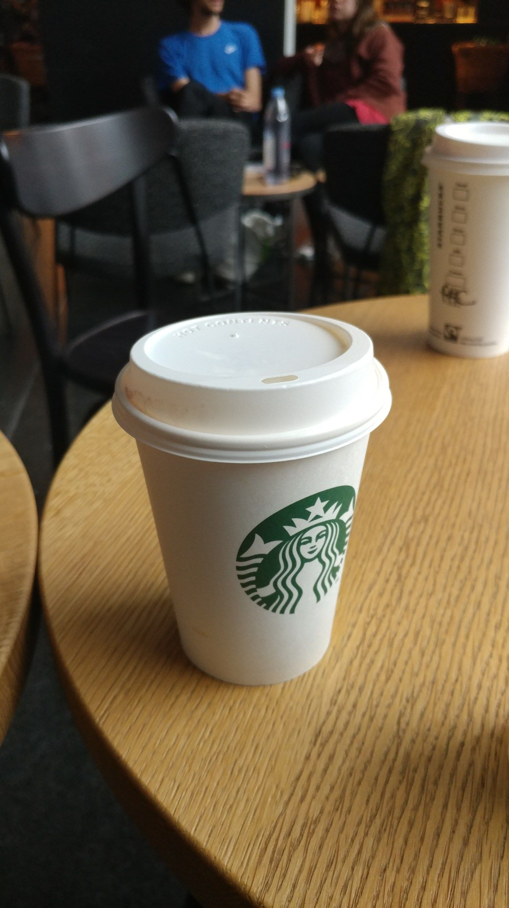
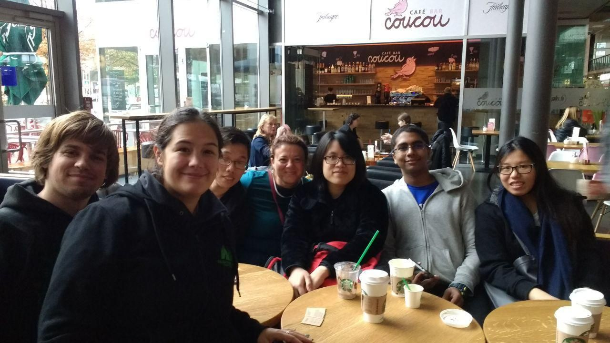
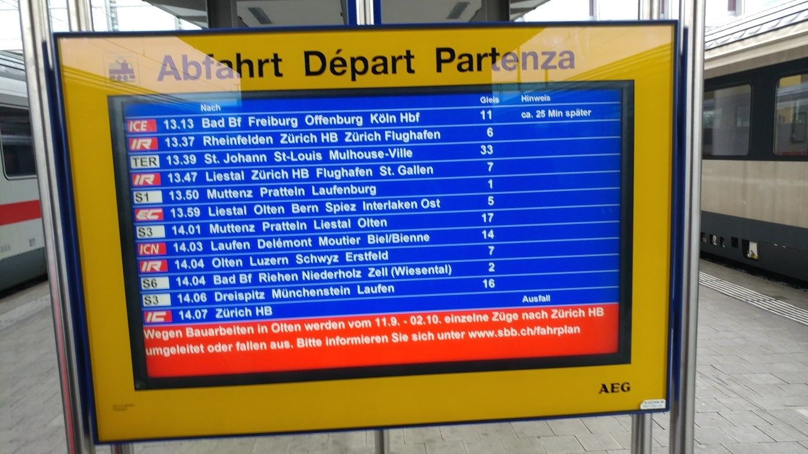
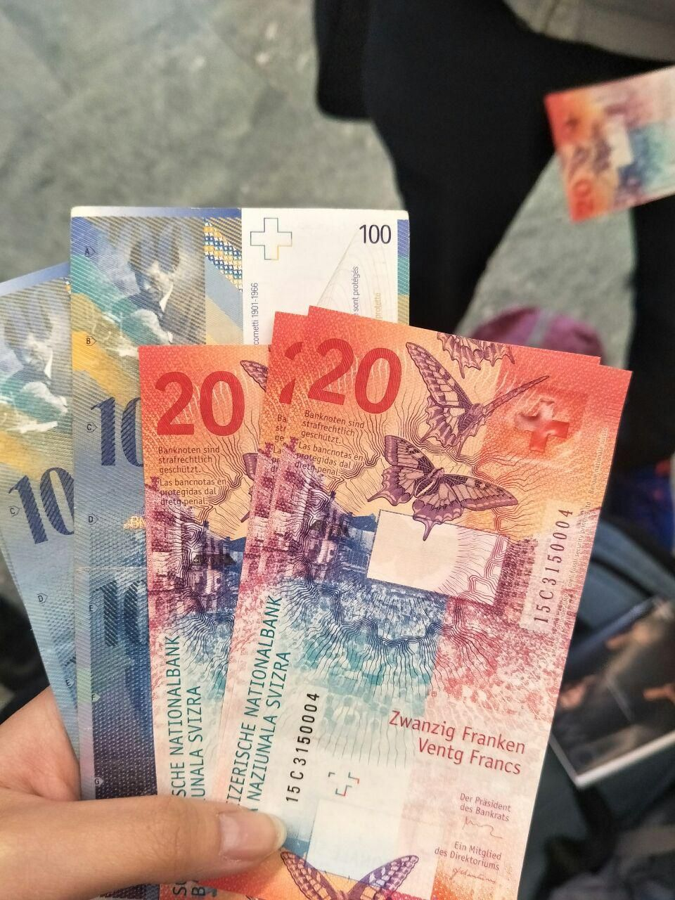
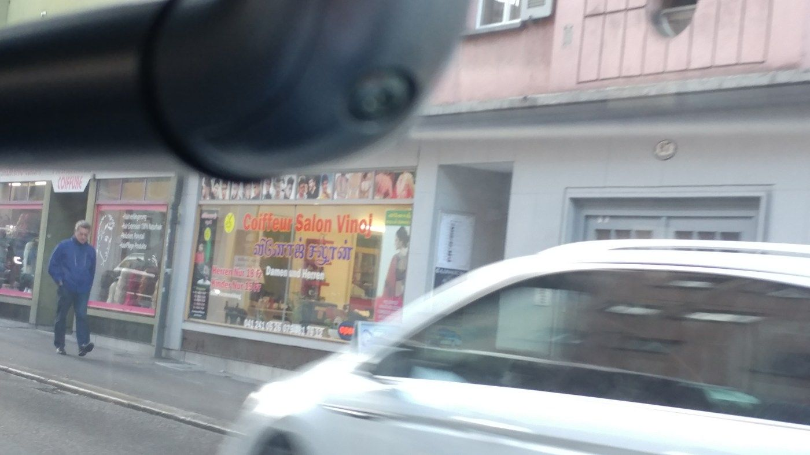
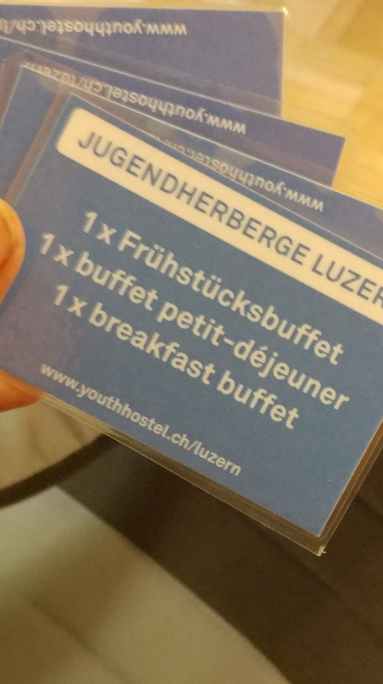
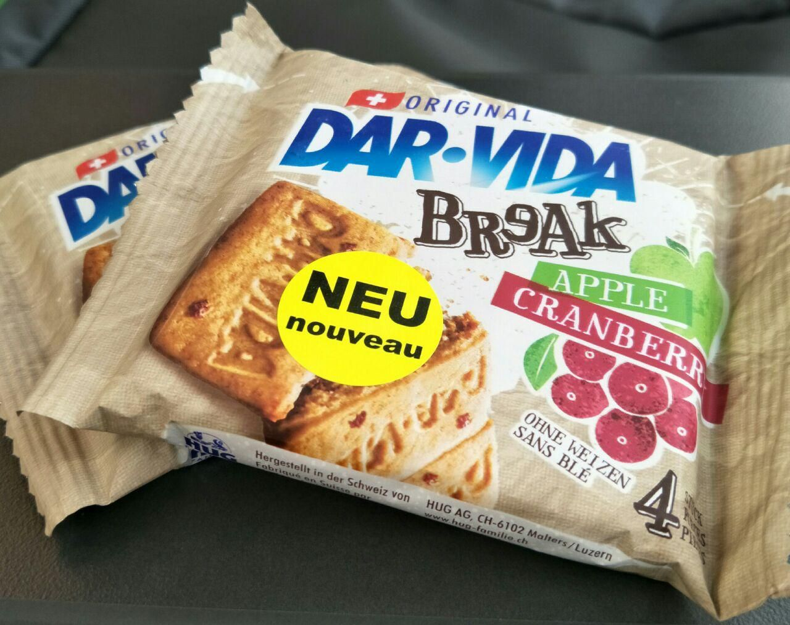
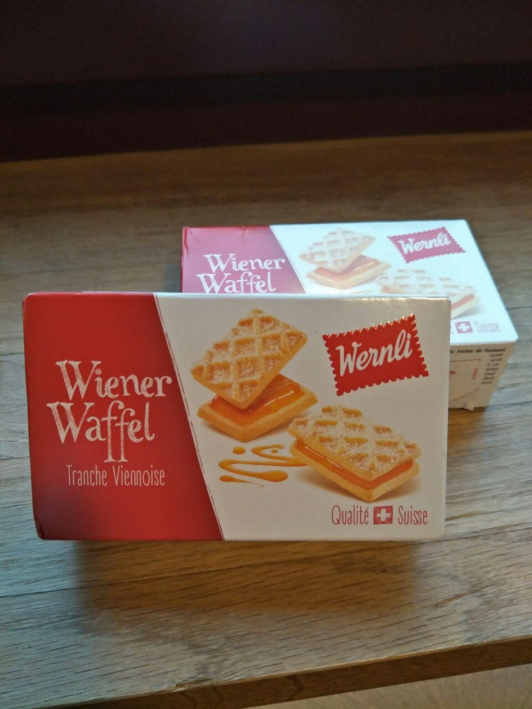

We woke up at 5 to get ready for Switzerland. There was a blackout in the morning due to power fault possibly due to rain. Because of that, we left at 6.30am instead of the initial aim of 6am. We reached Karlsruhe Hbf at 7.15am. We were almost 40 minutes early and we were freezing in the cold. Before leaving, we took a group photo. 

We then took the train to Rastatt. From there, we had to alight and proceed to take bus as there was some disruption between Rastatt and Baden-Baden. While we were confirming with the bus driver if it’s the correct bus, a friendly German Women by the name Angela told us that we don’t need to show our ticket. Following that, we got into a conversation with us. She works in Saudi Arabia as a nurse trainer, she married a Pakistani who knows 6 languages, converted to Muslim 2 years ago, after being married for almost 15 years. 
She mentioned that she likes to live in a place with multi-culture and she reminded me that perhaps I also share the same goal. She said Germans are too boring, talking about the same thing compared to in Saudi Arabia where many cultures come together and share their experiences and cultures in their own country.

I was amazed that she could tell that I was Indian and was interested to know where we came from as we were a group of ethnically mixed people.

Once we got down from the bus to go to the train station, the staff at the station was telling Angela that there was a hurricane the previous day and we would have to get down at a station and take a bus. She told us that it wouldn’t affect us but will affect her. I gave her my Germany number before we parted (she took first-class) and she said that she will be comingg to Karlsruhe soon and she can meet us to help us make better decisions with reference with traveling to other countries like France and other parts of Germany. 
To our dismay, we say many getting down at some station and a kind soul translated the German announcement to us in English that meant that there is a tree that fell due to the Hurricane and we must take a bus to another station and take a train from there. While waiting for the bus to Denzlingen, we saw Angela again. Throughout the bus ride, we were talking about a few things she heard about Islam, which I was not fully sure.

We alighted from the bus and made our way to Denzlingen train station and seeing Angela with 2 luggage, I offered to take 1 of it for her. She walked ahead of me and boarded the train first. To our shock, the train left immediately, before I gave her luggage back.

Thank god for giving her my number before parting. She immediately called me and said that she will take the next train to Basel SBB to get her luggage. Luckily, there wasn’t a need to as the train was going Freiburg first, her hometown and we agreed to meet in Freiburg to handover our luggage.

Throughout this ordeal, we were very thankful to 2 students we met in the Bus, from Frankfurt and there were also going to Lucerne. They helped us with the translation of all the German announcements and helping us check what time the next trains will be, without which, we would be left stranded.

The next train to Basel SBB was slated to arrive only 30 minutes later so Angela welcomed us to Freiburg, her hometown with a Starbucks treats. I tried the Pumpkin Spice drink and she said she expected me to get that as there were spices ( a reference to me being Indian).

The train station at Freiburg was quite unique. They had a luggage conveyor belt to bring luggage up and down staircases.

As we parted to get our train to Basel SBB, she mentioned to keep in contact with me and invite us for German food in Karlsruhe. She also told us that it’s the law that if we are delayed by more than 60 minutes, they will refund 50% of our ticket for us. We took a group photo before parting. 
But then our train to Basel SBB was delayed again. With the help of the 2 students, we finally reached Lucerne at 3.03pm, instead of the initial 12.00pm.

Their train station train display was quite atas (high class).

 
We then went to ask for reimbursement but no DB Office in Switzerland so we went to SBB(main train operator in Switzerland) and they said they will call and check for us but it said it will take 2-3 weeks and he cannot confirm the outcome as it was caused by a natural phenomenon.

We tried withdrawing money using pin at the ATM there but I couldn’t withdraw from my card. I then realized that I only activated magnetic stripe but not overseas cash withdrawal 
Luckily Nicholas could withdraw money and we withdrew 100 Frank each.

Switzerland currency was quite cute.

.

We consulted the tourist information Centre on how to go to our hostel and we proceeded to take Bus 18 to Jugendherberge hostel, our favorite Hostel. On my way, I saw Tamil words on this salon, which was quite surprising as I wouldn’t expect such a thing in Switzerland.

It looked more high class than Germany with a longue, with a tv place, and a kettle and most importantly faster Wi-Fi.  They even had a breakfast card which we had to give to redeem our free breakfast.

Breakfast Card

But on the downside, the room was smaller, boys bathing can only Max 1. Girls bathing can max 2. Their toilet works on motion detection so if you don’t move for a while, the light offs on its own. The worst thing was that the Wi-Fi only worked on the ground and 1st floor. I ate cup noodles for dinner.

We then made our way to see the Chapel Bridge and Old town. By then, it was 6pm and it was a race against time to see the attractions before sunset. We had to take bus 19 from the previous bus stop so we went walking down the street finding it. We also had to buy a data sim card.

We went by this shop as we wanted to see and compare the prices. In the shop, I saw a Tamilian and tried talking to him in Tamil. He was shocked that I could recognize that he knows Tamil. I enquired about the Sim Card. 
He told us a pretty good deal from Lycamobile -2gb for 10 euros, something I don’t remember reading online. I only saw 1Gb for 10 euros. Supposedly, his shop had a special collaboration with Lycamobile and he had mainly this plan. 
It was around 6.30pm when he tried to register for us but the system was down and he had to rush to somewhere so he said he will call me. He also gave an alternative that he will give me the sim card for free and all I need to do is to go online and register but I refused. Never in my life have I seen such kind people.

He told me that Lucerne has a lot of Sri Lankan Tamilians, mainly because they were refugees who were evicted from Sri Lanka during the Tamil Tiger war in 1991. 
He gave us free chocolates and waffle biscuit. That was a very kind gesture.

 
 
 
  <meta/> <meta/>   
 
 <!-- close group --> 
 
  <meta/> <meta/>   
 
 <!-- close group --> 
 <!-- close row --> 
 
We then went to chapel bridge and old town. We realized that there are a lot of Asians there and it’s the most popular tourist destination in Switzerland. There were so many nice sceneries.

This slideshow requires JavaScript.
 
We walked around and I bought Mcflurry brownie with caramel sauce for 3.90 Frank, something I didn’t see or try anywhere before. Everything in Switzerland was expensive supposedly. 
On our way back, we saw 2 people dying hair along the lake/river.

After we went back to the hostel, he called me at 10.30pm and said I can come by the shop to do it now. I told him I’ll come in the morning as it was getting late. I was thinking how come I could immediately recognize that he was Tamil and I got reminded that he was similar to a Vasantham (local Tamil channel in Singapore) local artist, who acts as Anbu in Kalyanam 2.

I decided to get up earlier in the morning, eat breakfast earlier and go get the sim card done

