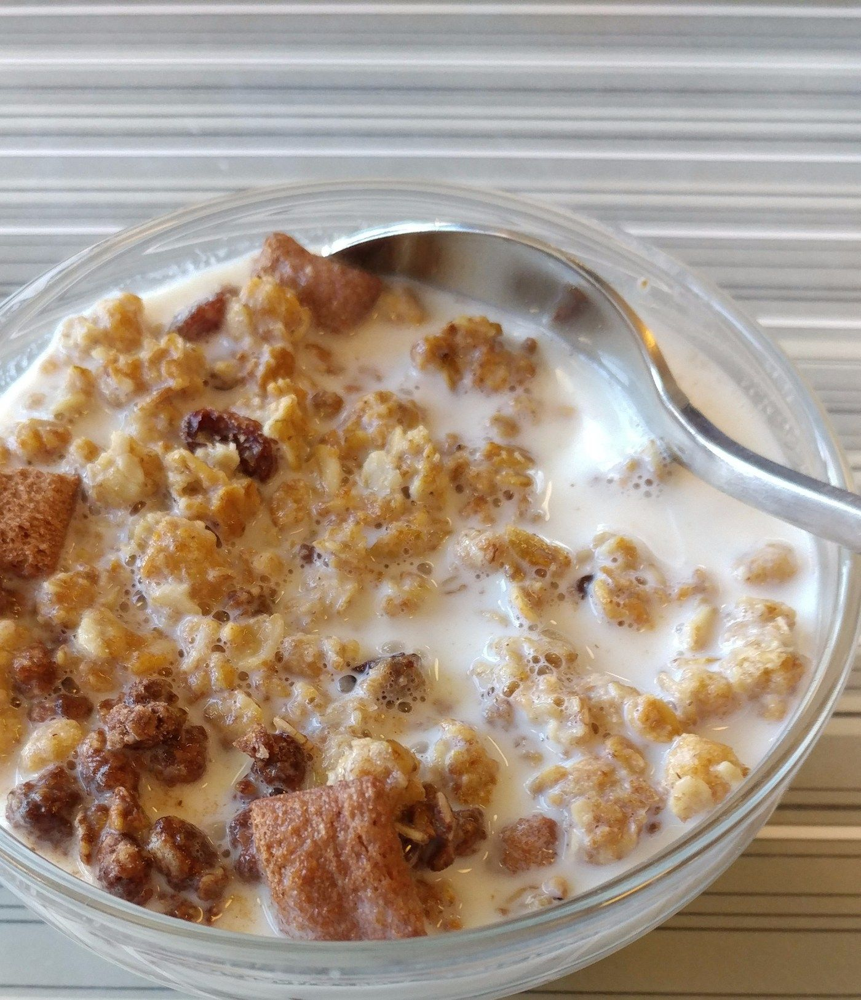
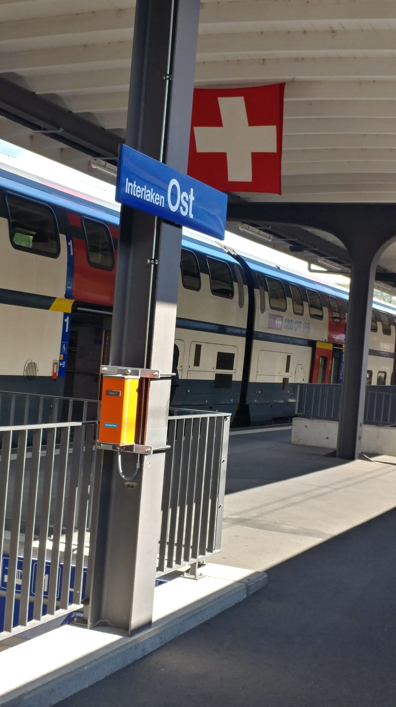
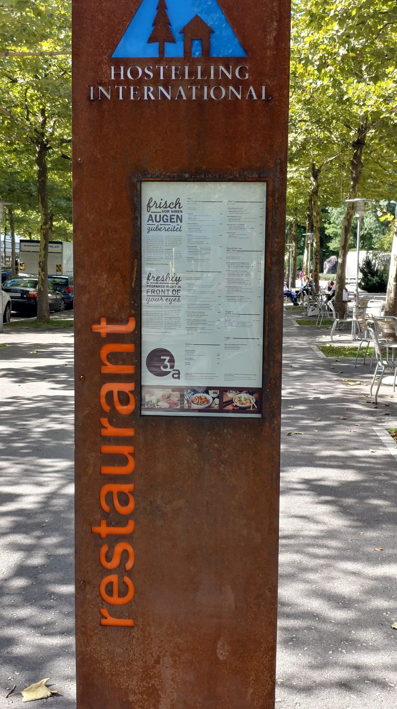

We woke up early to get breakfast and get the sim card. The breakfast cereal was very nice. Around 8.30am, we went and settled our data card.

Cereal with Milk

He gave more biscuits to us and when we said we cannot accept it, he said that since we are traveling, we can eat it on the way or during our break. I took a photo with him as a memory.

We missed our train at 10am so we took the 11am train. While waiting, we met this Pakistani couple who are US citizens in Washington DC and we talked for a while before parting as they were in First Class again.

We reached Interlaken Ost and walked about 3 minutes before reaching Jugendherberge hostel.

 
 
 
  <meta/> <meta/>   
 
 <!-- close group --> 
 
  <meta/> <meta/>   
 
 <!-- close group --> 
 <!-- close row --> 

My god, it looked more like a hotel than a hostel. There had a luggage storing room, a restaurant and recreational activities like Table Foosball and a Pool table.  We reached quite early so we had to keep our luggage in the luggage room, which was better than putting in a locker with money.

This slideshow requires JavaScript.

In the meantime, we went for souvenir shopping in the city. All the souvenirs were very expensive, on average 7 Frank. The t-shirt was 25 Frank. I would really go bankrupt just staying there.

We got hungry and ate at a Lebanese Restaurant. We paid 29 Frank for a small portion of a wrap and the chicken was not cooked properly.

I enquired about purchasing a Jungfrau ticket and he said it was 206.40 Frank, which was cheaper than the online price was 210 Frank. I told the rest of my friends about the price but they suddenly mentioned it was too expensive and they were not going. In the end, only I was interested in going Jungfrau. In the meantime, Nicholas and Jia Qi researched about bike renting and wants to go the next day instead of Jungfrau. 
So, I booked a trip to Jungfrau myself at hostel counter at 4 Frank cheaper (206.40) due to the visitor card (that is needed to stay in Jugendherberge hostel).

I rechecked the weather forecast and said that 11am it will be clear and I calculated that since it will take 2 hours there to go up, I should leave around 8.30 there. <a href="https://weather.com/weather/tenday/l/SZXX0057:1:SZ">https://weather.com/weather/tenday/l/SZXX0057:1:SZ</a>

I initially felt sad that no one wanted to come with me but realized that I have grown big enough to travel on my own. 
It was going to be different and exciting. Going to a place alone in an unknown country. Let the adventure begin.

