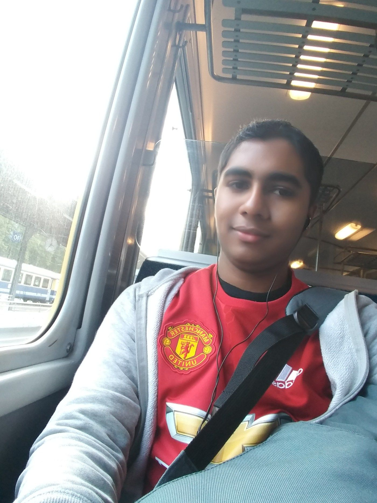
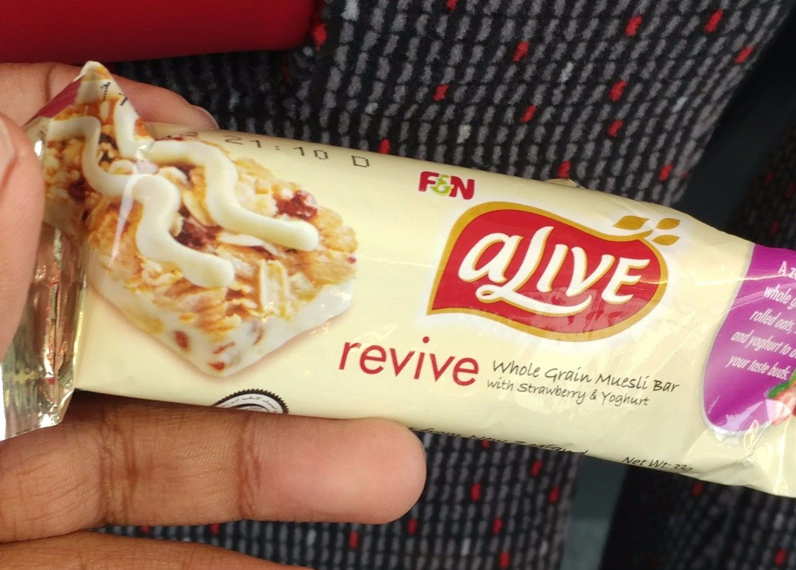
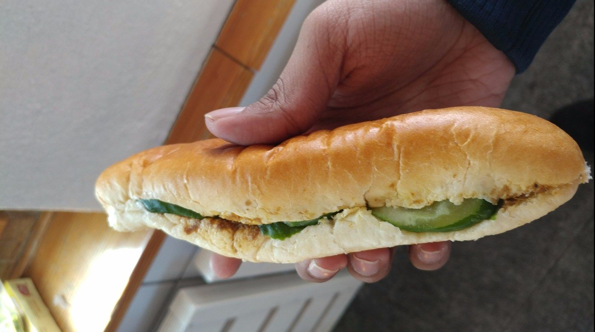
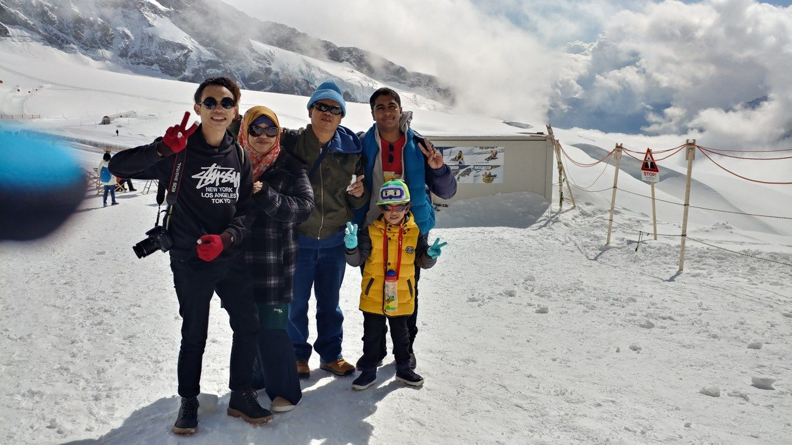
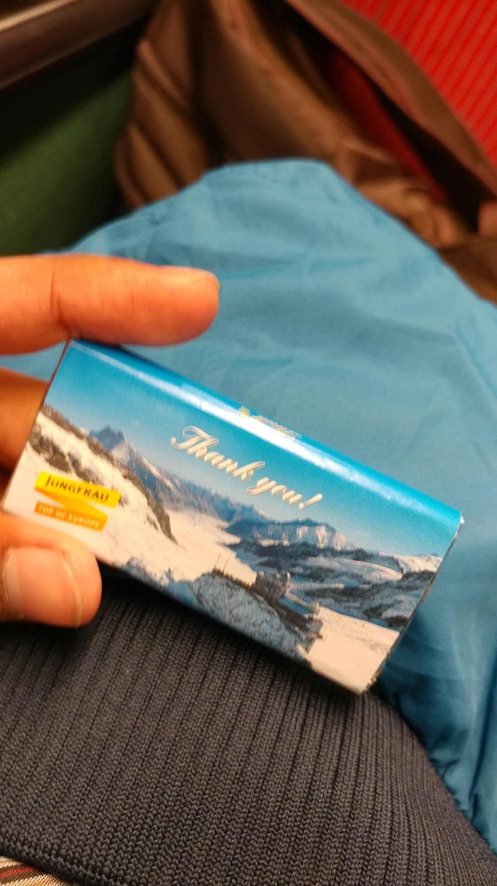
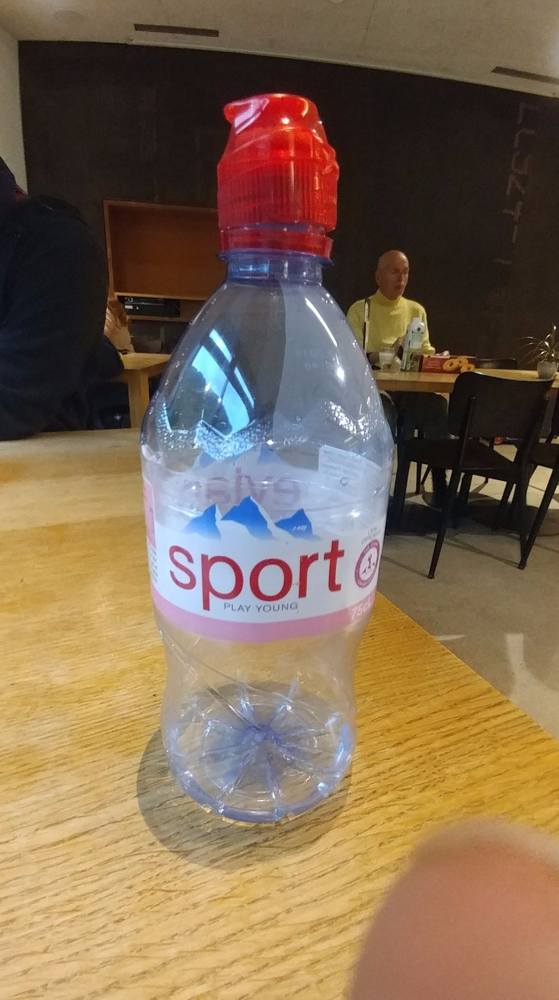

After deciding to go on my first maiden Solo trip to a tourist attraction, I woke up at 6.40am. After eating breakfast, I proceeded to take the 8.35am train up to Jungfrau.

While waiting for the train, I was thinking about how I have grown, old enough to venture out and see the world alone. I called my parents to update them that I’m fine. They were curious on why I chose to go on a Saturday as from their experience, it will be crowded as many go up the alps to do skiing. I was praying that it would not be that crowded. At the same time, I was determined to meet and interact with people who speak the languages I know (Malay, Bahasa Indonesia, Tamil or perhaps Hindi).

After boarding, I saw a Malaysian looking family in the same cabin (characterized by them speaking Malay and looking Malaysian). I figured that I would bump into them again. In the train, I reread blog and realized that I forgot which cabin I took as it will split to the 2 areas. Thankfully, I took the train to Lauterbrunnen as from the brochure, I only saw the way down was through Grindelwald and wanted to explore both ways.

The two blogs I read were

<ul>
<li><a href="https://truthfullyus.blogspot.co.uk/2016/11/jungfraujoch-blog-top-of-europe.html?m=1">https://truthfullyus.blogspot.co.uk/2016/11/jungfraujoch-blog-top-of-europe.html?m=1</a></li>
<li><a href="https://www.google.de/amp/s/www.european-traveler.com/switzerland/by-train-to-jungfraujoch-top-of-europe-station-in-the-swiss-alps/amp/">https://www.google.de/amp/s/www.european-traveler.com/switzerland/by-train-to-jungfraujoch-top-of-europe-station-in-the-swiss-alps/amp/</a></li>
</ul>

At Lauterbrunnen, I got down to change to the WAB cogwheel train heading towards Kleine Scheidegg. In the train, I took the single seat part and put my bag on the opposite seat as there seemed to be enough space for everyone. Then, the Malaysian looking family came in and they seemed to be just enough seats for everyone. So, I took off my bag from the seat and talked to them Malay that they can come at sit down here.

We then conversed in Malay and I introduced that I’m from Singapore. They continued asking which part of Singapore and all that while, I kept on thinking that they were from Malaysia and even asked if they were from Johor since they knew parts of Singapore like Woodlands. Then realized that they were from Singapore and their son was studying a Business course in Temasek Polytechnic. They were shocked that I could converse in Malay as their first impression of me was that I was from India. 
At Kleine Scheidegg, we took the Jungfraubahn train to Jungfraujoch. While waiting for the train, they gave me an oats biscuit, saying that it will keep me full for around the next two hours, until we explore Jungfrau. The train stopped at two special viewing points, the first for 1 minute and the other for about 5 minutes. It was getting clearer and clearer.

Biscuit they gave me

The view on the way up was amazing.

This slideshow requires JavaScript.

When we reached Jungfraujoch, we saw many Asian tourists there, primarily from China and Japan but thankfully, many of them were going back. I believe that they came early in the morning by taking the morning ticket or something.

Amidst all the tourists, I lost the Singaporean family and went around exploring the place. I took photos of the alps from inside and explored that building. I found the Lindt Chocolate, named the tallest Chocolate Shop in Europe and bought 40 Frank worth of chocolates to finish up my Frank as the chocolates were the same price as the supermarket, 100g for 4.50 Frank (I only withdrew 100 Frank). I figured that it will be fresher on the top as they constantly made new batches of chocolates since many tourists are buying from there.

Then I went to get a Jungfrau Passport to stamp my arrival there. I then enquired at the customer service on where to go out to see the Alps. On the way there, I came across a souvenir shop where I saw the staff talking in Japanese to the Japanese tourist buying items. I heard them saying some Chinese too. It comes to show how many tourists from these 2 countries come there that they learnt Chinese and Japanese.

I found the way to the viewing tower and reunited with the Singaporean family. We then took turns helping each other photos. I’m grateful to them for making my photos turn out nicely. After taking photos, they gave me Rendang filled bread to eat, citing that they had excess. That was a really nice gesture.

Rendang Filled Bread they gave me

It was a dream come true to go to the top of Europe and I definitely did not miss the chance to take a photo here.

This slideshow requires JavaScript.

Then they asked where I went just now and replied with I was exploring the Chocolate shop and they asked me to bring them there as they couldn’t find the shop. So, I went to proceed there but I forgot the way there and we pounced at another opening to the snow and we saw people skiing there. The view there was picturesque and they said we should take a photo, particularly for me to show my parents that I’m safe in Jungfrau. After taking a photo, while going the Chocolate shop, we looked back and found ourselves very lucky as it became cloudy slightly after we took the photo. Alhamdulillah.

It was strange for me but I honestly found myself overdressed for that weather. I was wearing 4 layers, with the last layer being a very thick layer and was feeling hot. I think that attire was more for -15 degrees, from my previous trip to Finland.

They then bought chocolates and stamped their Jungfrau passport. Around 1.15pm, we took the Jungfraubahn down to Grindelwald. On the train, my parents asked me if I went to the area with the flag saying it’s the top of Europe and I didn’t and was quite tired to get down and go there. That’s my only regret not doing. On the train down, I was surprised to get a chocolate with the Jungfrau wrapper.

Throughout my train journey, I found it very peaceful, for a change, to be away from my friends, to be alone and with a family, I just met. We decided to get down and explore Grindelwald before going back to Interlaken Ost. At Grindelwald, some of the things were cheaper and I bought a Caribbeana, to hook stuff like by shoe bag there as I forgot to bring one from Singapore and felt that I should buy something as a reminder of my trip to Switzerland. It only cost 3.50 Frank, compared to 7 Frank at Interlaken Ost. 
Before we parted, they gave me another oats bar and a bottled water.

Bottled Water

One thing I learnt today was that I prefer to be independent and like the process of meeting new people and it’s a better experience going alone and interacting with the people along the way, compared to going always with a group you know.

I found myself lucky to meet a Singaporean family, not in Singapore but in Switzerland and it seems like fate brought us together to perhaps not make me feel alone. To more adventures in the future.

