
Real Madrid vs Borussia Dortmund

It has always been a dream come true for me to watch a real soccer match, not an S-League match and it would be a waste to come here and not watch one. I was on a lookout to find a suitable match, something preferably involving either Bayern Munich or Borussia Dortmund (BVB), it possible the match between them.While looking through the matches, there was no clash between them between September and November but there was a Champion League match between Real Madrid and BVB. Initially, I thought we couldn’t make it as I had my German intensive course during then but 2 weeks before the match, I noticed the course schedule and realized that the lessons were until 2pm only and with the match only starting at 8.45pm, there was enough time to get there and we can come back the next day, before lesson starts at 9am. I asked Nicholas to follow me as according to the school policy, I am not allowed to go any traveling on my own.We immediately proceeded to book the tickets. I booked mine through Viagogo, after which I found to be pricier and could have bought it from the official website instead. We also found a train from Karlsruhe at 3pm and reaching there at 6.21pm, enough time for us to find dinner and make our way there via foot. The match tickets were delivered to us via UPS.Matchday, 26th September 2017, arrived.

After German class, we headed over to Karlsruhe Hbf and bought Mac, as we had some Mac voucher coupons left and were going to expire the next day. We didn’t have enough time to eat before boarding the train so we intended to eat on the train. Upon boarding the train, many eyes were on us with the Mcdonalds meal, as if it was a crime to eat on the train. We were scared, and decided not to eat for a while. After a while we got hungry so I asked this girl who was sitting opposite us if they were from Germany and if we could eat on the train. They said that its possible and the person on her right smiled discreetly, We then ate finish our meal, just before we reached Manheim. There, we had to leave our seat as someone had booked it and we changed our seats twice. That struck us that we could book our seats in the future so that we don’t need to keep changing and we could sit and travel in peace.

Our initial plan was to finish our German homework in the train but after a while, I got motion sickness while Nickolas dozed off. We decided to finish it while waiting for the train after the match, which we had a grace period of about 2 hours. Our train went past Koln(Cologne) and the scenery there was very picturesque, with a beautiful Cathedral.

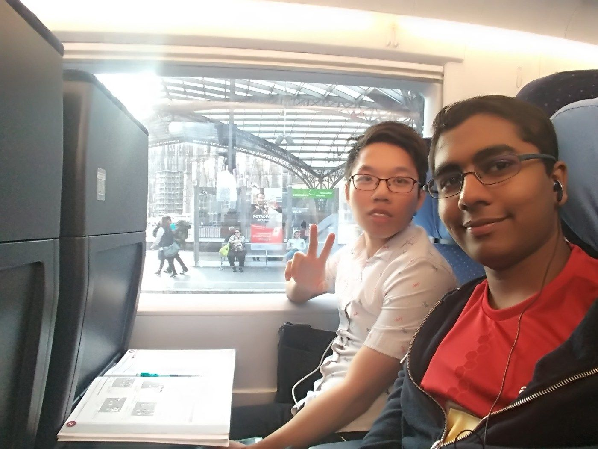

At around 6.22pm, we reached Dortmund. When we came out of the station, it was funny how everyone there was wearing the bright yellow Dortmund jersey, with some Real Madrid but I was a joker wearing a Manchester United (Manu) Jersey. I regretted buying a Manu jersey the previous time because I found the away Real Madrid jersey for the previous season ugly. This season’s jersey was very nice.Oh well, I didn’t have much choice at that moment. I was just praying that they will still let me entry haha. We had about 2 hours to the match so we decided to walk there, which was about 3.3km away and on the way visited the BVB fan shops.

 
 
 
  <meta/> <meta/> 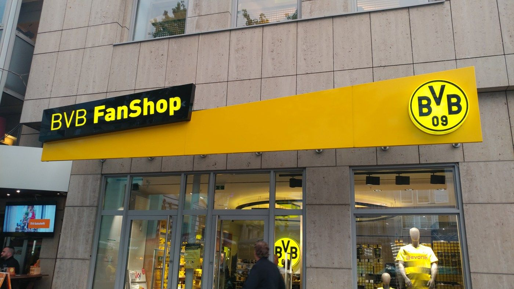  
 
 <!-- close group --> 
 
  <meta/> <meta/> 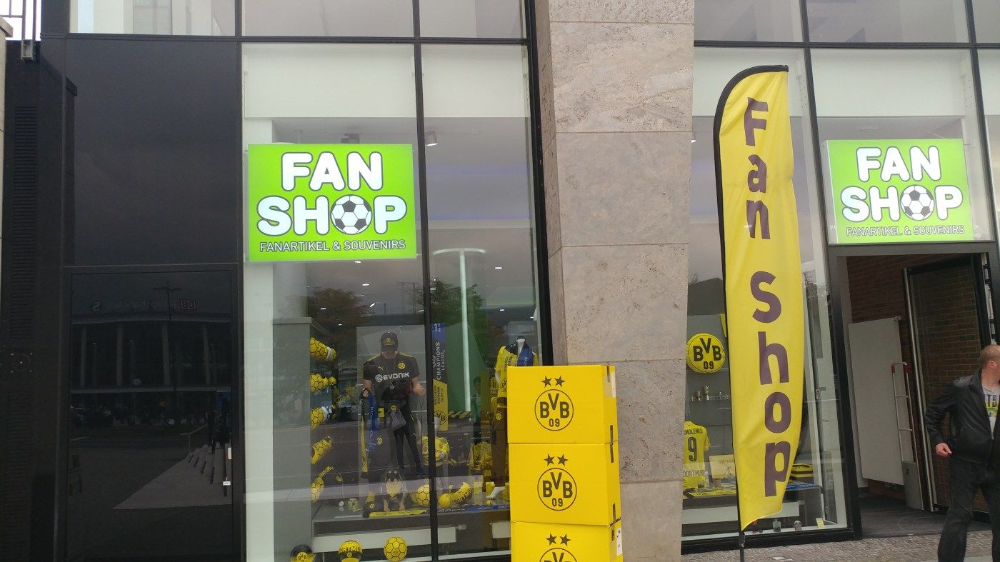  
 
 <!-- close group --> 
 <!-- close row --> 

Some of the items there were very cute, like this toothbrush I saw. The thing that amazed me a lot was that they were selling scarfs just for this match. It was nice. It also seems like they drew BVB mascot bigger cause they were very confident that they will win. I was intending to buy it but didn’t feel that it was worth the investment.

 
 
 
  <meta/> <meta/> 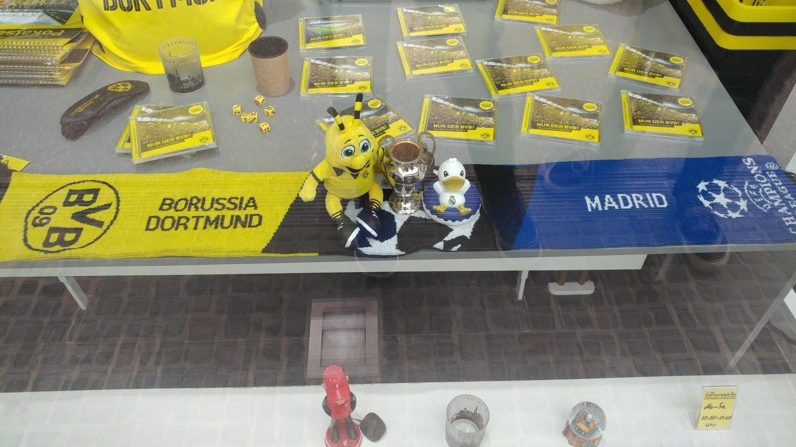  
 
 <!-- close group --> 
 
  <meta/> <meta/> 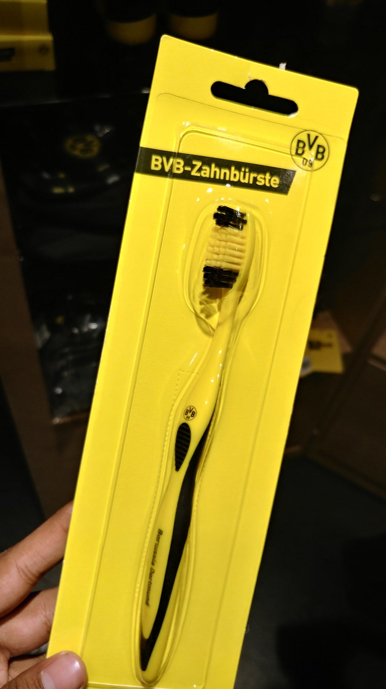  
 
 <!-- close group --> 
 <!-- close row --> 

On the way, I also saw the soccer jerseys of Real Madrid, BVB, and Manu but they were too expensive (90 euros) but perhaps I can buy it cheaper from Indonesia.We continued walking, appreciating the city, which looked different from Karlsruhe. 
We went past this halal Turkish food shop and it was selling Lemacun, a Tuesday special. But the meat they gave us was chicken meat and not beef so it didn’t taste as nice and it was pretty expensive in general. This is the place we went.

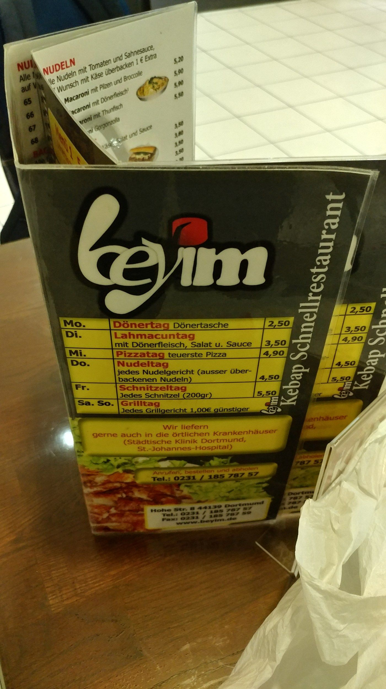

Following that, we made our way to the match. We wouldn’t have needed a GPS as we could just follow the flock of people wearing bright yellow, as they were BVB fans going to support the match. It was great to see that not only men but women too were going to watch the match and were wearing the home team jersey.After about 19 minutes of walking, we reached Signal Iduna Park and my god, it was crowded. Never in my life have I seen so many people at one place. Now I understand why the school did not recommend us to go to watch a soccer match.

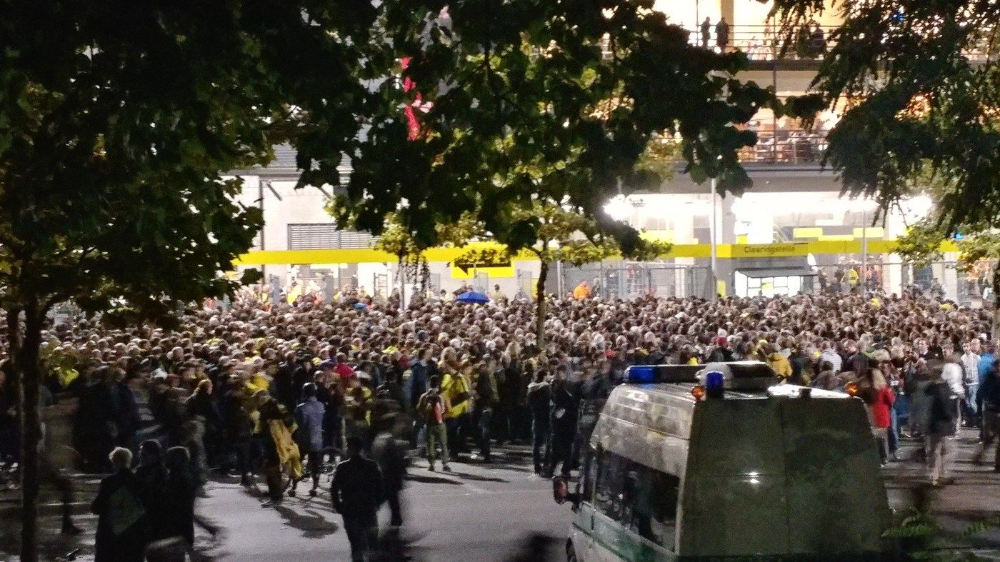 
I tried to take a photo with the stadium name but it was too dim.

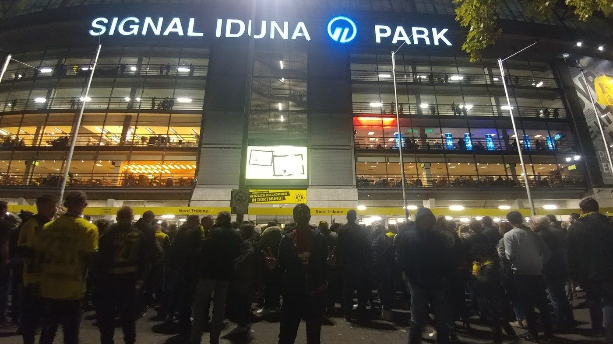

As we were clearing to go in, we were stopped by security personnel, asking us to deposit our haversacks as we cannot bring that in. We cannot also bring water bottles in, for security purposes. We then had to pay 0.50 euro to deposit our bags.Since we didn’t have water, we decided to go in and buy and it cost a lot, 3.50 euro per cup (500ml) and there was a long queue to buy and we missed the kickoff. It was surprising to see that they were selling Doner Box (Turkish food) instead of other food like nachos and so on. 
Luckily I managed to capture this before the match began.

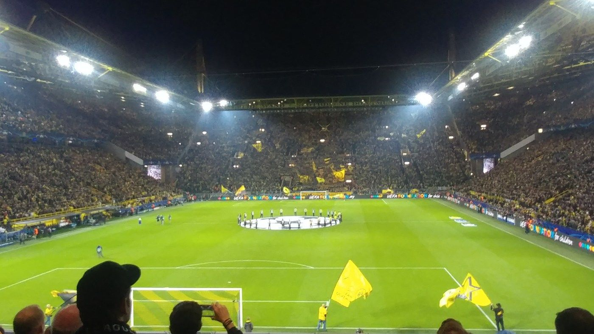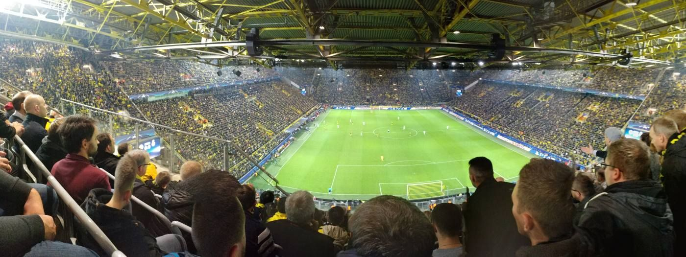 
We then went to sit down. Our seats were at area 76 and view from there was superb. 
The experience there was surreal. Fans constantly cheering for their favorite team. I realized though that there were BVB fans sitting at the away section( the section I was in, mostly for Real Madrid fans) and it was interesting to see fans from the same section having 2 different set of emotions for every chance played by the teams. 
Initially, I was just enjoying the match and I didn’t expect Real Madrid to score so fast with Bale scoring at 11 minutes and wasn’t able to capture on camera. Ever since then, I captured every chance was lucky to capture the rest of the goals on my phone.By halftime, it was 1-0. I was initially shocked at the result. The odds were that BVB will win as Real Madrid has failed to win at Dortmund for the last 3 times in Germany and I was expecting a sudden turnaround of events.

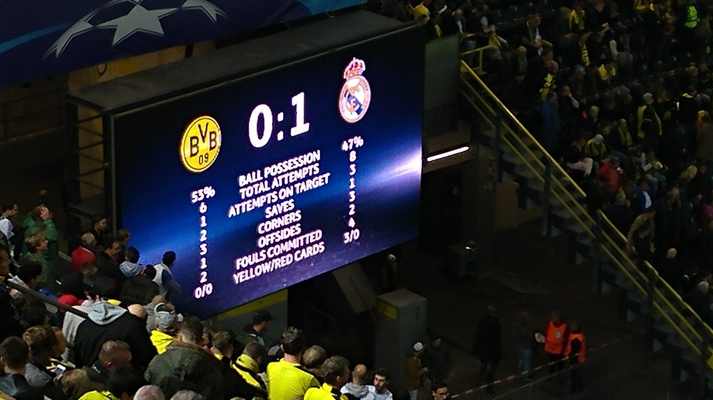

We used half time to take some selfies.

 
 
 
  <meta/> <meta/> 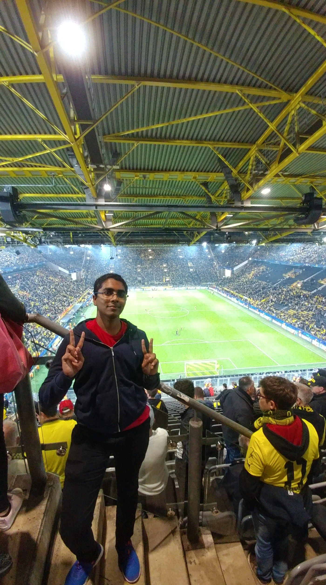  
 
 <!-- close group --> 
 
  <meta/> <meta/> 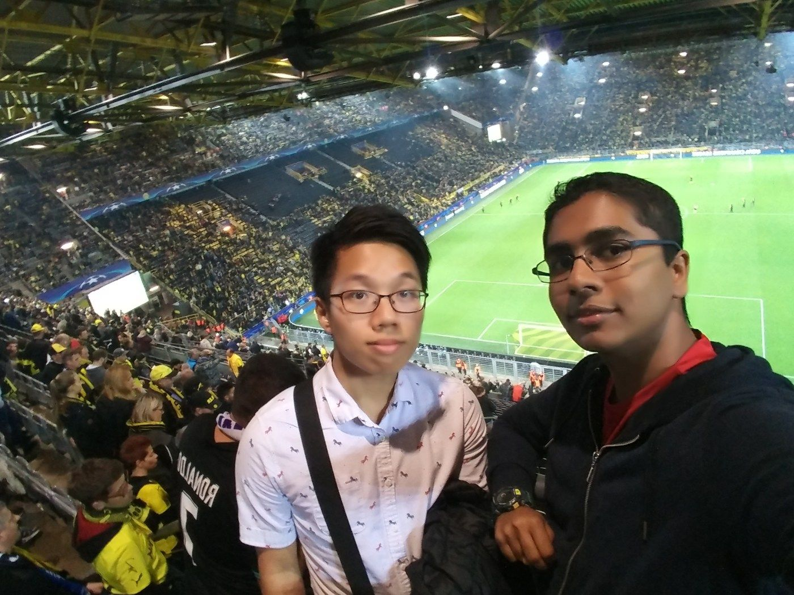  
 
 <!-- close group --> 
 <!-- close row --> 

The 2nd half was quite unexpected. Real Madrid’s Cristiano Ronaldo reopened the scoring after 49 minutes and extended Real Madrid’s lead to 2-0.

But just 5 minutes later, BVB scored a goal through Aubameyang.

But Real Madrid came back and scored another at 79 minute to confirm victory. At around 85 minutes, we could see that there was no way that BVB could do a comeback and we saw some home fans leaving the stadium.

The game was very interesting, especially in my opinion as Real Madrid made a few Goal line clearances and Ramos, my favorite player was a solid defender. It was a great day for Real Madrid fans and surely many were on cloud nine upon hearing the final whistle. Surely, all of us are hoping they can win the Champions League again, for the record 13th time.One thing down from my bucket list, watching a soccer match live. But surely, I have to go Spain, to Santiago Bernabeu and watch a Real Madrid match. 1 day, that will come true too. 
Following there, we proceeded to go back to the train station. It was 11 and our train will leave around 1.44am, the first train from Dortmund. In the meantime, we went to McDonald’s and finished our homework. We were sleepy and with a lesson in a few hours’ time, we had to get some sleep so we slept throughout the train ride.While boarding the train, I realized that everyone in the same cabin as me were Real Madrid fans. I could see how much dedication they had that they traveled all the way just to watch the match.

There was a train delay and this caused us to reach Karlsruhe around 12 minutes late. Luckily, we reached school on time, sharply at 9 where we had an oral German test.This was a once in a lifetime experience. Next main thing to do before leaving Germany back to Singapore is to visit the Eiffel Tower.

