<h2>Pre-Preparation</h2>

We went for the Welcome Meeting for all international students at our universities and there, a staff from Studentwerk came and told us that they have a special trip to Paris this semester and the places are running out fast. As for me, I was intending to go Paris at the end of the trip with two of my friends (1 did not want to come citing safety issues). However, after seeing that deal, I thought it was quite a good deal. 129 Euro for 2 days, a stay at a 3 Star Hotel, a 3hour bus tour of the whole Paris and free metro tickets. It’s quite worth it considering we have a tour guide to explain the significance of the different attractions and it is technically safer to go as groups as its harder for pickpockets to target us.

Owing to the fact that it was a school trip, and someone tried to pick up my friend who did not want to go, at the hostel, she eventually agreed to come along.

For me, the main thing I wanted to see was the Eiffel Tower, and actually climb it too.

<h2>Day 0: 20th October 2017</h2>

Friday, 20th October 2017 had finally arrived. We were asked to arrive at 11.50pm but we were so filled with excitement that we reached at 11pm so we used the free Wi-Fi at AO hostel. While waiting for the bus, we saw our Vietnamese friend we met from German class, Dank. We boarded the bus and were slated to arrive at around 7am and there will be 20-25 minutes (toilet break) stop for every 2h30 minutes. I was quite sleepy owing to the fact that I slept only 5-6 hours to wake up for a Skype meeting that didn’t require me and thus slept through the whole bus trip. The liaison in charge talked solely in German so I couldn’t understand every single word they said.

Day 1: 21st October 2017 
7am, we reached Bastille for coffee as per schedule. We thought we had to go to a Café or something but instead, we drank coffee just outsid the bus. The coffee was bitter and I wasn’t able to finish it.

Our tour guide was from Baden-Baden (Germany) and he gave us advice that we should not keep anything in our jacket front pockets or the back pockets of our pants because the pickpockets there in Paris are very smart in pickpocketing. He also cautioned us check our valuables after anyone bumps into us. 
At 8am, we then left as per the plan for a 3-hour tour around Paris in the tour bus, showing the important landmarks/monuments in the city. (Sadly, it did not include the Palace of Versailles). Our first main stop was near the Place du Trocadero where we could see the Eiffel Tower and get a good photo with it. Finally, it was a dream come true, to see the Eiffel Tower in person.

 
 
 
  <meta/> <meta/> 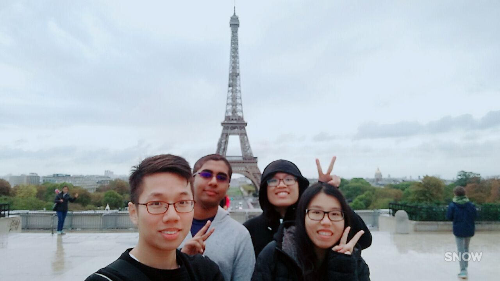  
 
 <!-- close group --> 
 
  <meta/> <meta/> 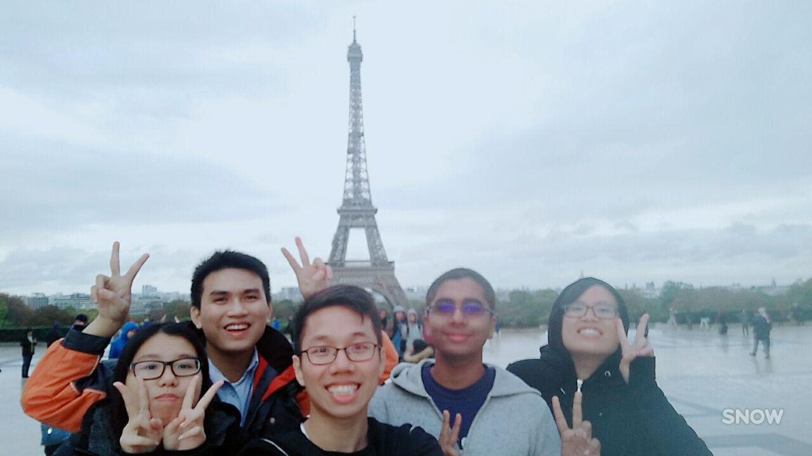  
 
 <!-- close group --> 
 <!-- close row --> 
 
There, we were approached by a few people selling Souvenirs, and it was amazingly cheap. 5 Key Chains with the Eiffel Tower design for just 1 euro. It was quite a shock as I didn’t see such cheap souvenirs when I previously went to Finland (each was at least 5 Euros.

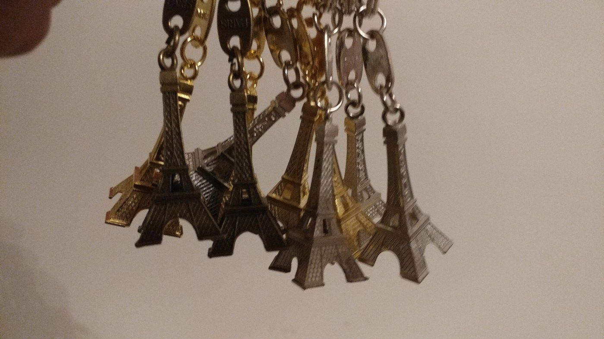 
We then went to tour the other main areas of the city. I realized that Paris was made of more than 1 island since they are kind of separated by the river (Port Neuf). 
We got down at Montparnasse Tower, supposedly like Seoul tower (Korea) where we can see the whole city from the 56th Floor. We had to pay 10 euro, which was cheaper than the price listed at the reception (adult price was 17 euro or something)

There, for a change, I saw an Indonesian tour group and was amazed to see the staff (who looked French) talking in Bahasa Indonesia -The things people do for tourism.

There were some telescopes to see the city clearly and I approached an Indonesian family and asked them if we need to pay money to use it. They said yes and even allowed me to see it before the time was up. Such a lovely gesture. Using it, I could get a perfect zoomed in view of the Eiffel Tower.

I then walked up to the 59th Floor to observe the whole city without enclosed windows. It was very windy there. Guess what, I saw the top roller Paris. Reminds me of Switzerland, Jungfrau where I saw the highest chocolate and watch shop in Europe.

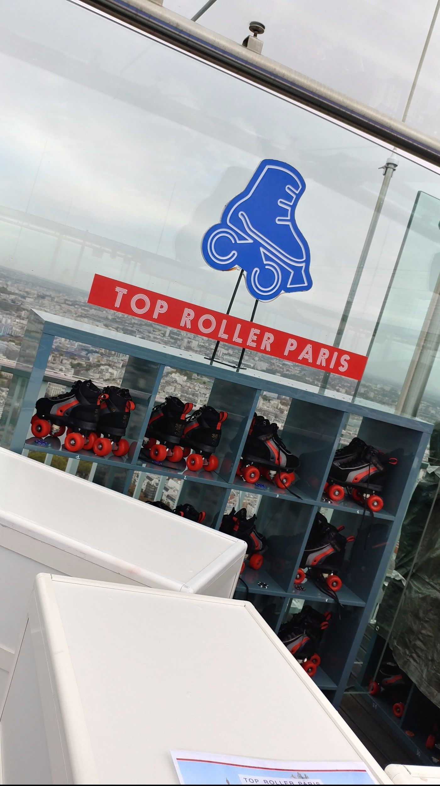

At around 12, we went to our hotel and there was some delay in checking in.

The hotel was quite good, just that the toilet could have been bigger. Thankfully, everything was resolved, and we had to report after a while but as we didn’t know what time to report, we took our time, until the tour guide called me. 

This slideshow requires JavaScript.

We rushed out then (around 1.25pm) and realized that the actual reporting time was at 1pm. 
Then we made our way to Notre Dame via metro. The nearest subway station to our hotel was Corentin Cariou.

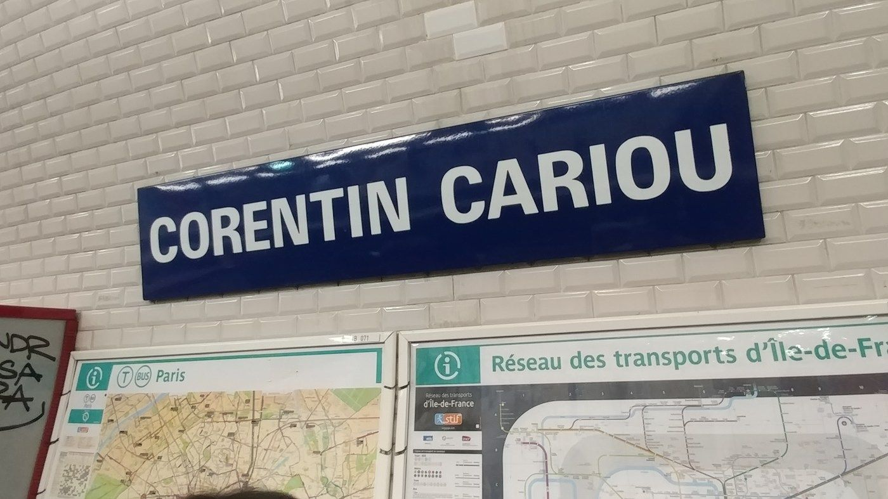

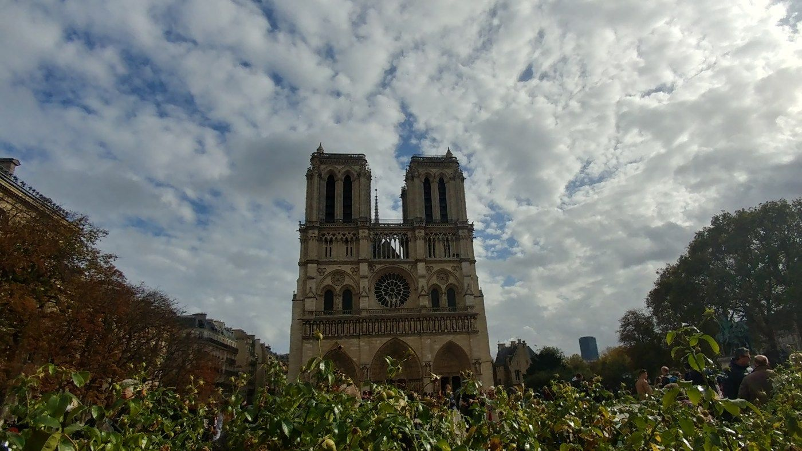
Notre Dame

He gave us 1hour 10 mins of free and easy time to either get lunch or explore the city Centre. 
There he dismissed us and just before that, he told us an advice that no one would ever tell us.

<em>“If you go to any shop, always enter by saying Bonjour, say Merci (Thank you) and Au Revoir(Good bye in French)”</em> 
So we went around the area, finding possible souvenirs and food to eat. We were finding cafe bistros that our tour guide told would give students affordable lunch (includes sandwiches) for 8-9 Euro (cheap here in Paris). 
But then, we found a shop selling a combination of middle eastern food(Kebap), Indian(biriyani), KFC (fried wings and chicken) and McDonalds (burgers). They were very nice and even spoke English to us, asking us to sit and explaining their menu to us. 
I slowly heard their conversation and heard the waiter talking to the counter people in Hindi and asked if he was from Pakistan (he looked like) and he confirmed it. 
By then, we were running late to go back (was 3.20pm by then-the time we had to report) and so we asked plastic bag to pack our food. Then while paying, I found out that the they are from Bangladesh. 
PS. In a hurry to buy and leave I forgot to take a photo of the menu, shop and so on. However, this wasn’t listed in a halal blog that I found saying the 5 halal restaurants in Paris.

<a href="https://www.havehalalwilltravel.com/blog/dine-like-a-parisian-at-these-5-muslim-friendly-restaurants-in-paris/">https://www.havehalalwilltravel.com/blog/dine-like-a-parisian-at-these-5-muslim-friendly-restaurants-in-paris/</a>

<a href="https://www.havehalalwilltravel.com/blog/where-to-eat-in-paris-7-must-try-muslim-friendly-restaurants/">https://www.havehalalwilltravel.com/blog/where-to-eat-in-paris-7-must-try-muslim-friendly-restaurants/</a> 
We went back then headed to nearby the river for a surprise river cruise (was given as an add on, on top of the package). It was a 1-hour cruise ride showing the main attractions (of course it lacked Disneyland).

This slideshow requires JavaScript.
 
Lady luck wasn’t shining on us that day so at the very moment we were reaching the Eiffel Tower spot (to do a U-turn), it poured super heavily and everyone on the top deck got down. As a result I couldn’t get a good picture. 
Some of the attractions were attractive and the scenery was picturesque. The rain stopped after a while. 
Towards the end of the cruise, we found out that the cruise cost 14 euro, which I find personally cheap to show the attractions. I expected it to be 40 euros or nearby but I guess it’s cheap as they was great competition among the numerous operators. We ended our cruise around 5.10-5.15.

Hereafter, we went nearby the Eiffel Tower. And he was telling us that we can either queue to go up the Eiffel Tower or follow him to a mountain area to get a nice view of Paris. (not sure exactly what he said cause he talked in German mostly)

So a group of us (me and some other students on the trip) went to buy tickets to walk up the stairs(our tour guide told us it was only 5 or 6 euros) but when we reached the ticket counter (it was 6.20pm) and they said that the steps closed at 6pm(opens at 9am). Then the queue for the elevator was quite long (we would need to wait for another 2 hours) and by then the view would not be as nice since the sun would have set.

 
 
 
  <meta/> <meta/> 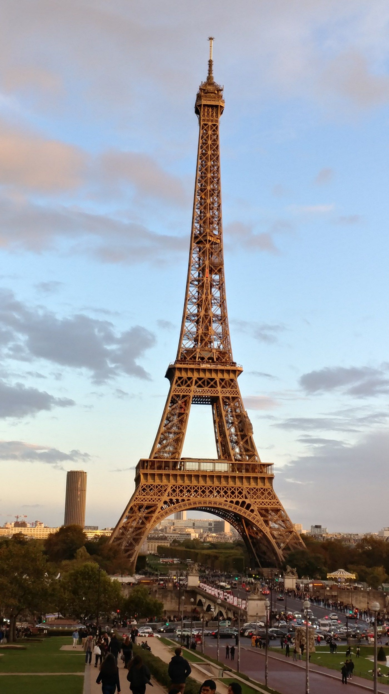  
 
 <!-- close group --> 
 
  <meta/> <meta/> 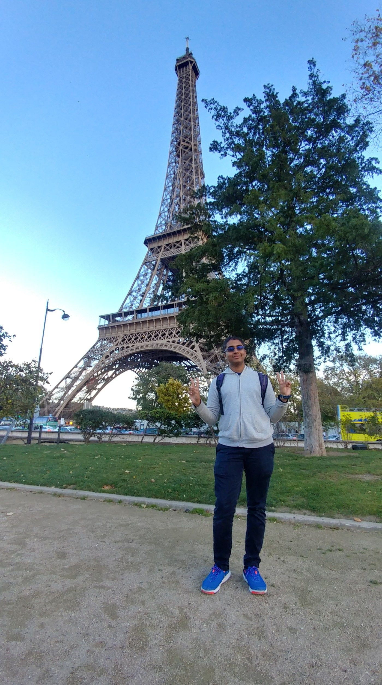  
 
 <!-- close group --> 
 
  <meta/> <meta/> 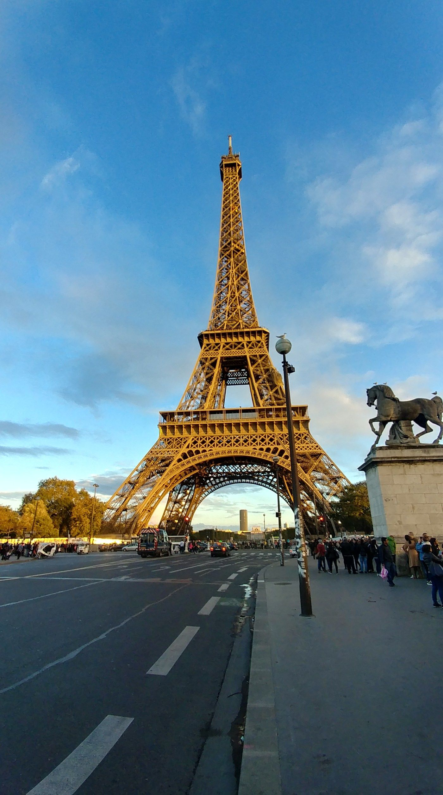  
 
 <!-- close group --> 
 <!-- close row --> 

Thus, we had to forgo our plans. We then decided to visit 1 of the shopping streets. 
Av. des Champs-Élysées, 75008 Paris, France, upon a suggestion from 1 of them. On the way, we took a group photo with the Eiffel Tower as the background.

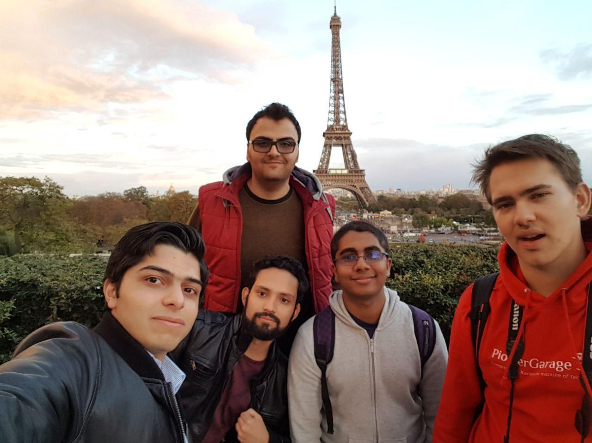
With newly met friends

We were getting hungry so we went to a convenience store to buy something as we were getting hungry. I got 2 croissants. Besides, it would be a waste if I went France and didn’t try their croissants. It was 95 cents (plain) and 99 cents (with some chocolate inside). The things are generally more expensive than Karlsruhe but is quite standard as it was a city( yet still cheaper than Switzerland where I almost went bankrupt).

We walked past a few stylish cars (Ferrari and Lamborghini Aventador for a test drive (90 Euro for 30 mins). My friend wanted to drive but he didn’t bring any important documents (driving license/passport) and his phone died so he couldn’t show the 
e- copy. 
He tried asking how much it would take for a photo sitting behind the wheel. He got an answer of 20 euro. So we took some photos together with the car.

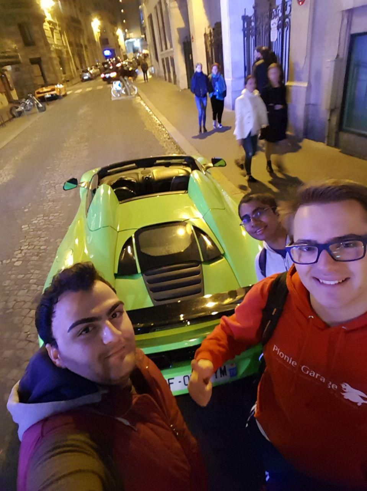

Along the Champs-Élysées, we saw the Louis Vuitton shopping mall where most tourists from China flock to (from what the tour guide said). 
After that, the 2 of them, Computer Science students from KIT left as they were already tired. The remaining 3 of us walked more and we went to Place De La Concorde. From there, we saw the Eiffel tower so beautiful with lights. So with my 3 friends (from Singapore) eating nearby Eiffel Tower, we decided to go to see the tower and meet them. We decided to take the metro as we had a free metro ticket and our legs were getting tired. 
We asked a few French students we met in the metro on how to go to the Eiffel Tower and they told another way that wasn’t listed on Google maps, that is to Trocadero. We took the subway to Trocadero and when we came out, we realised it was the same place we came in the morning (where they sold 5 key chains for 1 euro) and where we took a photo with my newly found friends. The place was filled with flocks of people and the environment was darker but lightened by the shining Eiffel Tower.

Then I met my friends at the metro station. I asked my Iranian friend on where he thought I was and he said Syria. It was surprising indeed, being my first-time hearing this. This adds an entry to the list of countries I look like I come from (India, Malaysia, Singapore).

On our way walking, 1 thing I saw really struck me, that is there were so many homeless people on the streets, that too as families. Most were Muslim and looked to be from the middle east. They seemed to be refugees. The reason why it struck me was that it was cold but they braze the cold for survival and it will get colder once winter comes. So I went to research about homelessness in Paris. It seems some actually act like Syrian refugees to gain sympathy and can earn up to 500 Euros a month. Interestingly, begging is legal in France since 1994 under 3 conditions.1) It isn’t done in an aggressive way. 2) Children aren’t used to beg.3)It doesn’t affect public order.

Its strange how I saw families with children still begging. I realised that I am very lucky to have everything in life.

We then returned back to the hotel, bathed and ate left over sandwich (from the previous day) as dinner and utilized the free fast Wifi to use social media before sleeping.

<h2>Day 2: 22nd October 2017</h2>

The next morning, we woke up around 7am for breakfast. We had to eat finish and board the bus by 8.30am. 
The food was nice and authentic.

 
 
 
  <meta/> <meta/> 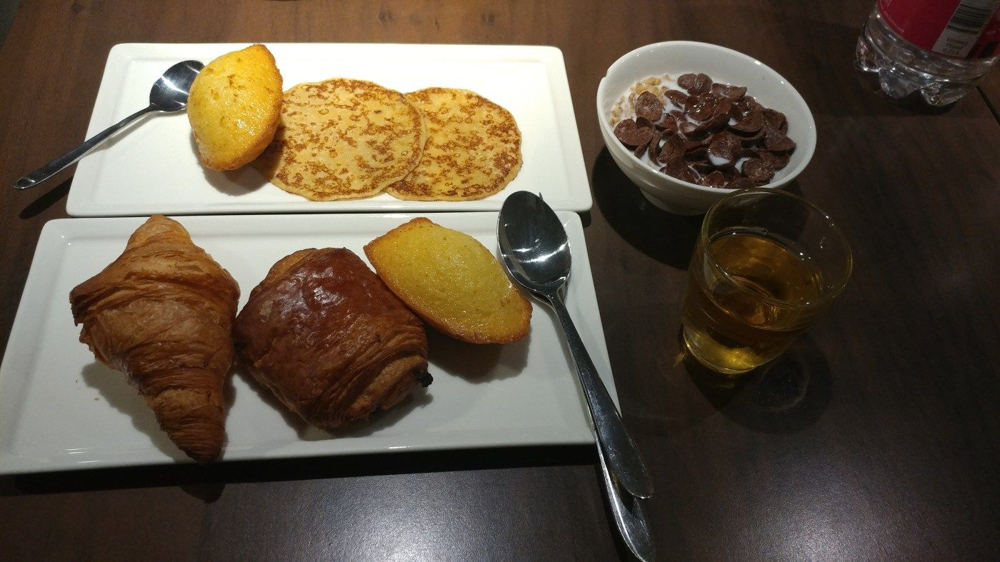  
 
 <!-- close group --> 
 
  <meta/> <meta/> 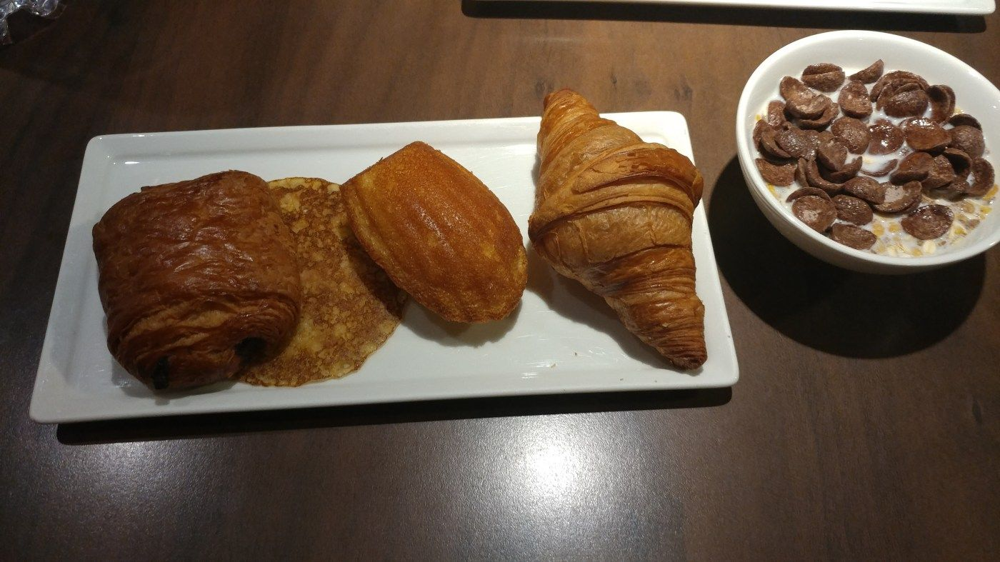  
 
 <!-- close group --> 
 <!-- close row --> 

While leaving, I accidentally left my phone in the room and came back to take it. For a moment, I lost my friends while going to report in the bus but luckily they came after a while.

We proceeded to Louvre museum. During the bus trip there, I noticed that there were quite a handful Muslim shops (Arabic words were written), something I least expected. Possibly somewhere worth migrating to.

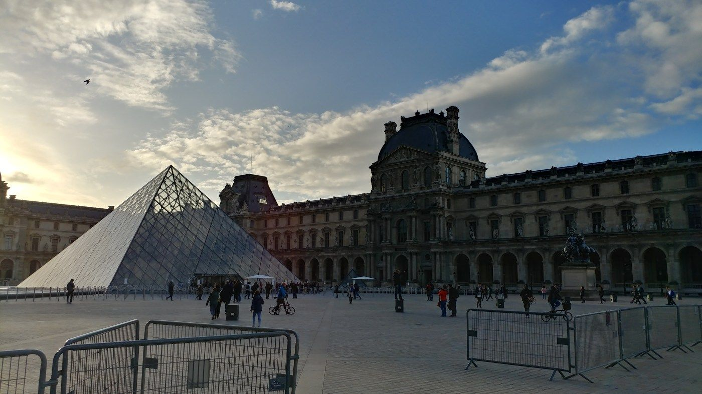

There we were given 3 hours to tour the whole Museum. I separated from my Singaporean friends and went with my newly made Mexican friend, Eric and Iranian friend, Nima. The first thing we dashed to see was the famous Mona Lisa but there was a big crowd trying to catch a glimpse of it too. To my dismay, the Mona Lisa painting was rather small. I expected it to be very big, especially given the hype given to it. Oh well, I shouldn’t have kept my expectations too high.

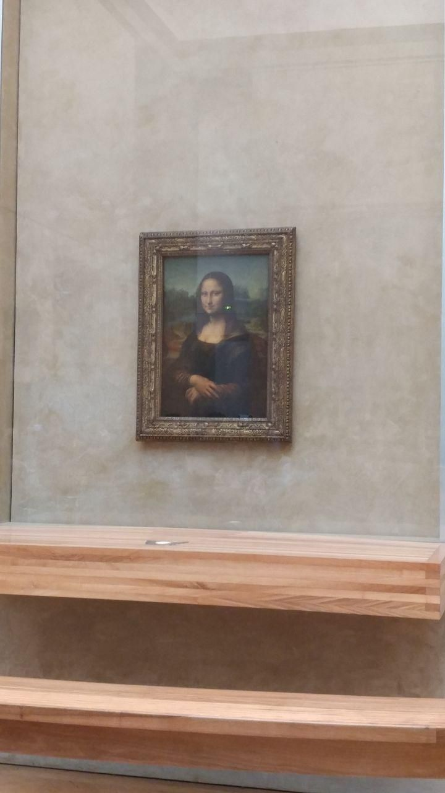

We searched and found the Islamic Art section. It was interesting to see that many of it came from Iran. When Nima (my Iranian friend) went finding the toilet, we lost him. He then texted us that he went out as he got bored of the museum. We then went around, checking out the other exhibits. We got lost after a while but coincidentally found the toilet. We found the Louvre museum quite a maze to walk through as to go from one end to another end of the level, we had to take the stairs down then up again. 
We went near the South East Asian exhibition (level 1) and saw a computer. We tried downloading the visitor guide and accidently crashed the computer.

We came out by another entrance and I got scammed. Someone came up to me asking if I know English and said they need us to sign to show our support for deaf children. I thought it was some petition but then they said they needed some donation so I gave them 2 euro then she said something like minimal money is something like 20 euro then I said I don’t have. They didn’t pursue it. I thought it was free.

An African seller selling souvenirs talked to my friend in Spanish and asking him to buy. I was quite shocked that they learnt other languages.

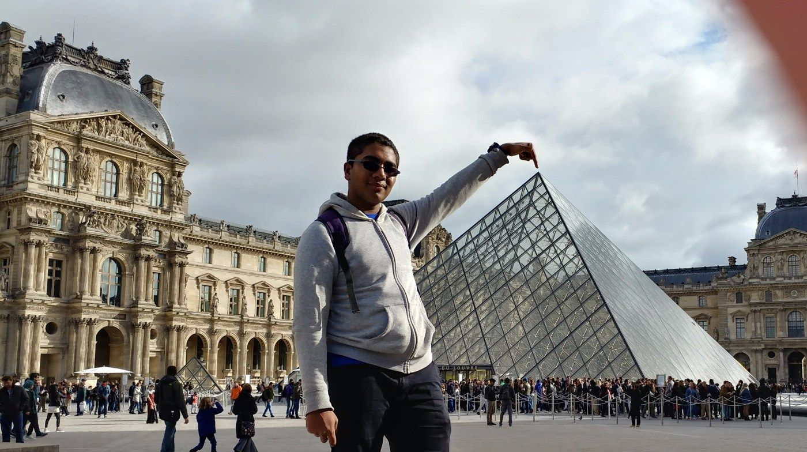
Touching the pyramid

We then reported back to the bus at 1pm and left back to Karlsruhe.

All in all, Paris is a nice place to live in. I see many different races together, even more diverse than Singapore, something I love. For some reason I saw many Africans, even more than UAE. 
In my opinion, even though Paris is generally more expensive than Karlsruhe but it’s a nicer place, somewhere I don’t mind coming back again, especially for work.

<h3>Reflection</h3>

Our journey around the city on the 1st day showed me some interesting things that people in Paris did or they have. 
1) Using 1 ticket, 2 students tried to dash in before the ticket machine closed. The machine is not the same as Singapore that closes immediately after it detects a human passing. Because of the continuous occurrence of this, just travelling from Concorde to Trocadero, our ticket was checked 4-5 times by officers. My two other friends were asked to show their passport/identification card. Not sure why but luckily, I didn’t have to. Was it because I looked young and innocent? Am I? Hmm…. 
2) ‎In Germany, they write 3.99 Euro but here they write 3 Euro 99. Different indeed. 
3) Cars and Pedestrians have a mutual relationship that is hard to understand. Sometimes it’s Green signal but cars wait when people cross. Sometimes it’s Red signal but cars just cross. 
4) The people there are very cute in my opinion. Some cross while it’s a red signal and when they see a car approaching, they dash across with joy as though they were having fun. Cool!

<em>A tip: If someone comes up to you and asks if you know English, say no.</em>

