<h3>Prior details:</h3>

Prior to this trip, I had already researched the places of interest I wanted to go as the initial plan was to go with some friends I met from the university. However, it did not materialize because on weekends they require us to stay at least 2 nights in hostels. 
So, since I had finished my project and had a few days to spare plus, I wanted to do some traveling. It would have been a waste to come to Germany and not see Berlin so I decided on visiting Berlin. And I kept on thinking where else I could visit so I chose Amsterdam.

The days of my trip were specifically selected. Wednesday, 22nd November was for Amsterdam as it was the only sunny day that week and Thursday, 23rd November for Berlin as it was finally sunny for that week. Given the short span of good weather, I only spent 1 day in each of the cities, with my accommodation being on the bus during the travel between cities.

<h3>Day 0: Karlsruhe to Amsterdam</h3>

I left my hostel on Tuesday 21st November at 11pm for my bus to Amsterdam. I used flix bus. On my way there, I received a message that the bus will be 5 minutes late from the original time of 23:55. 
At 00,00, bus still hasn’t arrived. While waiting I saw a group of 3 Indonesians who were going to board the same bus as me. I wanted to start a conversation with one of them but couldn’t as he slept off.

In the bus, sleep was rough and hard to get. I Got up at every stop along the way. But it was interesting as I saw a toilet on a bus for the first time.

<h3>Day 1: Amsterdam</h3>

The bus reached 09.15, instead of the initial arrival time of 8.15 am. 
It was cold. I didn’t bring my very thick jacket as I checked the weather and the range were between 10-13 degrees. 
But when I reached there, it was 5 degrees. A small sense of regret filled me.

I then went to buy a travel pass. It seems the price of 7.50<b>€</b> I saw online was for unlimited bus only. For all modes of transportation (bus, tram and, metro), the cost is 16.50<b>€</b>. So, I bought the latter one.

My initial plan was to catch the street food market – Albert Cuypstraat before going Anne Frank house for my time period of between 10.15-10.30am.

But then, I took the wrong train that led me to Central station. So I went with the flow and remembered that Crispy king was nearby so I walked to the store there. I bought the regular frites(3.95 Euro) with Special sauce (0.95<b>€</b> extra) for my breakfast and got full just by eating that. It was expensive but worth it.

<h4>Anne Frank house:</h4>

I then made my way to Anne Frank house. 
There was an Own Time Own Target tour with individual audio devices that explain the different exhibits. Initially, the crowd wasn’t that bad but after entering the secret annex (Anne Frank secret hiding place), it became very slow as space was limited and they were already many people in front of me. 
Reading and hearing about what happened made realize how lucky we have been in Singapore where we will never have to go through the same ordeal she was in. It inspired me to reread the book. I was touched and amazed by Anne Frank’s father idea of protecting them.

I spent around 1 hour 30 minutes here.

<h5>A suggestion:</h5>

If possible choose the 10am slot for the tour. That’s when there is the least amount of people. This is certain because you can only enter during that time slot but you can leave anytime from the place. When I left the place, there was a large queue waiting to enter the place. Also, don’t forget to book your tickets online!

<h4>Canal hop on hop off tour</h4>

Upon exiting the house, I saw a meeting point for a canal tour. So I waited until the time for my boat and then when I asked them, they said that my boat was on the other street with the canal. There I waited for about 20 minutes before the boat came. 
Also, I felt a bit cheated as you can buy tickets on the boat and it was slightly cheaper.

I didn’t print out the online ticket and the staff said that I need to if not they won’t accept it so she asked me to email her and she helped me print.

Some facts I learnt from the boat tour:

<ul>
<li>Amsterdam is known as the Venice of Northern Europe.</li>
<li>People there like beer a lot and they brew their own after initially importing from other countries like Germany. That’s how Heineken, their local beer brand came.</li>
<li>Some of the best skaters come from Netherlands and during winter, some parts of the canal closed to allow people to do skating.</li>
<li>I went past the biggest floating Chinese restaurant.</li>
<li>Amsterdam is definitely a cyclist nation. The number of bikes parked at the station was a lot.</li>
</ul>

This slideshow requires JavaScript.

On the boat, I met an Indian from Karnataka, Northern India where they speak Kannada, who is having a course in Germany.

<h4>Albert Cuypstraat (Street Food Market) :</h4>

I took the tour until Albert Cuypstraat. 
On the way, I saw Saravana Bhavan, a famous Indian restaurant with words in Tamil and Hindi.

 
 
 
  <meta/> <meta/> 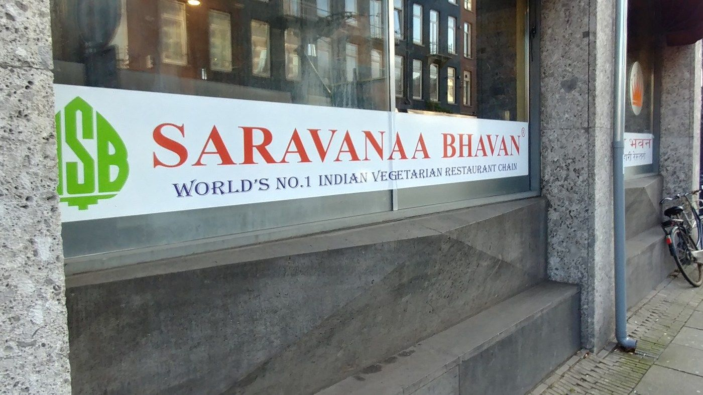  
 
 <!-- close group --> 
 
  <meta/> <meta/> 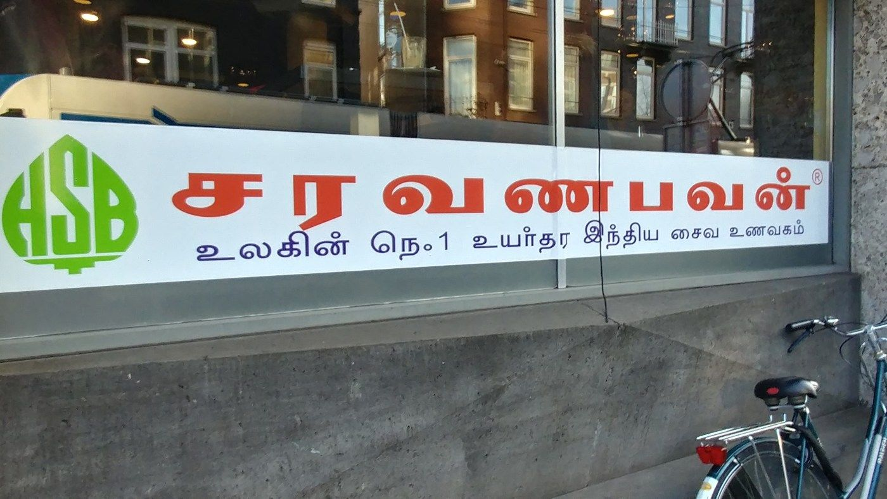  
 
 <!-- close group --> 
 <!-- close row --> 

There, I saw an Asian and Indian store.

 
 
 
  <meta/> <meta/> 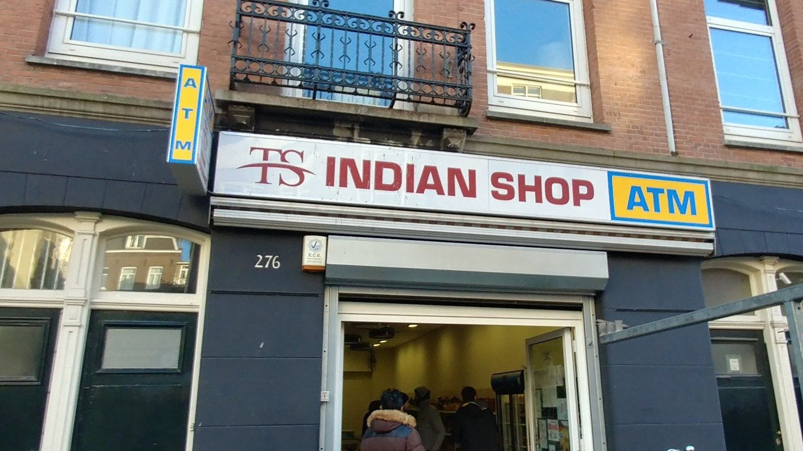  
 
 <!-- close group --> 
 
  <meta/> <meta/> 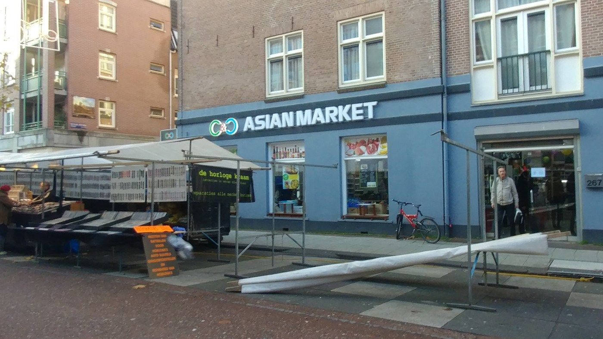  
 
 <!-- close group --> 
 <!-- close row --> 

I walked through the whole market.

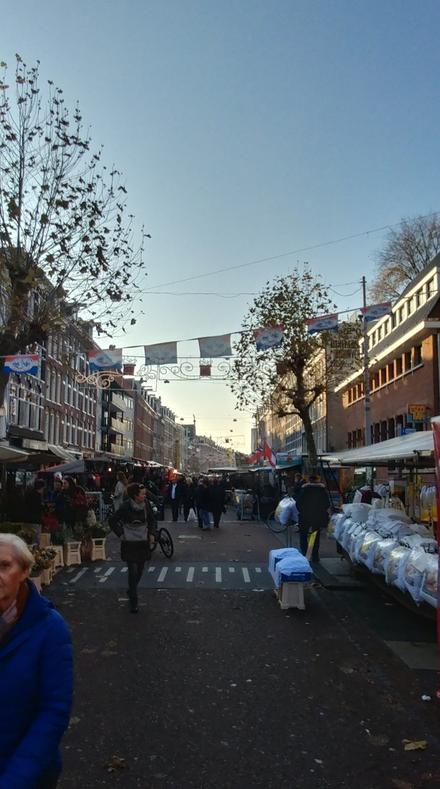

The store owners from a  variety of races -Indian, Punjabi, Arabic, Dutch and so on. 
After looking through the whole market, I decided to try the Stroopwaffles based on this blog – <a href="https://www.havehalalwilltravel.com/blog/these-5-muslim-friendly-street-food-in-amsterdam-will-make-you-drool/">https://www.havehalalwilltravel.com/blog/these-5-muslim-friendly-street-food-in-amsterdam-will-make-you-drool/</a>. 
I talked to the owner. He mentioned that currently, his store is the only store that sells original Stroopwaffles as the other store owner had retired. He was taking over his father’s business, which has been there for 43 years. He mentioned that other shops use a lot of other ingredients that are sweet and not use the original spices.

I tried the Stroopwaffles with chocolate syrup. He even told me how to eat it, which is from the non-coated area to the chocolate area.

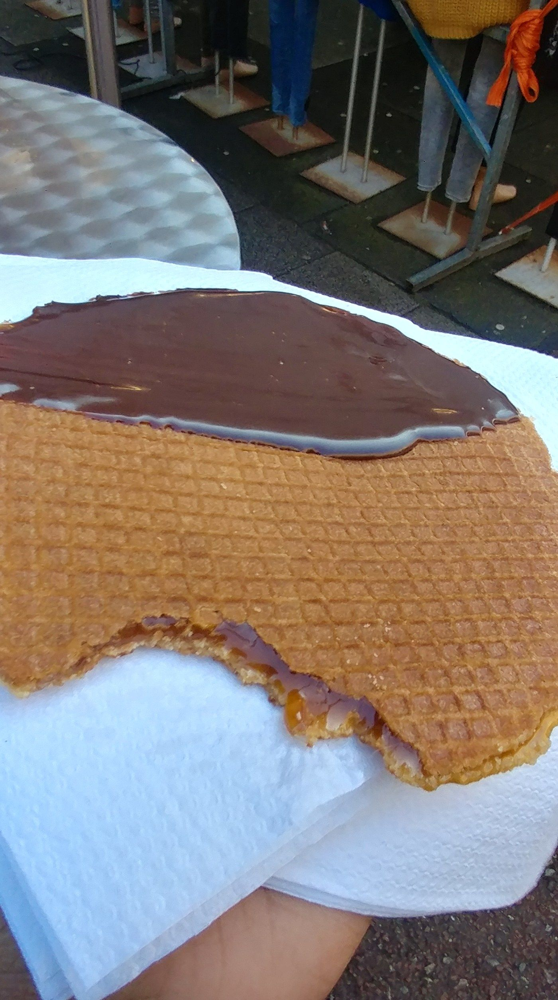 
It was nice, I could taste the cinnamon inside. After that, I bought 1 set of cookies, with a box, for protection and another for my other friends from Singapore to try. 
The box was cute.

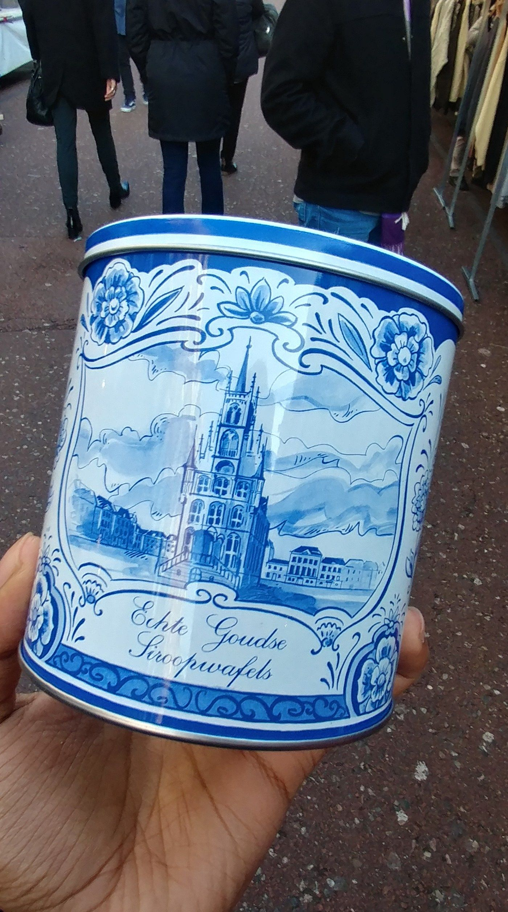

I also bought some souvenirs, which was reasonably priced (1 for 2 euro and 3 for 5 Euro)

I also bought an Amsterdam shirt. When buying the shirt, the shop owner said that he is not allowed to give plastic bag without charging me as if not he can be fined between 250-500, a law that started this year, 1st Jan 2017.

<h4>Al-Kareem mosque</h4>

The nearest mosque to the Albert Cuypstraat was Masjid Al-Kareem. After entering, I met and talked to a Pakistani guy there. From him, I found that the mosque was a Pakistani mosque. 
He has stayed in Amsterdam for 40 years already. 
He started the conversation first, asking in Hindi how I am. Then I asked him if he is from India.  We then exchanged our country origins. 
The conversation continued, saying how he loved it in Amsterdam, citing it the best City in the world. 
I’m still surprised how he knew that I know Hindi and shocked that he still continued to talk to me despite my broken Hindi as from another experience, the person switched to English after finding out my Hindi was bad. Or maybe my Hindi improved?

He asked me if I study IT cause many of his friends from India study that. He has 2 sons, both of which are accountants. His eldest son is currently working in Microsoft Ireland under his internship, sponsored by his institution. 
He mentioned that he would not go back to Pakistan because everything was there – halal food, his friends and all. Also, even his friends want to continue living here.

<h4>Pathe Cinema</h4>

 
 
 
  <meta/> <meta/> 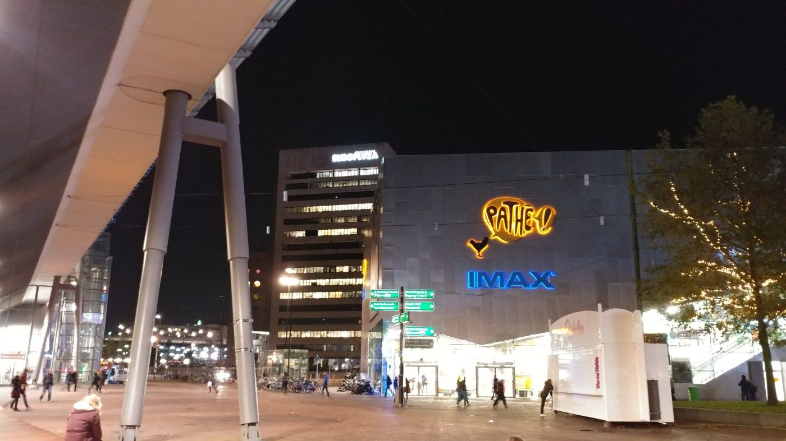   Pathe Cinema  
 
 <!-- close group --> 
 <!-- close row --> 

It had been 3 months since I last watched an Indian movie in the cinema and a search for one in Germany this week didn’t yield a result. So I wanted to experience how it would be like to watch an Indian movie in Europe. 
I bought tickets for the first movie I found, Ittefaq, a Hindi crime thriller movie that released on 3rd November 2017. 
It was easily accessible, 1 minute away from the metro station. There before entering, I bought myself some popcorn and drink. The popcorn selection was rather different. It was prepared, a to-go concept instead of in Singapore where it’s prepared when we order. The popcorns were of different sizes, small, medium and large.

Also, the drinks available were only in bottles, not like in Singapore where the drink is dispensed in a paper cup. A 500ml bottle cost 3.99 euro, which is more expensive.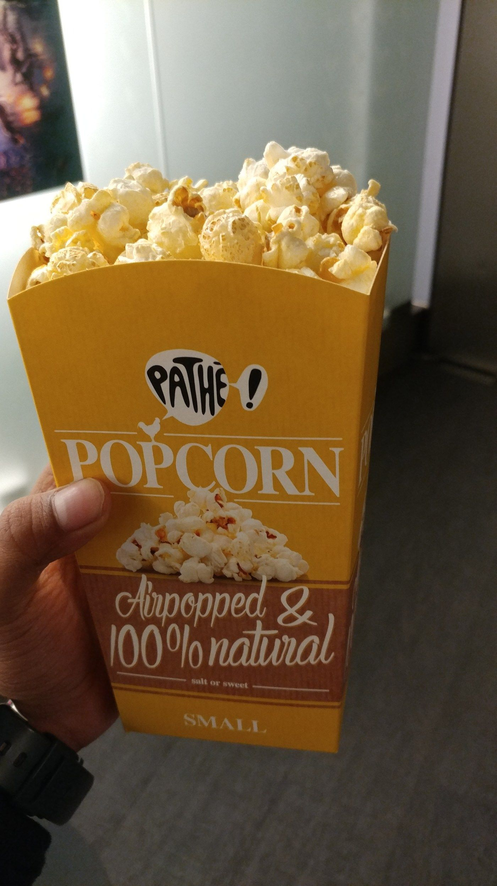

It was my first Hindi movie I watched in the theatre without English subtitles. There were Dutch subtitles though and I noticed that German and Dutch have some similar words. 
For example, waarum (Dutch) is warum(German) – Why (English)

Particularly at the start, the sound wasn’t that good. I couldn’t hear some of the words properly. It was muffled. Thankfully, I could understand the movie and 80% of the words used.

What caught my eye was the writing of the movie schedule of when the movie starts and ends. In Singapore, they only show the start time but never the end time. By giving the end time, it is better as we can plan what to do next and the movie ended as per the schedule.

<h4>Surinamese food for dinner</h4>

By then it was already 7.30-7.45pm. I then realized that the canal cruise had ended already at 6pm. Thus I went to have some unique cuisine – halal Surinamese food, at Suri Kitchen for a light dinner.

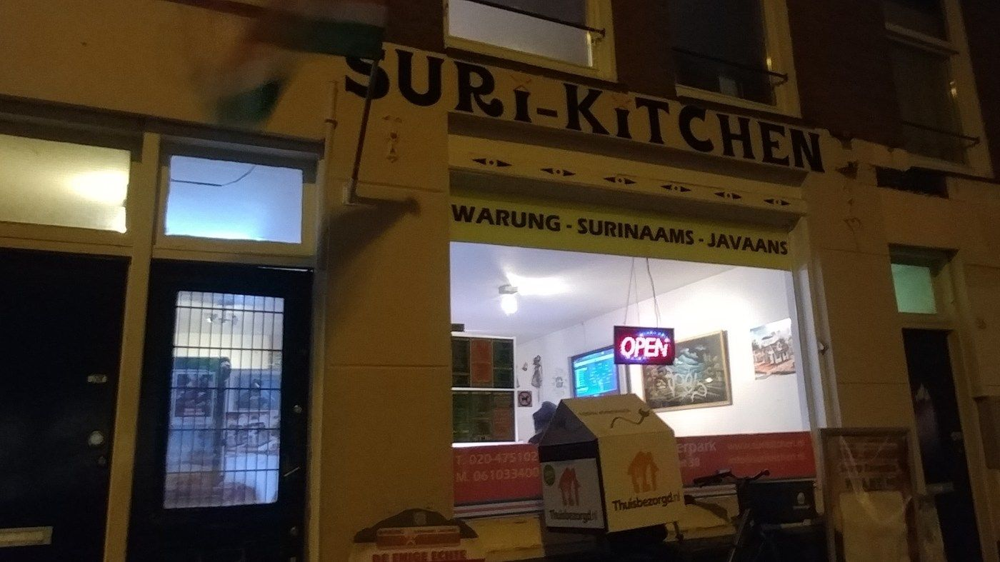

Suriname is an interesting country, a place I only found out while researching on halal food here. It is a Dutch colony, situated in South America, the only territory outside of Europe where the majority of the population speak Dutch. 
They have a mix of people from different countries – China, India, Africa and the list goes on. 
<a href="https://en.m.wikipedia.org/wiki/Suriname">https://en.m.wikipedia.org/wiki/Suriname</a>

I asked them for a recommendation and based on my desire to try the bread dishes, they asked me to try Kip fillet (bread with chicken). It was nice but I was just too full to finish it. The food wasn’t spicy, and there was some additional ingredient added to the bread that gave it a unique taste. Worth a try. There are also some other shops selling other Surinamese food(Surinamese Chinese food).

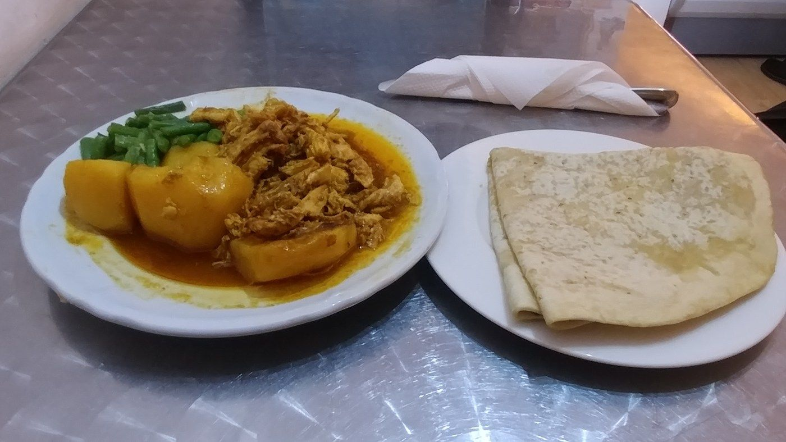

<h4>Waiting for bus to Berlin</h4>

After going back to Amsterdam Sloverjik, when intending to use the toilet, I found that it had already closed at 9pm, which was 1 hour earlier. I had time to spare until the arrival of my bus at 11.15pm.

While waiting for the bus, I saw the Indonesian group I saw the previous day and I talked to that guy. He just finished studying Global studies at Freiburg University (2.5 years) and now he is bringing his family traveling. We exchanged Facebook contacts. He was actually shocked that I knew Malay, as I asked him where the toilet was on the bus the previous night.

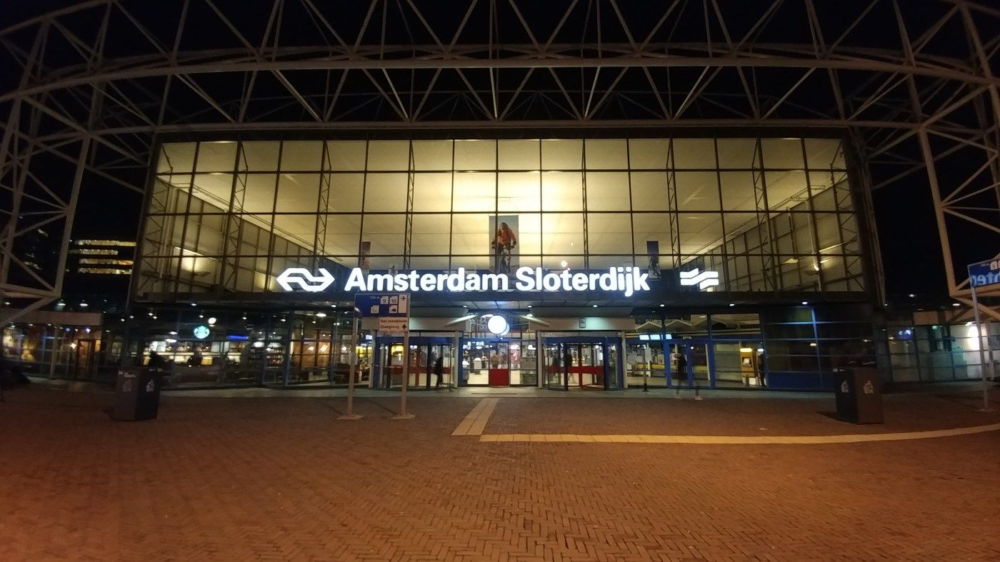
Bye Amsterdam. I will return to you 1 day

<h4>Bus to Berlin</h4>

The bus was very full and I sat in the last row, in between a masters student from Portugal studying in Hamburg and a person from Suriname, who lives in Berlin. I tried to create a conversation as he looked Indian and asked but he said he wasn’t but his parents were. It was a first, meeting a Surinamese Hindu.

<h3>Reflection</h3>

1 day in Amsterdam is definitely not enough to fully explore the city. I feel great to be exposed to many languages at such a young age. I am grateful to have taken Malay as my 3rd Language in Secondary school and learnt Hindi from all the Hindi movies I love to watch.

Knowing more languages open more doors for conversations with others.

Take note that Toilets close early.

It was nice to know that here, more people know English and talk very good English, even better than Germany. With its plethora of Halal food options and other stuff, it’s a country worth considering for migration if needed.

Amsterdam has many sights and thus try not to come in Winter as the sun sets early, giving less time to conquer as many sights as possible. A good time is September as its autumn with still long sunlight hours and good temperature (not too hot or cold) 
Next stop: Berlin

