
Its been slightly over 4 months since I came back and till today I still miss my 3 months in Germany. Relooking at the photos, I got inspired to summarise my trip and this post details these 15events.

1) Moving accommodation on my birthday

My group of friends and I were tasked with an additional task of sourcing for our own accommodation as the university hostel ones were fully booked. After 11 nights of staying in the Jugendherberge Youth hostel, we finally moved to Hostel Ariva, which was cheaper but further away, that too on my birthday. Still missing my friend Lollyk who I met. From seeing a fire alarm being activated to getting scolded by the landlady, it is something hard to forget. Besides, no more free breakfasts for us.

 
 
 
  <meta/> <meta/> 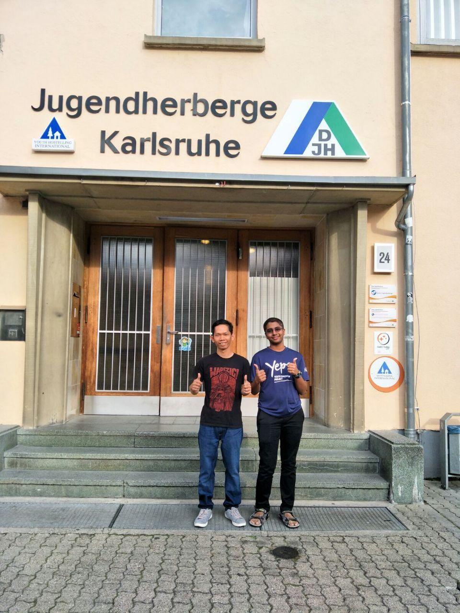   Youth Hostel stay with Lollyk  
 
 <!-- close group --> 
 
  <meta/> <meta/> 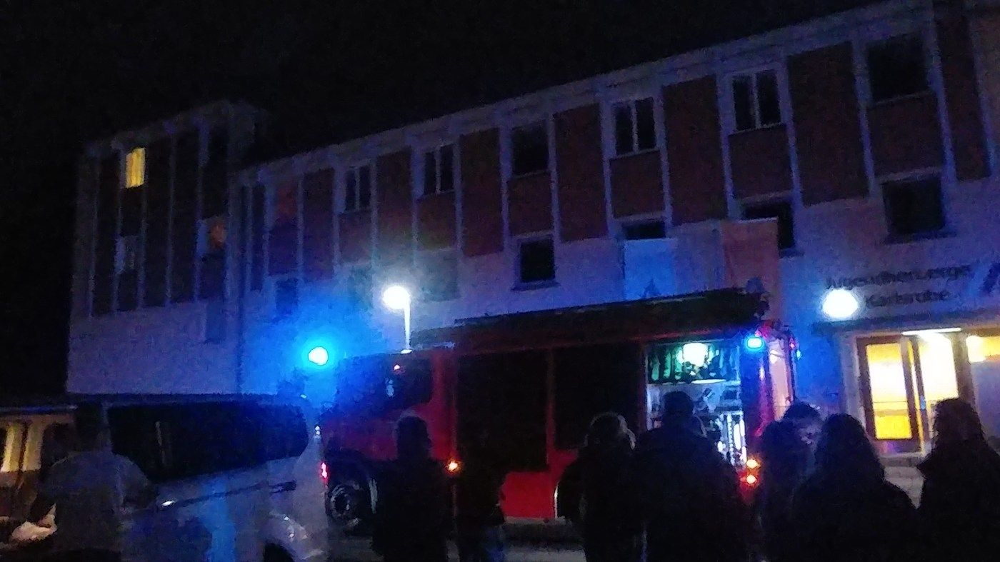   Fire alarm activated  
 
 <!-- close group --> 
 <!-- close row --> 

2) Switzerland 
Now that accommodation was settled, we had a week to spare before our German Course started. So we visited Switzerland for 3 days. My god. Our experience was truly one of a kind- getting affected by a hurricane – taking others luggage, meeting a Sri Lankan Tamilian, and bumping into a Singaporean family in Jungfrau.

 
 
 
  <meta/> <meta/> 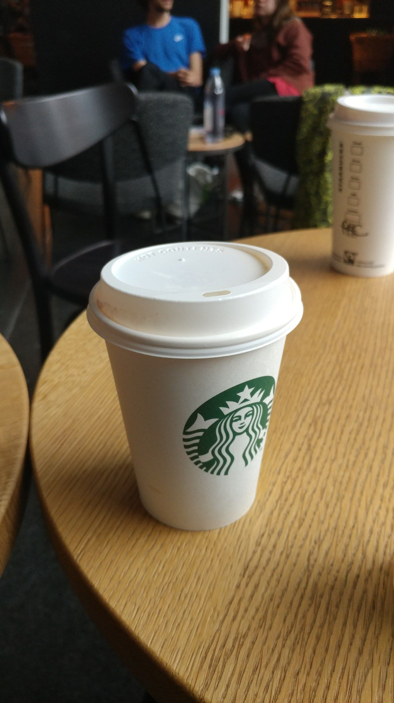  
 
 <!-- close group --> 
 
  <meta/> <meta/> 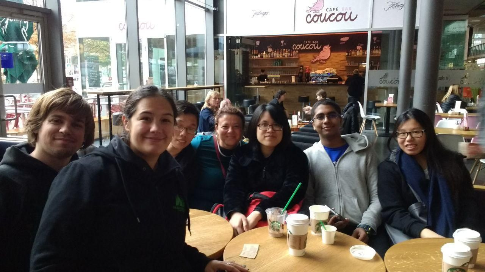  
 
 <!-- close group --> 
 <!-- close row --> 
 
 
  <meta/> <meta/> 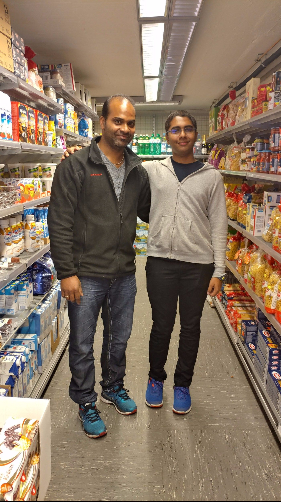   The friendly Tamil shop owner  
 
 <!-- close group --> 
 
  <meta/> <meta/> 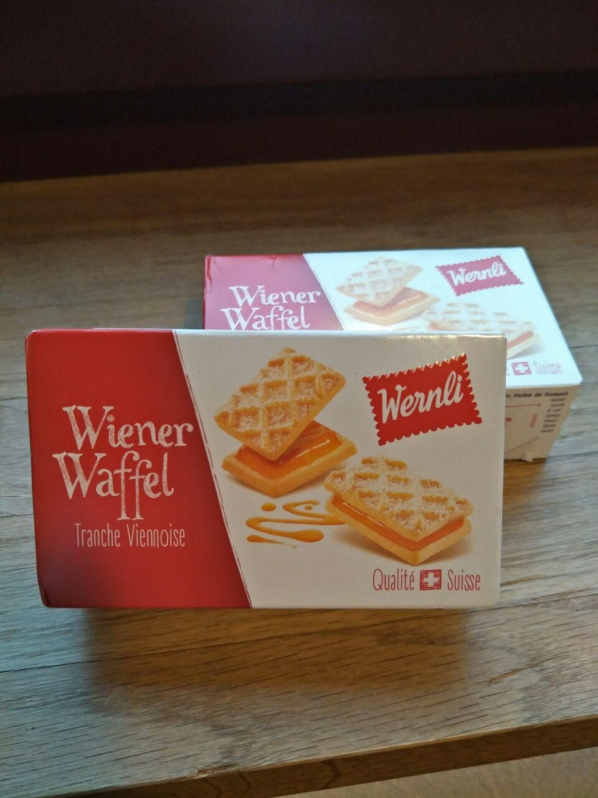  
 
 <!-- close group --> 
 
  <meta/> <meta/> 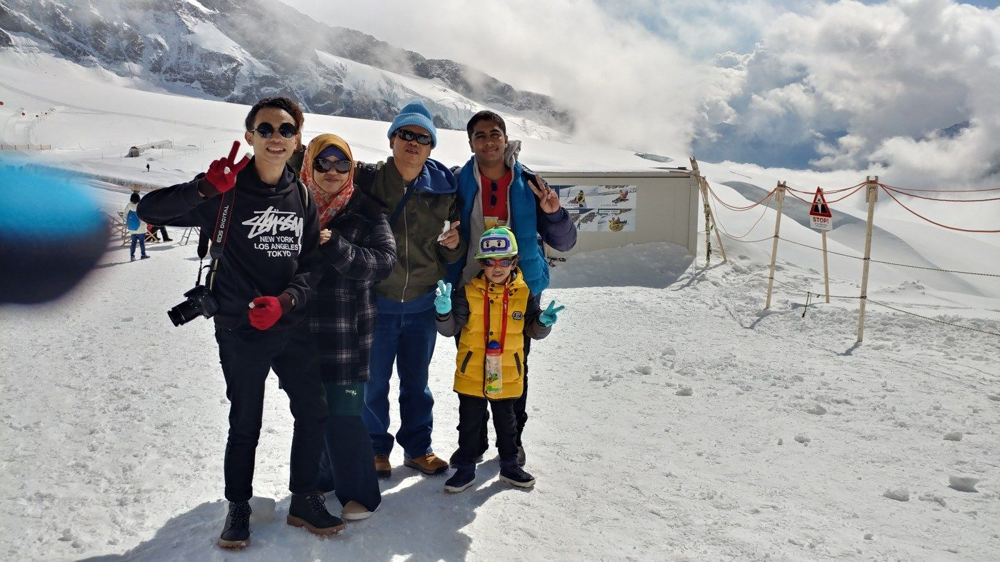  
 
 <!-- close group --> 
 
  <meta/> <meta/> 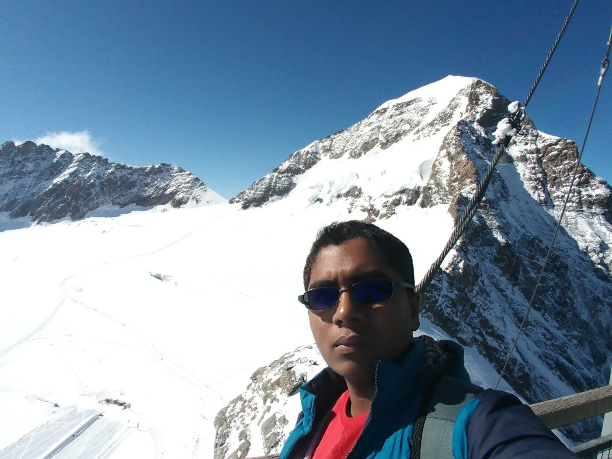  
 
 <!-- close group --> 
 <!-- close row --> 
 
3) Laptop crashed 
After that interesting experience, I saw it imperative to share these experiences in the form of a blog and started writing it the day after we returned. But midway, tragedy struck. My laptop crashed halfway writing my blog due to a hard disk failure. At that moment, while disappointed that I had to rewrite my blog, I was thankful that I hadn’t officially started my project, and had all my pointers on Google Keep.

4) German Course 
After exploring a new country, and in shock that my laptop failed on me, I commenced the intensive German Course (A1. 1). We were lucky as we were the first batch from NYP to enrol in this class. There, we met many people from different countries (e.g. China, Korea, Vietnam, Taiwan, Greece). 
Luckily, a laptop wasn’t required for the class.

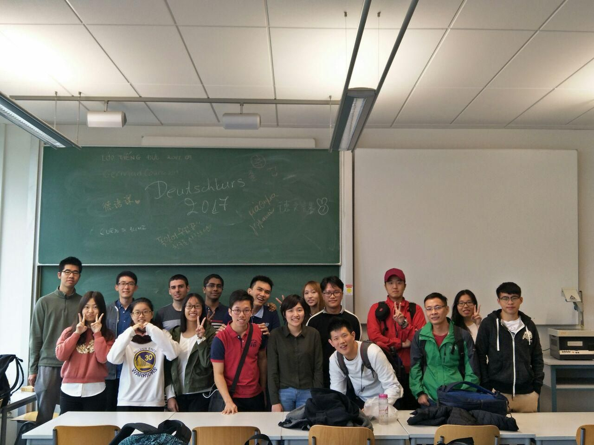
My German Classmates

5) Soccer match 
What’s going to Europe and not seeing a soccer match? I wanted to watch the ideal match, either involving Bayern Munich, Borussia Dortmund, Barcelona, Real Madrid or any English teams. 
So I searched for any match and came across the Champions League game between Real Madrid and Borussia Dortmund @Dortmund Stadium. It was during our German course so what we did was we set off after our class and went for the match and returned back the next day morning for the lesson. One of the coolest things I have ever done.

 
 
 
  <meta/> <meta/> 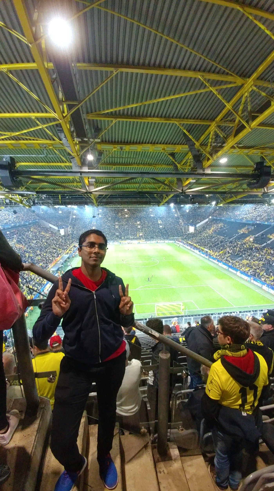  
 
 <!-- close group --> 
 
  <meta/> <meta/> 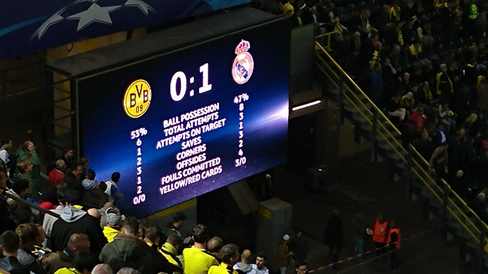  
 
 <!-- close group --> 
 <!-- close row --> 
 
6) Predictive modelling and Machine Learning module 
Could say that my batch was lucky, with us having the chance to attend a module together with German students and taught by our NYP lecturers. 
I thank my lucky stars for this as the lecturers were able to bring a spare laptop for me to do my project.

7) Time spent with teachers 
Our period marked the first time that NYP lecturers (Dr Kenny Lu and Dr Koh) came over and we took this opportunity to spend time with them. We ate Indian buffet, went to the zoo, botanical gardens, went past a street festival and visited the Palace of Karlsruhe.

 
 
 
  <meta/> <meta/> 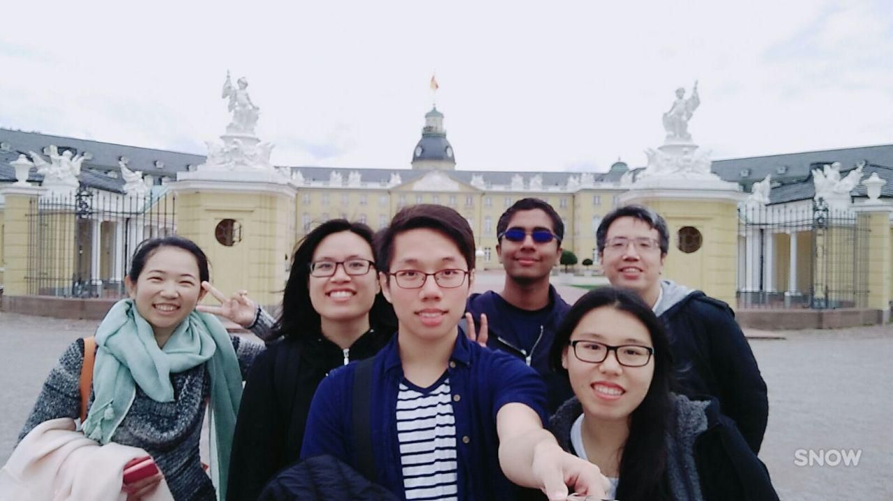  
 
 <!-- close group --> 
 
  <meta/> <meta/> 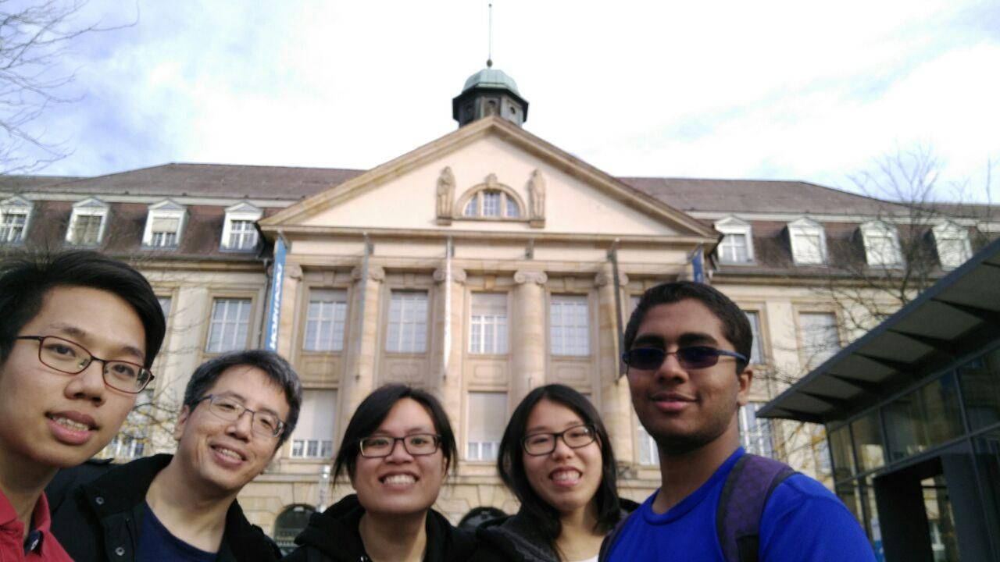  
 
 <!-- close group --> 
 <!-- close row --> 

8) Karlsruhe and ZKM tour 
When we initially arrived in Karlsruhe, we received a welcome package. It contained a form asking us to sign up for tours in Karlsruhe for a cheap price. We signed up for the Karlsruhe tour and the ZKM (Arts and Technology museum) tour for just £4.

A key highlight of that trip was the auto age detecting machine while entering the ZKM. Why? As it detected my age to be 32, just because of my beard. So untrue.

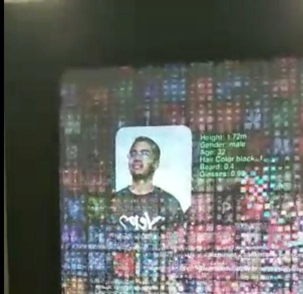 
Apart from meeting others such as from Bangladesh and Brazil, I found out that our area was near 1 part of the Rhine river and we could take a tram down there, which was free with our student tram pass.

9) Rhine River 
Upon hearing that the Rhine River was nearby, we went there to take a look. The view was breathtaking.

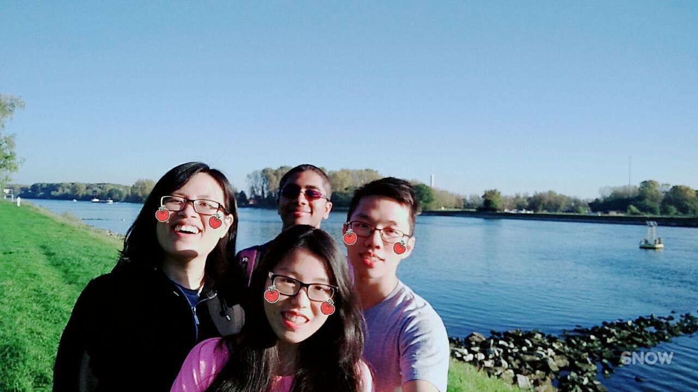

10) Welcome meeting 
The welcome package also included an invitation to join the exchange students welcome meeting. There, introduced the different student groups in the university and the latest events lined up for students, especially a 2D 2N trip to Paris at just £129, that too with a tour guide and a stay at a 3 🌟 hotel. 
11) Lornie’s place for cake 
Lornie, our buddy, invited us for cake in her house, where she self-baked the black forest cake, that too without alcohol as I couldn’t eat it. There we played a German card game and ludo, which is actually a German game.

 
 
 
  <meta/> <meta/> 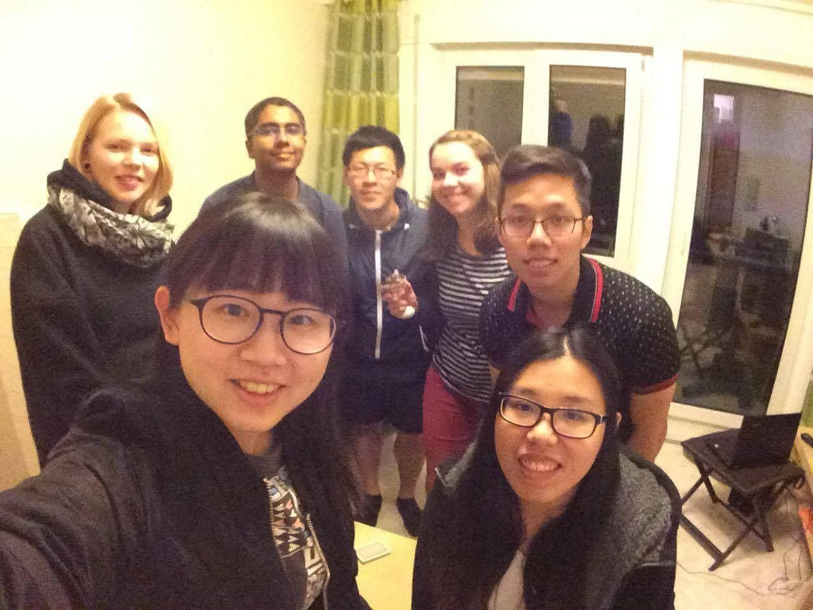  
 
 <!-- close group --> 
 
  <meta/> <meta/> 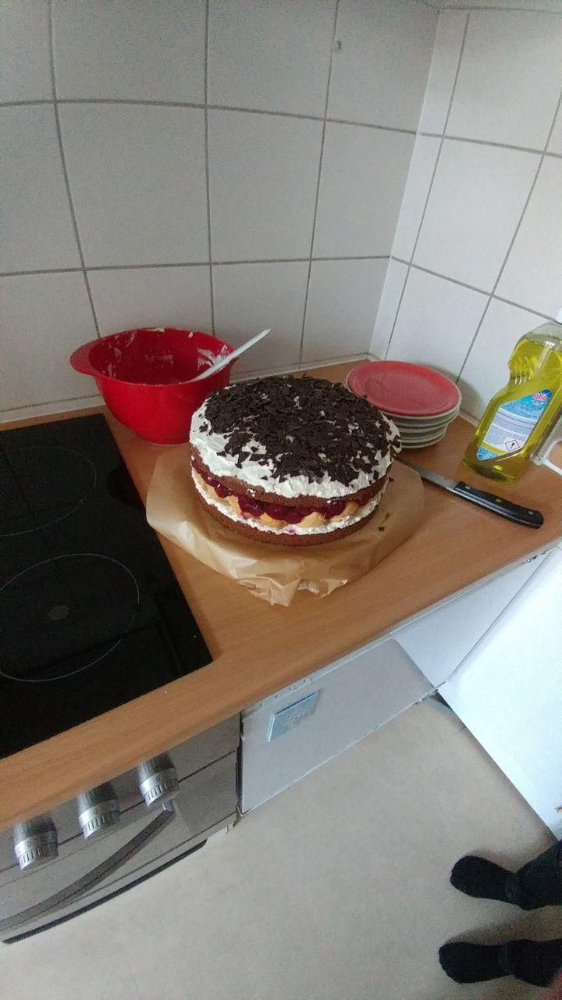  
 
 <!-- close group --> 
 
  <meta/> <meta/> 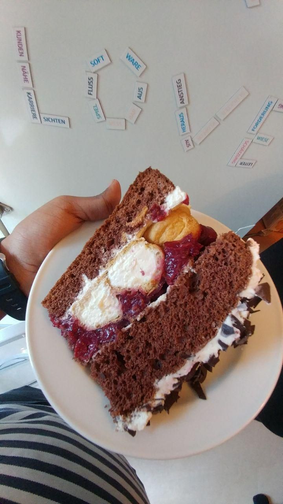  
 
 <!-- close group --> 
 <!-- close row --> 
 
12) France trip 
Finally, got a chance to visit the Eiffel Tower and the Louvre museum. I still feel that the Mona Lisa is overrated. I expected it to be bigger. My only regret is not being able to climb the steps of the Eiffel Tower. Will definitely go back there 1 day. Miss the delicious madeleine that was part of the breakfast during our stay at the 3 Star Hotel.

 
 
 
  <meta/> <meta/> 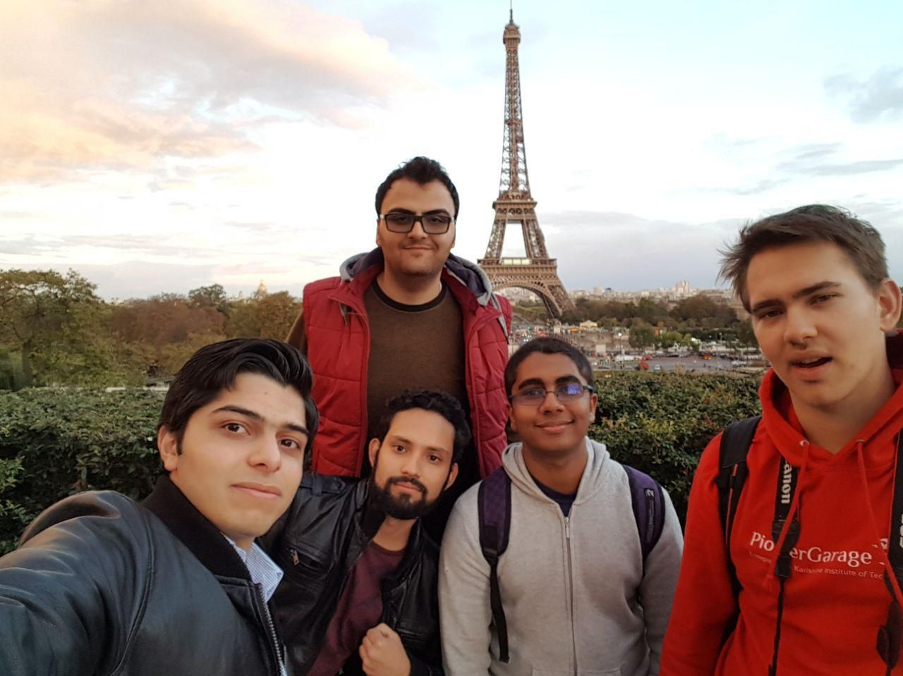   With newly met friends  
 
 <!-- close group --> 
 
  <meta/> <meta/> 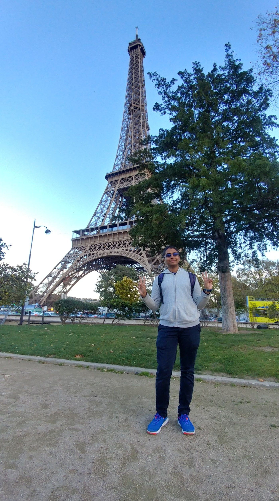  
 
 <!-- close group --> 
 <!-- close row --> 
 
 
  <meta/> <meta/> 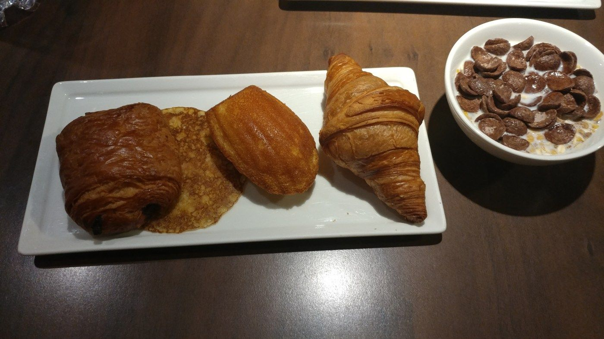  
 
 <!-- close group --> 
 <!-- close row --> 
 
13) Seeing Doctor 
Tried to not get sick there but got sick, that too on a Friday and it deteriorated after 4pm. Clinics close at 4pm and we had to go to the City hospital. We had a hard time finding our way there, with not many directions, coupled with the heavy rain that night. We also had to get our medication separately another day from the pharmacy. Definitely a good but expensive experience. 
14) Going to a bar to see people get drunk 
I was talking to someone about how I can’t drink and many I know drink every weekend and the person suggested visiting the student bar to see how the atmosphere was like, and what happens when someone gets drunk. The student bar served really cheap alcohol during happy hours. £1 for a beer bottle or 1 tequila shot. So much cheaper than Singapore.

15) Solo trip to Amsterdam and Berlin 
To end my 3 months on a high, considering that I had already completed my project, I decided to set foot to Amsterdam and Berlin. Though I had to go alone, I’m glad I did as the trip taught me self-confidence and self-independence. Haish, if only I spent more time in Amsterdam, the city I would definitely migrate if I had to.

Happy to have tried halal CurryWurst, the ever famous stroopwaffles, Surinamese Food and visiting iconic landmarks such as the Berlin Wall and Brandenburg Gate.

This slideshow requires JavaScript.

All in all, my trip was a very pleasant and memorable one and definitely, the most unique anyone from NYP has faced. I’m grateful for such an opportunity and looking forward to doing another exchange in university.

Thank you also to my 3 other friends – Jia Qi, Nicholas and Zhe Rong for this memorable experience.

