
It’s been a while, only because Covid-19 disrupted my plans to travel a new country a year in university. Initially not planning to go exchange because I thought Singapore won’t open up and when it did in April 2022 and my friends were all going, I panicked and applied for exchange in Year 4 Sem 1 in a last minute ditch effort to go overseas. Initially planning to go just for exchange to Netherlands, I got enticed to go Spain after watching Tu Jhoothi Mein Makkar and its amazing songs with spectacular scenery from Spain .

<iframe allowfullscreen="" loading="lazy" src="https://www.youtube-nocookie.com/embed/zBlklssMFEo" title="YouTube video"></iframe>

Qatar, a tiny yet prosperous nation located in the Middle East, is a melting pot of cultures and traditions.I thought of transiting in Qatar on my way to Spain for 2 reasons

<ol start="1">
<li>Qatar was 1 of the cheaper flights with student prices that had free flight WiFi. It ranks well in the world with Singapore Airlines so I wanted to try it</li>
<li>I wanted another country to add to my list but I was not really interested to see too much of Qatar, having visited UAE and Turkey already. So a simple transit tour sufficed. Also, I read online that this transit tour was free for those who took Qatar (which is not true btw). I had to pay 27 USD/99 Qatari rial for the 3 hour tour.</li>
</ol>

<strong>Tour I went on</strong>

Qatar is home to some of the world’s most iconic buildings, including the National Museum of Qatar, designed by French architect Jean Nouvel. The museum is in the shape of a desert rose and features an impressive collection of art and artifacts.

<figure>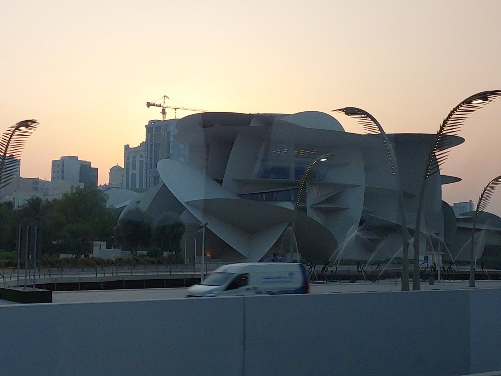</figure>

Qatar’s architecture is heavily influenced by Islamic geometry, and the country’s stunning mosques are a testament to this. The Blue Mosque of Qatar, designed by a woman from Istanbul, is a masterpiece of Islamic design. Qatar is also home to some of the world’s most impressive malls, including the Mall of Qatar, which boasts over 500 stores.

<figure class="gallery">
<figure>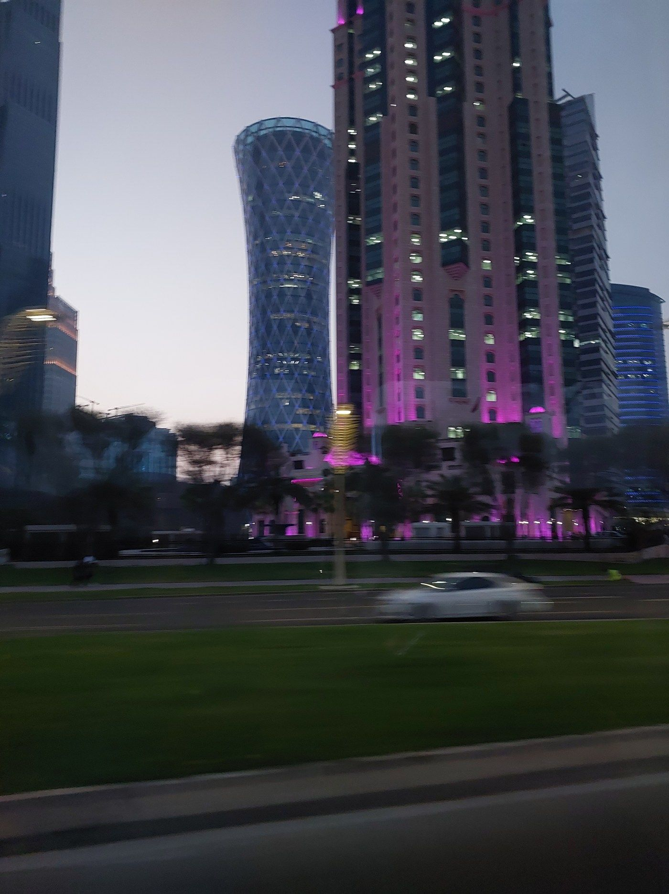</figure>
<figure>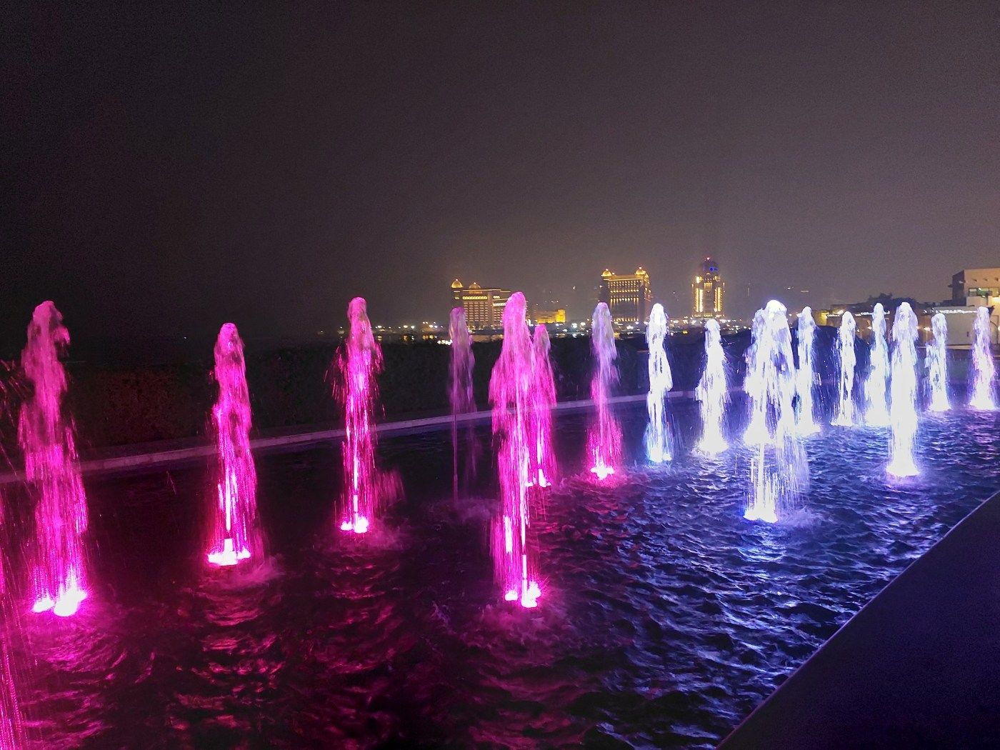</figure>
<figure>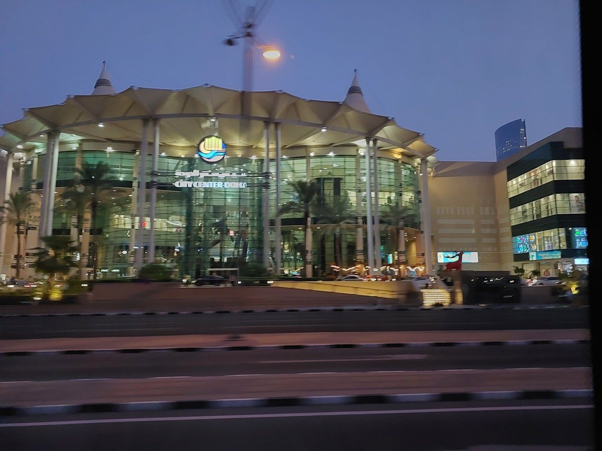</figure>
<figure>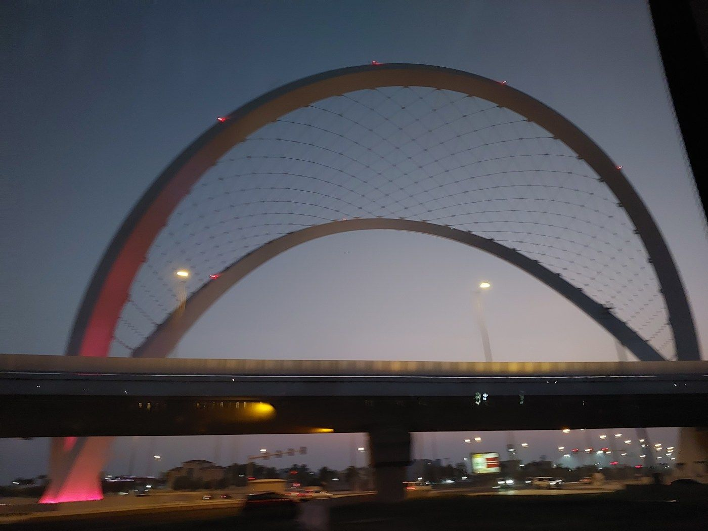</figure>
<figure>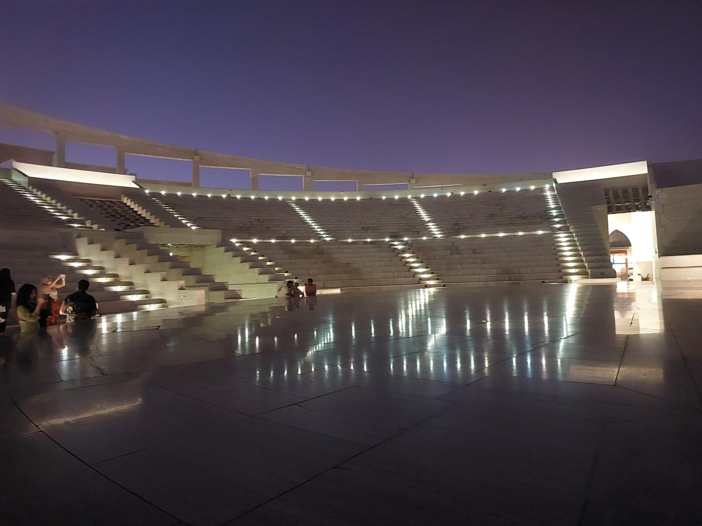</figure>
</figure>

We also went to a Souk (marketplace), which is very similar to Dubai/Abu Dhabi. Really wanted to buy a souvenir from Qatar but didn’t feel like it and it meant I had to use Qatari Rial or USD.

<strong>Fun Facts About Qatar</strong>

<ul>
<li><a href="https://issuu.com/marhabaqatar/docs/marhaba_information_guide_issue_83/s/15365604#:~:text=Qatar">Qatar is one of the safest countries in the world</a>, and has <a href="https://www.numbeo.com/crime/rankings.jsp?title=2023&amp;displayColumn=1">maintained its position,out of 142 surveyed nations</a>.  Must be because of its syariah law and its Islam-influenced tradition (so no live-in relationships, no public display of affection etc. )</li>
<li>Qatar has a rich history, and the discovery of oil in the 1940s transformed the country’s economy. It has a GDP of just below Singapore.</li>
<li>The country emits the most CO2 per capita in the world</li>
<li>Qatar is home to a diverse population, with only 10% of the population being Qatari, and the rest being foreigners. Only 1 shop in the whole of Qatar sells alcohol. No restaurant will sell pork but some places can find cocktails</li>
<li>Qataris have many benefits such as access to free electricity and water. The standard of living is rather high here</li>
<li>Dudong whales can be found in the sea here</li>
<li>Qatar is a conservative country, and it is essential to respect local customs and traditions. Public displays of affection are not allowed, and live-in relationships are frowned upon.</li>
<li>Qatar has its own airport for the royal family, call about true royalty</li>
<li>Was told that they have a museum with 3000 cars</li>
<li>They use pigeon towers to make the surroundings nicer because they have a designated toilet so the streets were cleaner than expected. Their faeces are used as fertilizer for the plants they grow</li>
<li>They hosted the World Cup 2022 and they used containers as a novel concept to make their stadium 974 which hosted 6 games.</li>
<li>Most plants are from overseas since they are essentially a dessert.</li>
<li>Qatar used to be called Katara, and unlike the rest of the world where it is happening during summer, everything stops here because it is just too hot. It was barely 36 degrees when I was there at 6pm and I was sweating profusely.</li>
</ul>
<figure>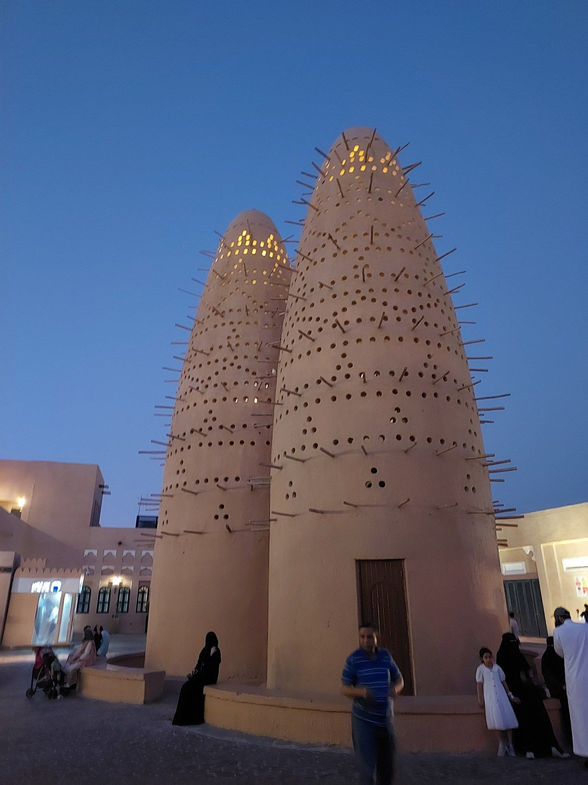</figure>

<strong>Other things that happened</strong>

<ul>
<li>Got praised by airport security for my t-shirt ( I was wearing a Qatar World Cup t-shirt – I mean finally a shirt for the occasion</li>
<li>A Bangladeshi came up to me and asked if I’m from Bangladesh – Little did I know that I now look Bangladeshi</li>
<li>I brought a pestle and mortar for cooking in Spain but because my luggage weight exceeded I brought it via hand carry (the biggest mistake I made) and it was thrown away when I finished the transit tour in Qatar and I got scolded in Hindi by the airport security (some Indian/Pakistani guy) and I don’t even know why</li>
<li>Because I took my time and came to board my flight to Spain, my name was specially called to request me to board. Felt like a celebrity haha</li>
</ul>

<strong>Food I ate on the plane</strong>

Food on Qatar Airlines thankfully did not disappoint. I had the best pandan gula melaka dessert ever, so I asked for another round. The food on both legs was splendid.

<figure class="gallery">
<figure>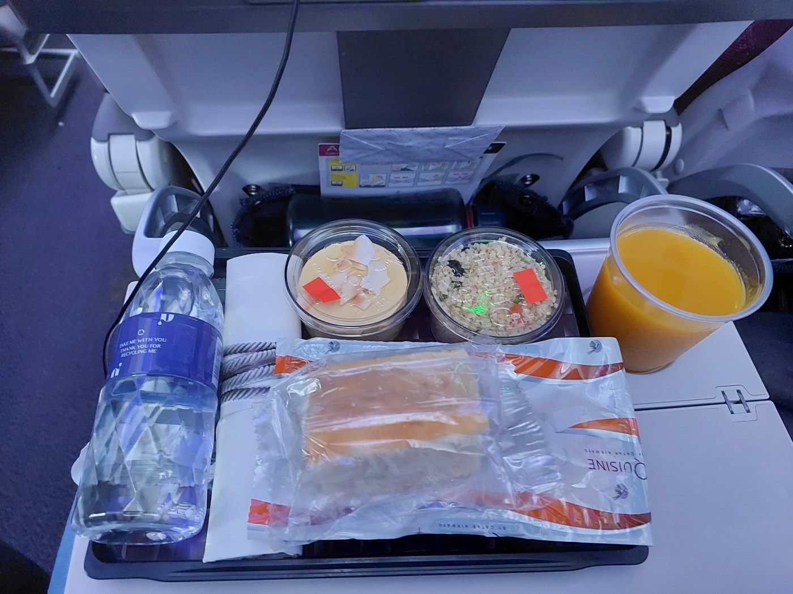</figure>
<figure>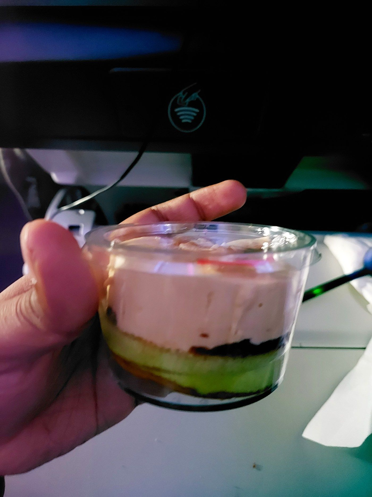</figure>
<figure>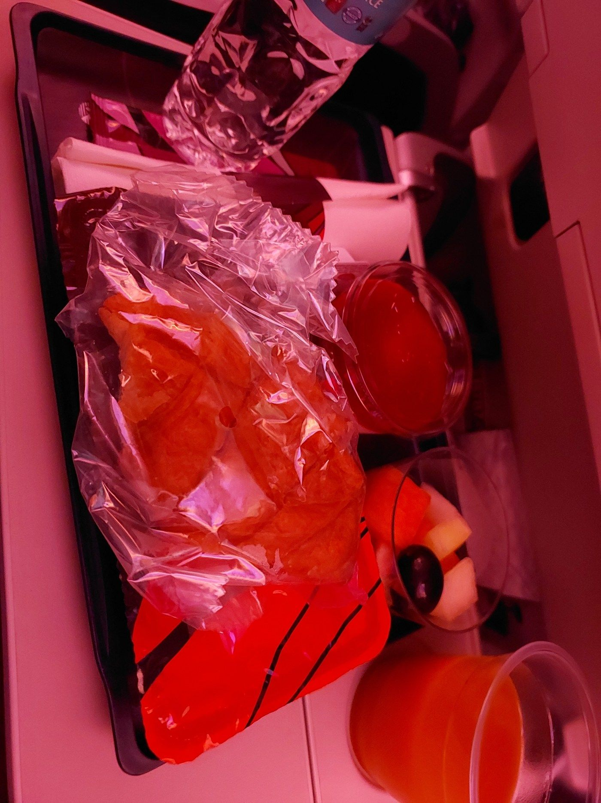</figure>
</figure>

<strong>Food I ate during my long 12-hour layover</strong>

Shawarma because the transit time was too draining and all the food there was  quite expensive.

<figure>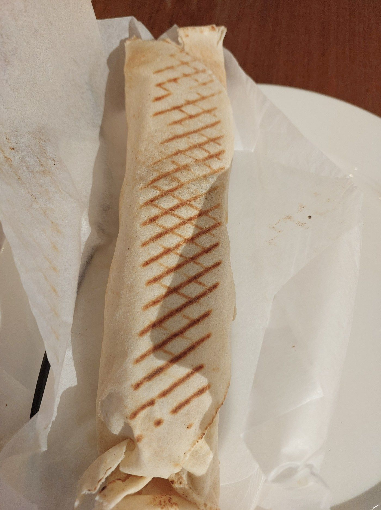</figure>

<strong>Conclusion</strong>

Nice country with a nice airport, but does not need too much time and would be best as a transit location but don’t be like me and get 12-hour transit time please. More time can be used to explore other countries like UAE which has more attractions

