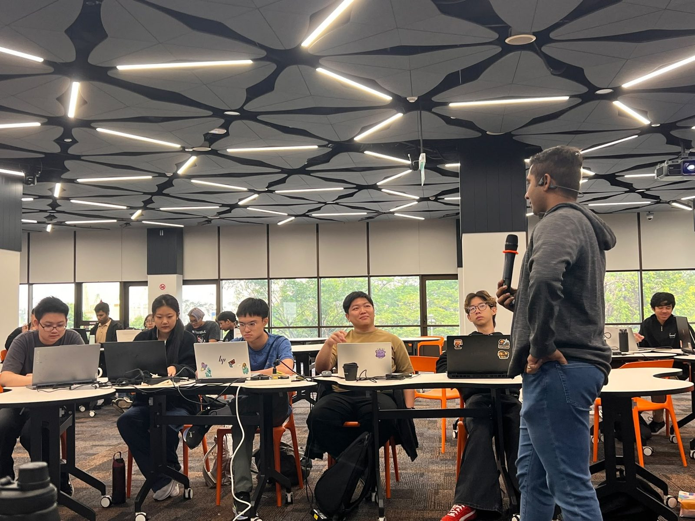
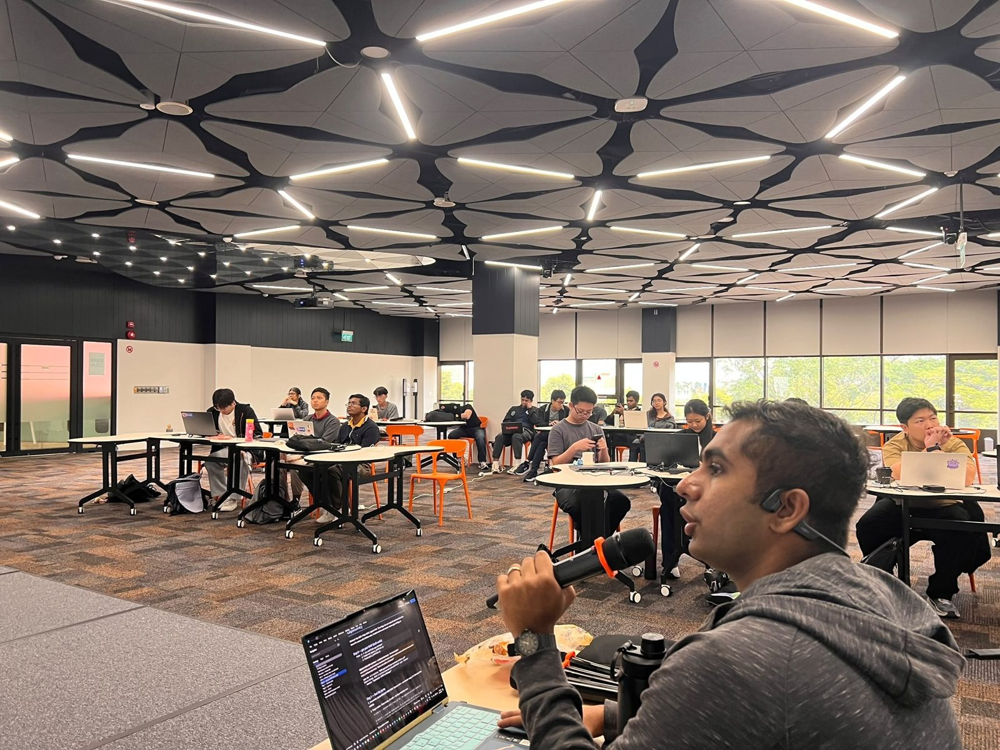
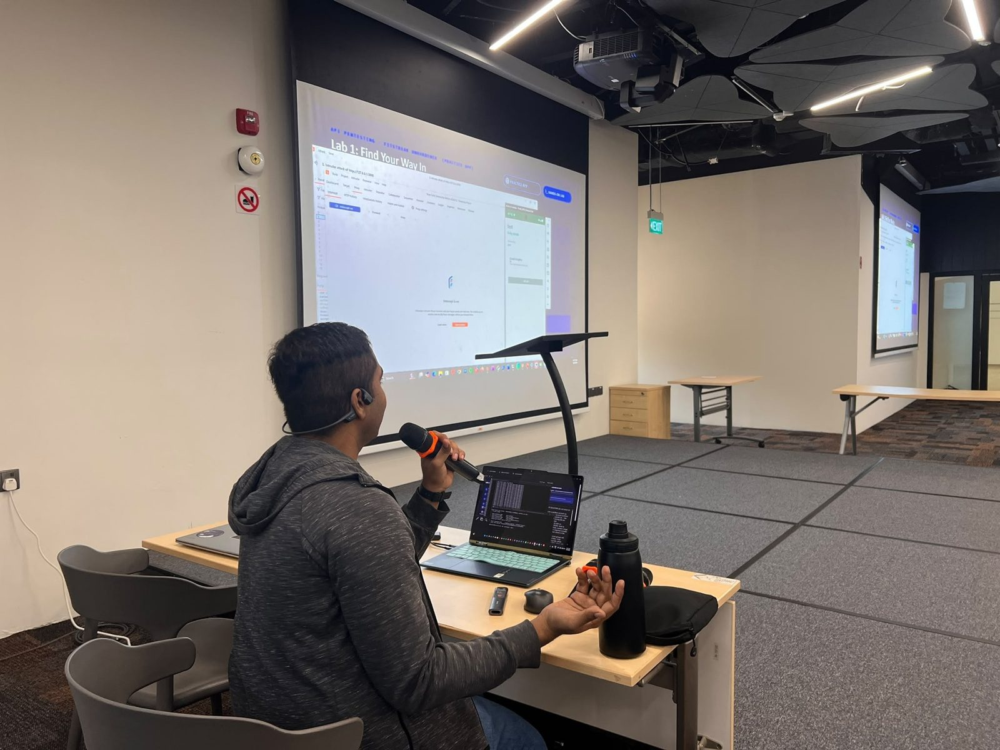
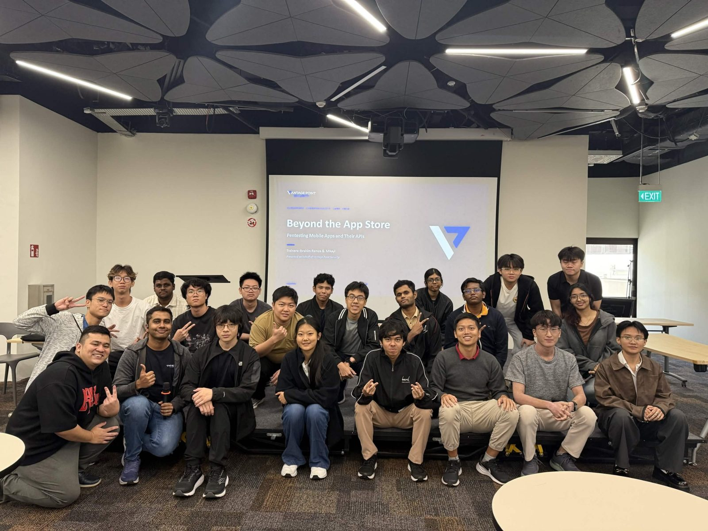

On 9 September 2026, my Vantage Point Security colleague Mikayl and I ran a mobile pentesting workshop at the **Singapore Cybersecurity Camp (SCC)**, organised by Div0. We called it *Beyond the App Store: Pentesting Mobile Apps & Their APIs*. The focus was writing custom Frida scripts to bypass an app's root detection and SSL pinning, and then poking at the APIs running behind it.

## Flipped classroom, all hands-on

I wanted the session to be as hands-on as possible, so we flipped the classroom. Participants got pre-workshop reading to learn the concepts first. We opened with a Kahoot to see who had actually done the reading and to reinforce the ideas they'd need. After that, it was hands-on all the way.

Between demos at the podium, Mikayl and I spent most of the time walking between tables, looking over shoulders and helping people get unstuck.

<figure class="gallery">
<figure><figcaption>Walking the room during the labs</figcaption></figure>
<figure><figcaption>Taking questions between exercises</figcaption></figure>
<figure><figcaption>Walking through a lab on the big screen</figcaption></figure>
</figure>

## From IDOR to full account takeover

We started on the API side of a demo app. On an unhardened build, participants exploited an IDOR in the Forgot Password function and walked it all the way to a full account takeover.

Then we handed them a hardened build of the exact same app, this time with real runtime defences: root detection and SSL pinning. To even attempt the same attack again, they had to:

- set up a rooted Android emulator
- run static analysis on the app with JADX
- write their own Frida scripts to bypass both defences, until traffic was flowing through Burp

For a lot of them, it was their first time touching Frida or even thinking about SSL pinning. Watching it click for them in real time was the highlight of my day.

## A birthday-themed capstone

For the final challenge, participants used everything they'd learnt on a brand-new app. The workshop happened to fall on my birthday, so the capstone had them exploiting vulnerabilities to uncover the details of my "secret" birthday party and RSVP their way in.

## Real-world setup, real-world skills

Getting rooted emulators, certificates and Frida working together is part of the job, and participants got plenty of practice at it. Learning to troubleshoot your own testing environment is exactly the kind of real-world skill we hoped they'd walk away with.

## The best part of the day

It wasn't the slides. It was the attitude and passion of the participants. A few stayed back after the session, almost skipping lunch, to ask how to keep learning mobile app pentesting, since this was their first time trying it. Two of them told us that out of the three workshops they'd attended so far, ours was their favourite because it was more hands-on than theory. That was a nice sign the flipped classroom worked, and it truly made our day.

<figure><figcaption>The Beyond the App Store crew at the end of the day</figcaption></figure>

Thanks to Div0 and the SCC team for having us. Vantage Point also wrote about the workshop on its [company blog](https://blog.vpsec.io/articles/training-at-singapore-cybersecurity-camp-scc/).
