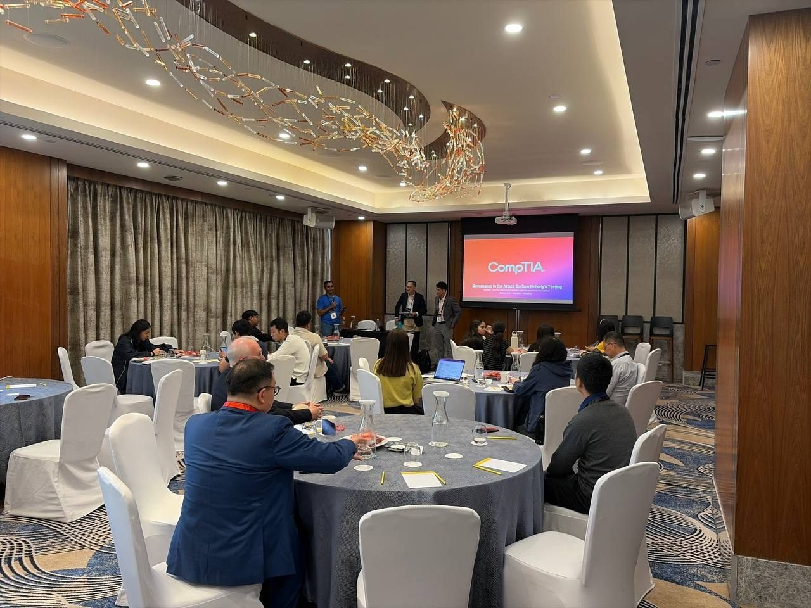
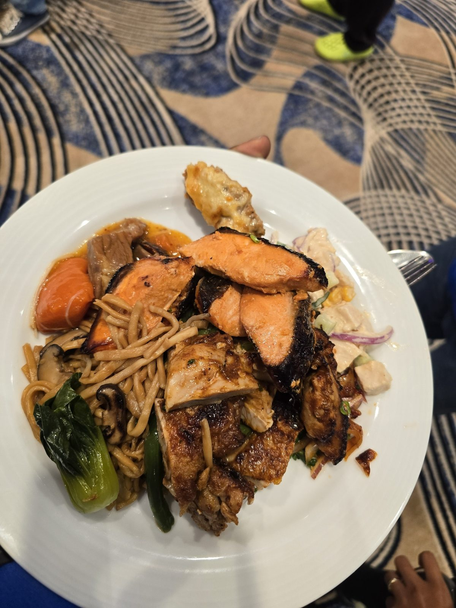
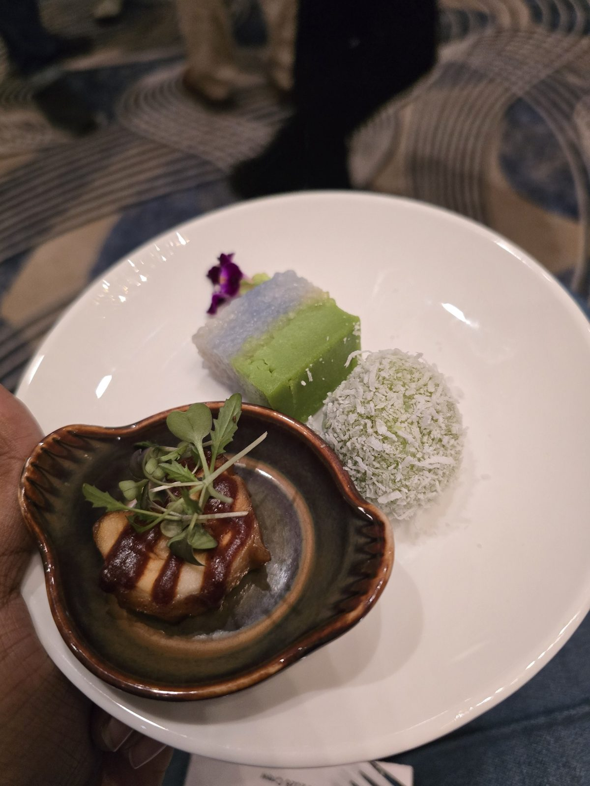
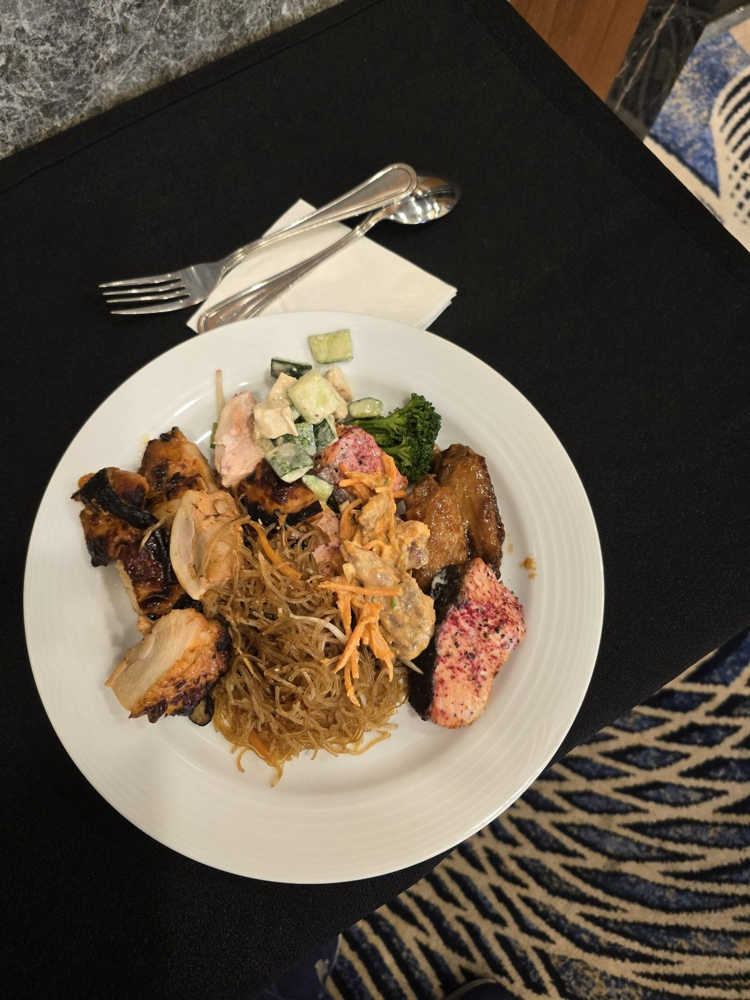
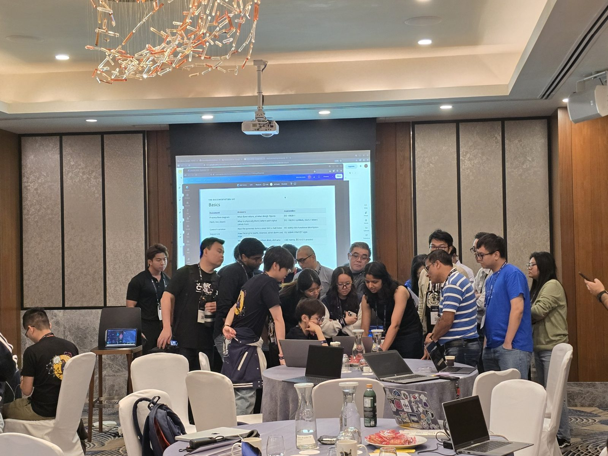
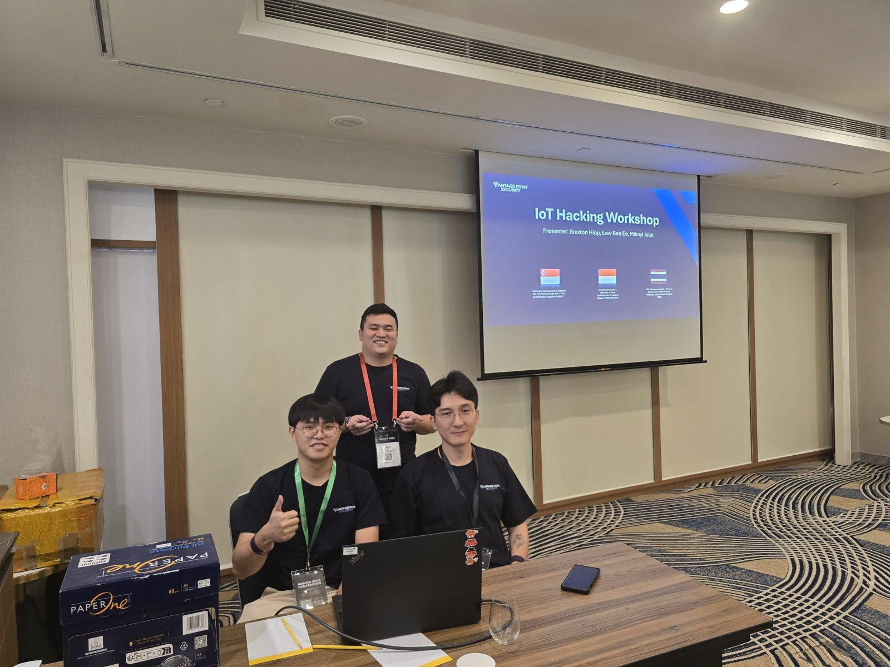
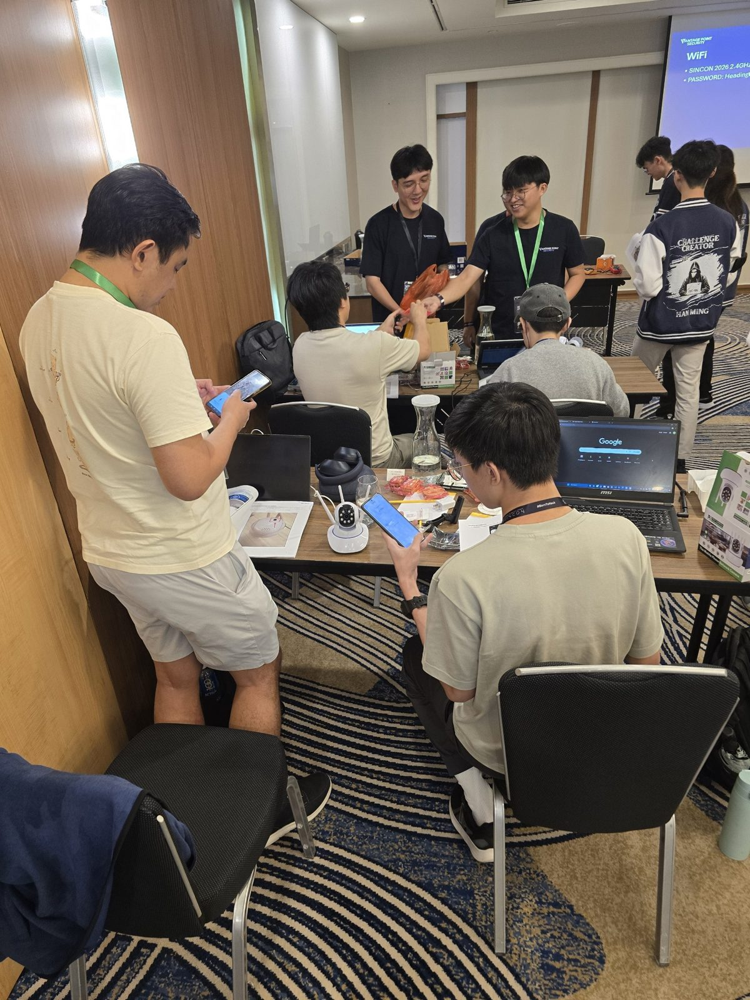
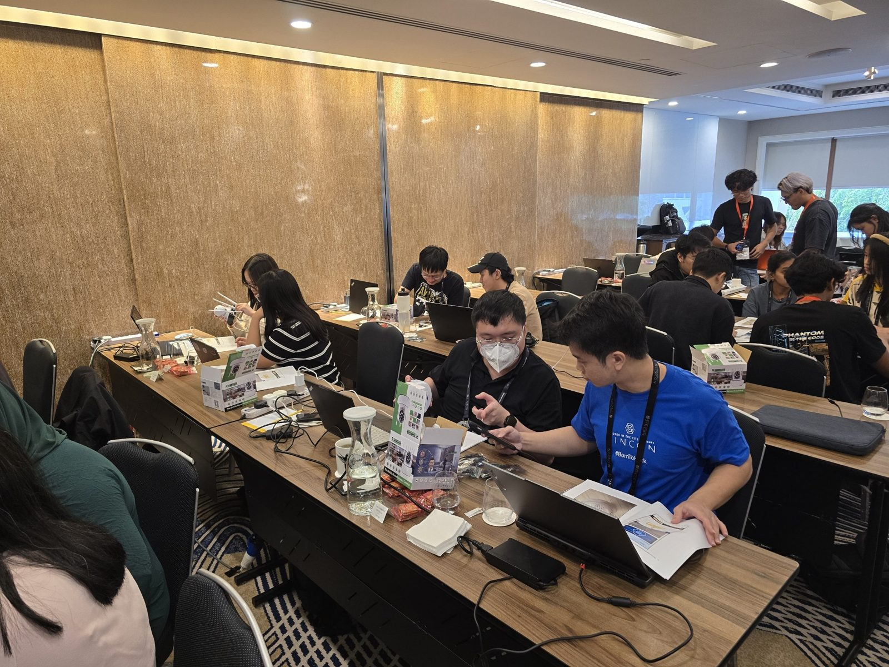
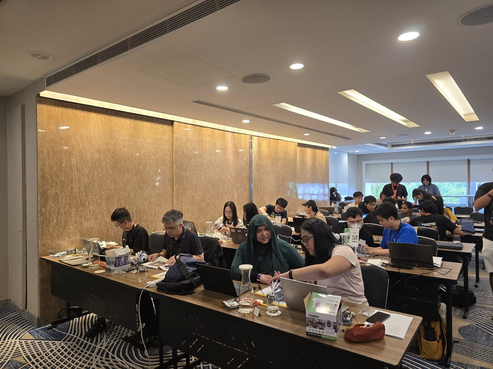

This was my first time volunteering at SINCON. Why pay for a ticket when you can go for free as a volunteer?

I first attended SINCON back in 2018. On 15 and 16 October 2026 I finally came back, this time on the other side of it, as part of the **BizCom track**.

## Life on the BizCom track

A big part of my job was introducing the speakers. Before each session I'd spend a few minutes getting to know the speaker, so I could introduce them properly to the audience. Being up front for every session also meant I got a front-row seat to every talk on the track.

<figure>
<video controls playsinline preload="metadata" poster="/assets/img/talks/sincon-2026/introducing-a-speaker-poster.jpg">
  <source src="/assets/img/talks/sincon-2026/introducing-a-speaker.mp4" type="video/mp4">
</video>
<figcaption>Getting to know a speaker before introducing them to the room</figcaption>
</figure>

<figure><figcaption>Introducing the speakers for the CompTIA session</figcaption></figure>

## What I picked up

Being up front for so many sessions meant I came home with a page of notes. A few things that stuck with me:

**AI, careers and the 20/60/20 split.** One idea I liked: AI can do about 60% of the work in the middle, but the first 20% (framing the problem) and the last 20% (judging the result) are still human work. Another: certs matter less than they used to, and problem solving matters more. It comes down to attitude, skills and knowledge.

**OSINT: how to find information.** Usernames can always change, but the account ID never does, and it's unique. So the theme across every platform was: get the ID first, then use it to find the current username and the history behind it.

- **Websites:** map the JS files to find endpoints. A good reminder from my day job too.
- **GitHub:**
  - Add `.patch` to a commit URL. If the account isn't set to use the `@github` noreply address, the author's email shows up.
  - If a user renames a repo, using `curl` on the old repo URL shows where the new one lives.
  - Query `api.github.com` with the user ID to get the current username.
- **Telegram:**
  - The user ID is only visible in Telegram Desktop, after turning on an experimental setting ("show peer ID").
  - With the ID you can find past usernames and account names.
  - Funstat (a paid tool) shows which public groups an account sent messages to, plus its language and interests.
  - Telemetrio can analyse Telegram groups and channels, even deleted ones.
  - Always download files from Telegram, because accounts get deleted.
- **Instagram:**
  - The username is often different from the display name.
  - Instagram shows the date an account joined and its former usernames, and sometimes where the account is based.
  - Tagged posts and comments are a good way to find usernames.
  - Get the ID, and you can always find the current username.
- **TikTok:**
  - Get the ID, then check the feed and followers.
  - A reel can show where it was created, and its page source contains the ID. In one example that was enough to get to a street location.
- **X:** works the same way, and the profile picture shows the account ID.
- **Use more than one tool.** Each one sees a different slice.

**OPSEC for investigators.** Use a VPN for all organisation work, and give your investigation accounts a separate phone number, email and a username that has nothing to do with you.

**Threat modelling drives threat hunting.** Your threat model should follow your risk posture and your crown jewels. Mapping it to MITRE D3FEND shows the gaps and tells your hunters what to look for. CSA has a threat modelling guide that maps to MITRE, and LLM skills (like a threat knowledge-base search) work much better when you feed them text instead of PDFs or images.

## New tools, new ideas, familiar faces

I was so glad to catch up with so many old friends, like Andre, Manzel, Amos and Pei Si, and to make new ones, like Darya and Bajaj, among many others. I really love the SG cybersecurity community, and it's one of the best parts of a conference like SINCON: the hallway is half the event.

And yes, the food was very good.

<figure class="gallery gallery-tall">
<figure></figure>
<figure></figure>
<figure></figure>
<figcaption>Volunteering perks</figcaption>
</figure>

<figure><figcaption>Hands-on time at one of the other workshops</figcaption></figure>

## Cheering on my colleagues

My Vantage Point colleagues also ran an **IoT Hacking Workshop**, and I swapped the mic for a camera to take photos for them.

<figure class="gallery">
<figure><figcaption>The IoT Hacking Workshop team</figcaption></figure>
<figure><figcaption>Poking at smart cameras</figcaption></figure>
<figure><figcaption>Heads down on the labs</figcaption></figure>
<figure><figcaption>A full house</figcaption></figure>
</figure>

## Thank yous

Thank you to Paul for letting me take time off to volunteer at SINCON.

And a special thanks to the BizCom team for being such an amazing group to work with: Randall, Lucas, Joseph, Colby, and everyone else I met and worked alongside. See you at the next one.
